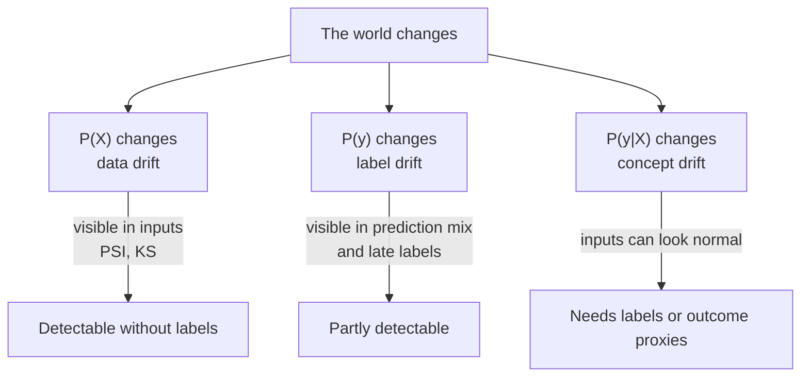
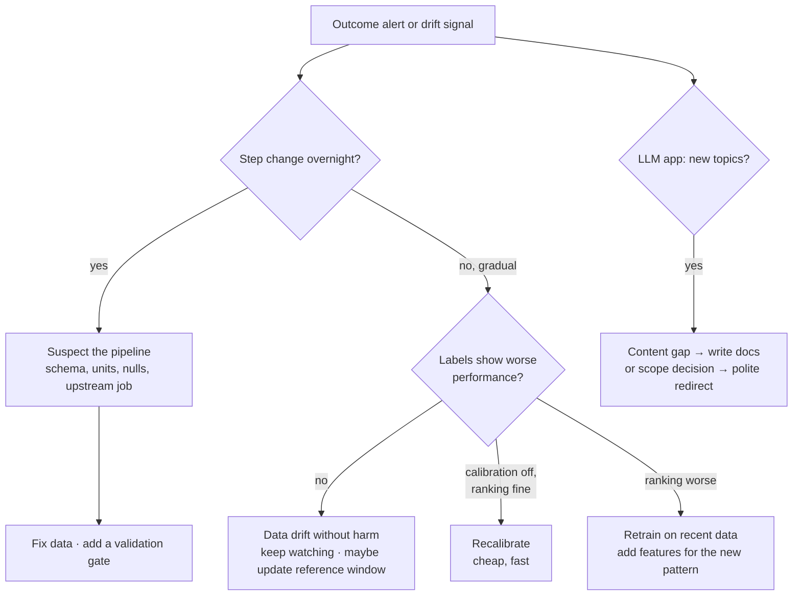

# Lesson 4.5: Drift and alerting

> ⏱ ~55 min · 🎚 Level: Core → Advanced · 🧰 Needs: [lesson 4.1](01-offline-vs-online-and-classification-metrics.md), [lesson 4.4](04-observability-tracing-and-metrics.md)

[Course home](../../README.md) › [Module 4](README.md) › Lesson 4.5

## 📨 The situation

> **Omar (Risk):** Fraud losses are up sharply this month, but every dashboard is green: latency fine, no errors, the model is "running". Our analysts say fraudsters switched to **card testing**: dozens of tiny online charges to check whether a stolen card works.
>
> **Lena (Support):** Related or not, the docs-assistant refuses more questions lately. People keep asking about crypto.
>
> **Diego (SRE):** And please, no more alerts that wake me up for things nobody can act on.

## 🎯 By the end you can

- **Classify** drift as data (covariate), label (prior), concept, embedding or prompt drift, using P(X), P(y) and P(y|X).
- **Compute** PSI by hand and **interpret** PSI and KS, including their traps.
- **Explain** why concept drift is invisible without labels, and which proxies help while labels are delayed.
- **Detect** embedding drift in user queries.
- **Design** outcome-based alerts that page only for actionable, user-facing problems.
- **Choose** the right response: fix the pipeline, recalibrate, retrain, or change the product.

## 🤔 Predict first

1. Inputs look identical to last month, yet the model got worse. Is that possible?
2. Inputs changed a lot this month. Must the model have gotten worse?
3. Which is likelier to page you at 3 a.m. for nothing: "PSI of `amount` > 0.2" or "fraud losses above budget for 2 days"?

---

## 1. What "drift" actually means

A model learns the relationship between inputs X and label y from a training snapshot. The world then moves in different ways:

| Type | What changes | Kestrel example | Hurts the model? |
|---|---|---|---|
| **Data drift** (covariate shift) | P(X), the inputs | Customers travel more after summer; more online spend | **Maybe.** Only if the model is weak in the new region of inputs |
| **Label drift** (prior shift) | P(y), the base rate | Fraud rate doubles during a breach | Calibration breaks; thresholds become wrong |
| **Concept drift** | P(y \| X), the relationship itself | Card testing: tiny charges that used to be harmless are now fraud | **Yes**, and the inputs may look normal |
| **Embedding drift** | Distribution of text/vector inputs | Users ask about crypto, which the handbook doesn't cover | Retrieval quality and refusals |
| **Prompt drift** | User prompts (length, language, intent) or *your* prompt templates | Users paste whole emails; a teammate edits the system prompt | Quality, cost, safety |



So the answer to question 1 is yes (concept drift), and to question 2 is no (data drift into a region the model handles well). **Drift statistics measure change, not harm.** That single sentence will save you many false alarms.

> ⚠️ **Common mistake:** blaming "drift" for what is really a **pipeline bug**. In practice, sudden input changes are more often a renamed column, a unit change (cents vs euros), a new null default, or a broken upstream job than a change in the world. Before you retrain, check the data contract and validation gates from [lesson 2.1](../02-data-and-model-pipelines/01-data-pipelines-and-validation.md). A gradual shift is more likely real; a step change overnight is more likely a bug.

---

## 2. Measuring input drift: PSI and KS

### Population Stability Index (PSI)

PSI compares the share of data in each bin between a **reference** (training data, or last stable month) and a **current** window:

```
PSI = Σ_bins (current% − reference%) · ln(current% / reference%)
```

**Worked example**: merchant category mix, reference vs current month:

| Category | Reference | Current | (c − r) · ln(c / r) |
|---|---|---|---|
| online_retail | 18% | 30% | 0.12 · ln(1.667) = **0.061** |
| grocery | 22% | 14% | −0.08 · ln(0.636) = **0.036** |
| all other categories | 60% | 56% | −0.04 · ln(0.933) = **0.003** |
| **PSI** | | | **≈ 0.10** |

Every term is ≥ 0 (shares moving in either direction add to PSI). The industry rule of thumb, from decades of credit-risk use:

| PSI | Reading |
|---|---|
| < 0.10 | Stable |
| 0.10–0.25 | Moderate shift: investigate |
| > 0.25 | Major shift: act |

Bin numeric features by **reference quantiles** (each bin holds ~10% of reference data), and add a small epsilon so empty bins don't produce `ln(0)`.

> ⚠️ **Common mistake: PSI on binary or low-cardinality features with quantile bins.** A 0/1 flag with 5% ones has quantiles 0, 0, …, 0, 1, so everything lands in one or two bins and PSI reads **0.000** even when the share of ones quadruples. The lab's first version had exactly this bug; `psi_numeric()` now treats features with ≤ 25 distinct values as categories. Always test your drift code on a shift you know is there (`test_psi_binary_feature_is_not_silently_zero`).

### Kolmogorov–Smirnov (KS) test

KS measures the **maximum gap between two cumulative distributions** (0 = identical, 1 = completely separate) and gives a p-value. Useful for continuous features. Two traps:

- **With large samples, everything is "significant".** With 20,000 rows a KS statistic of 0.02 has a tiny p-value but no practical meaning. Judge the **statistic (effect size)**, not p < 0.05.
- **Many features × many windows = many false alarms.** Monitoring 50 features daily at p < 0.05 gives you about 2–3 false alarms every day.

### Prediction drift: the cheapest signal of all

Monitor the **distribution of the model's own scores** (PSI on scores, share of transactions flagged). It needs no labels, it is one number instead of one per feature, and it reacts to whatever input changes actually matter *to the model*.

---

## 3. What the lab shows

```bash
uv run python scripts/drift_report.py
```

```
[data_drift]                              [concept_drift]
  merchant_category  0.239  moderate        txn_count_24h   0.159  moderate
  amount             0.185  moderate        amount          0.008  stable
  country_mismatch   0.067  stable          (everything else stable)
  ...

  scenario               fraud rate   PR-AUC  recall@0.5
  baseline (holdout)         1.593%    0.077        0.49
  data_drift                 3.040%    0.126        0.76
  concept_drift              2.940%    0.065        0.31
```

1. **Data drift lights up PSI, but the model copes.** Recall even *rises* (bigger amounts are easier to flag). An alert on PSI alone would have woken Diego for nothing.
2. **Concept drift barely shows in the inputs.** Only a faint `txn_count_24h` signal (card-testing bursts), with every individual transaction looking ordinary. Yet recall collapses from 0.49 to 0.31. That's Omar's "everything is green but we're losing money".
3. **PR-AUC went *up* under data drift** only because the fraud rate doubled (lesson 4.1). Watch the metric's definition, not just its value.

### Detecting concept drift when labels are late

Kestrel learns about fraud from disputes, which can arrive **up to 120 days** later. Waiting four months is not an option, so use **proxies that arrive early**:

| Signal | Delay | Notes |
|---|---|---|
| Customer "I don't recognise this" reports | Hours to days | Biased towards what customers notice |
| Analyst decisions on flagged transactions | Hours | Only covers what the model flagged (feedback loop!) |
| Fraud rate among a small **random holdout** of reviewed transactions | Days | Unbiased, costs review budget, the gold standard |
| Prediction drift (score distribution, flag rate) | Real time | No labels, but noisy |
| Business outcome: chargebacks per €1M | Weeks to months | The ground truth, late |

> 💡 **Production tip:** send a small random sample (e.g., 0.1%) of **unflagged** transactions to review. It costs a little review budget and buys you unbiased labels, the only way to measure recall in production and to catch concept drift early.

---

## 4. Drift in LLM systems: embeddings and prompts

For the docs-assistant, "inputs" are questions. You can't compute PSI on free text directly, but you can on **embeddings** and on simple text statistics.

| Technique | How | What it tells you |
|---|---|---|
| **Coverage similarity** | For each query, cosine similarity to the closest handbook chunk; track the mean and the share below a threshold | "Users ask about things our documents don't cover" |
| **Centroid distance** | Cosine distance between the mean embedding of this week's queries and the reference week's | "The topic mix moved" (coarse) |
| **Clustering + reading** | Cluster new queries; read a sample from new or growing clusters | *What* changed: the step that leads to action |
| **Emerging terms** | Words frequent now but absent in the reference | A cheap, readable topic signal |
| **Prompt statistics** | Length, language, share of pasted content, PSI on these | Users using the tool differently (cost and quality impact) |

From the lab (week 37 vs week 45 query logs):

```
week 37: mean best-match similarity = 0.37   out-of-coverage (< 0.25) = 33%
week 45: mean best-match similarity = 0.26   out-of-coverage (< 0.25) = 53%
emerging terms in week 45: crypto ×7, purchase ×2, buy ×1, bitcoin ×1, exchange ×1
```

Lena's mystery solved: users ask about crypto, the handbook has nothing on it, so the assistant (correctly) refuses. **That is not a model bug.** It is a content gap (write the docs) or a scope decision (redirect politely). The lab's hash embeddings are crude; with real sentence embeddings (`sentence-transformers`) the same method separates topics much more cleanly.

**Prompt-template drift** is the drift *you* cause: every edit to a system prompt changes behaviour. The defence is the registry and eval gate (lessons 4.3 and 4.6), plus the `answers by prompt version` panel, so every behaviour change is attributable.

---

## 5. Alerting on outcomes, not on everything

A good alert is **urgent, actionable, and about something users feel**. Everything else belongs on a dashboard or in a ticket queue.

| Signal | Route to | Why |
|---|---|---|
| p95 latency SLO breach, error spike, service down | **Page** (wake someone) | Users are hurting now, and on-call can act (roll back, fail over) |
| 👎 rate > 25% for 30 min, refusal rate spike, fraud losses above budget | **Ticket** (business hours) | Real, but needs investigation, not a 3 a.m. rollback |
| PSI > 0.25 on a feature, embedding coverage dropping | **Dashboard / weekly review** | A change, not necessarily harm; investigate in daylight |

That answers question 3: feature-PSI alerts are the classic source of alert fatigue. Alert on **outcomes** (losses, thumbs-down, SLOs) and use drift statistics to **explain** them.

The lab's `observability/alert_rules.yml`:

```yaml
- alert: AssistantThumbsDownRateHigh
  expr: |
    (
      sum(increase(kestrel_feedback_total{rating="down"}[30m]))
      / sum(increase(kestrel_feedback_total[30m]))
    ) > 0.25
    and sum(increase(kestrel_feedback_total[30m])) >= 20   # minimum sample size
  for: 10m                                                  # must persist, not blip
  labels: {severity: ticket}
  annotations:
    runbook: "Check eval dashboard and recent prompt/model releases; consider prompt rollback."
```

Anatomy of a good alert:

1. **A ratio, not a count**: 50 thumbs-down mean nothing without the total.
2. **A minimum sample size**: 3 ratings out of 4 being negative at 4 a.m. is noise.
3. **`for:` duration**: the condition must persist.
4. **Severity routing**: page vs ticket.
5. **A runbook link**: an alert without a runbook is a bug, as Kestrel's [on-call handbook](../../datasets/handbook/on-call-handbook.md) says.

> 💡 **Production tip:** the best SLO alerts use **error-budget burn rates** ("we're consuming a month's error budget in 6 hours"), which you'll build in [lesson 6.4](../06-scaling-and-operations/04-release-engineering-and-slos.md).

---

## 6. Responding to drift



**Retraining cadence** is a trade-off: retrain too rarely and you serve stale models; too often and you add release risk and cost, and may chase noise. Many teams retrain on a schedule (weekly or monthly) **and** on triggers (outcome alerts), always through the same eval gate. That is **continuous training**, covered in [lesson 4.6](06-progressive-delivery-and-prompt-registries.md).

---

## 🧪 Try it

From the lab folder:

```bash
uv run python scripts/drift_report.py
uv run pytest tests/test_drift.py -v
```

**Expected:** the report above, and 7 drift tests passing. Then compute by hand the PSI for `is_online` going from 25% to 35% of transactions, and check it with:

```bash
uv run python -c "from kestrel_fraud.drift import psi_from_shares; print(round(psi_from_shares([0.75, 0.25], [0.65, 0.35]), 4))"
```

<details><summary>Answer</summary>

(0.35 − 0.25)·ln(0.35/0.25) + (0.65 − 0.75)·ln(0.65/0.75) = 0.0336 + 0.0143 ≈ **0.048** → stable, even though online share rose by 10 points. PSI is gentle on moderate shifts of common categories.
</details>

## 🏭 In the real world

PSI comes from credit scoring, where lenders have long monitored score and characteristic stability by month. Card-testing attacks are a well-documented fraud pattern that payment providers publicly warn merchants about. Chip Huyen's article (below) is the clearest free treatment of distribution shifts and why monitoring ML is harder than monitoring software.

## ✅ Check yourself

<details>
<summary>Q1. Fraud rate doubles but P(X|y) stays the same. Which drift is this, and what breaks first?</summary>

Label (prior) drift. Calibration and threshold choice break first: probabilities are now too low and the cost-optimal threshold moves.
</details>

<details>
<summary>Q2. PSI on <code>amount</code> jumps from 0.02 to 0.9 overnight. First hypothesis?</summary>

A pipeline bug, such as amounts now in cents instead of euros. A step change that large overnight is rarely the world changing.
</details>

<details>
<summary>Q3. Why does monitoring 60 features with KS at p < 0.05 every hour create alert fatigue?</summary>

Multiple testing: about 3 false positives per hourly run by chance alone, plus large samples make trivial differences "significant". Use effect sizes, fewer aggregated signals and outcome-based alerts.
</details>

<details>
<summary>Q4. How can you estimate recall in production when only flagged transactions get reviewed?</summary>

Review a small random sample of unflagged transactions too. The fraud found there estimates missed fraud (FN), which gives recall without the feedback-loop bias.
</details>

<details>
<summary>Q5. The assistant's refusal rate rose from 8% to 20%. Retrieval top scores dropped and new queries mention "crypto". Retrain the model?</summary>

No. This is embedding/topic drift into uncovered content. The fix is content (add documents) or product scope (a clear redirect), not the model.
</details>

## 💬 Explain it back

Explain to Omar why the dashboards were green while losses rose, using the terms P(X) and P(y|X) once each, then propose two monitoring changes that would have caught it earlier.

## 🔑 Key takeaways

- Drift types differ by what changes: P(X), P(y) or P(y|X), plus text-specific embedding and prompt drift.
- **Drift statistics measure change, not harm.** Pair them with labelled performance.
- PSI and KS are useful but have traps: binning of discrete features, large-sample p-values, multiple testing.
- Concept drift needs labels: use early proxies and a random review holdout.
- Alert on **outcomes** with ratios, minimum samples, `for:` durations and runbooks; use drift signals to explain.
- Step changes are usually pipeline bugs; gradual changes are usually the world.

## 📚 Go deeper (free)

| | Resource | Why read it | Time |
|---|---|---|---|
| ⭐ | [Chip Huyen, "Data Distribution Shifts and Monitoring"](https://huyenchip.com/2022/02/07/data-distribution-shifts-and-monitoring.html) | The clearest free deep-dive on shift types, detection and monitoring | 60 min |
| 🔍 | [Evidently AI documentation](https://docs.evidentlyai.com) | Open-source drift reports and tests (tabular and text) | 30 min |
| 🔍 | [Google SRE workbook, "Alerting on SLOs"](https://sre.google/workbook/alerting-on-slos/) | Turning SLOs into alerts that are precise and timely | 40 min |
| 🔍 | [Google SRE book, "Monitoring Distributed Systems"](https://sre.google/sre-book/monitoring-distributed-systems/) | What deserves a page | 30 min |

---
⬅️ [Lesson 4.4](04-observability-tracing-and-metrics.md) · ➡️ [Lesson 4.6: Progressive delivery and prompt registries](06-progressive-delivery-and-prompt-registries.md)
