# Module 4: Evaluation and Monitoring
<!-- id: m-4 -->

> ⏱ ~12 hours (6 lessons × ~1 h + lab 3–4 h + quiz) · 🎚 Core → Advanced

[Course home](../../README.md) › Module 4

*Gate releases on automated quality checks, catch agents that forget context or call the wrong tool, and spot quality slipping in production before users complain.*

## 🧭 Where you are

```mermaid
flowchart LR
    M0["0 · Foundations"] --> M1["1 · Prototype → Production"] --> M2["2 · Data & Model Pipelines"] --> M3["3 · Serving & Optimization"] --> M4["4 · Evaluation & Monitoring<br/>📍 you are here"] --> M5["5 · Security & Governance"] --> M6["6 · Scaling & Operations"] --> C["🏆 Capstone"]
    classDef done fill:#d1fae5,stroke:#059669,color:#064e3b
    classDef here fill:#fde68a,stroke:#d97706,stroke-width:3px,color:#78350f
    class M0,M1,M2,M3 done
    class M4 here
```

## 📨 The story so far

Both systems are live for a pilot group. They're fast (Module 3) and built from reproducible pipelines (Module 2). Then the complaints start:

> **From: Omar (Risk)**
> The fraud model "is 98% accurate", yet losses are up and my analysts drown in false alarms.
>
> **From: Lena (Support)**
> Someone changed the assistant's prompt last Tuesday. It stopped citing sources for three days and we only found out from a customer.
>
> **From: Diego (SRE)**
> At 3 a.m. the assistant got slow. I had no metrics, no traces, nothing.
>
> **From: Maya (Manager)**
> Before we roll out to all 800 employees and to customers, I want proof it works, an alarm when it stops working, and a way to undo bad changes in minutes.

This module turns "it seems fine" into **measured, gated and monitored**.

## 🎯 Module objectives

By the end of this module you can:

1. Evaluate classifiers with the right metrics for imbalanced, cost-sensitive problems, and choose thresholds in **euros**.
2. Measure and fix **calibration** so model scores mean what they say.
3. Build an **LLM eval suite**: golden set, deterministic checks, a calibrated LLM judge, multi-turn and agent checks, and a red-team pack.
4. **Gate releases** in CI on quality and safety thresholds.
5. Instrument services with **metrics and traces** and build dashboards that show what users feel.
6. Detect **data, concept, embedding and prompt drift**, and alert on **outcomes** instead of noise.
7. Ship models and prompts with **shadow, canary and rollback**, using a **prompt registry**.

## 📖 Lessons

| # | Lesson | You'll learn | ⏱ |
|---|---|---|---|
| 4.1 | [Offline vs online evaluation and classification metrics](01-offline-vs-online-and-classification-metrics.md) | The confusion matrix, precision/recall/F1, ROC-AUC vs PR-AUC, slicing, why accuracy lies | 50 min |
| 4.2 | [Thresholds and calibration](02-thresholds-and-calibration.md) | Cost-based threshold sweeps, reliability diagrams, Brier, ECE, Platt, isotonic | 55 min |
| 4.3 | [Evaluating LLM systems](03-evaluating-llm-systems.md) | Golden sets, the metric ladder, RAGAS/DeepEval, judge calibration with kappa, multi-turn, agents, red-team packs, the eval gate | 70 min |
| 4.4 | [Observability: tracing and metrics](04-observability-tracing-and-metrics.md) | Golden signals + AI signals, Prometheus, PromQL, OpenTelemetry spans, Grafana | 60 min |
| 4.5 | [Drift and alerting](05-drift-and-alerting.md) | Data/label/concept/embedding/prompt drift, PSI and KS, label delay, outcome-based alerts | 55 min |
| 4.6 | [Progressive delivery and prompt registries](06-progressive-delivery-and-prompt-registries.md) | CI/CD vs continuous training, shadow → canary → full, rollback gates, prompt versioning | 55 min |

**Suggested order:** read 4.1 and 4.2, then do lab Part A. Read 4.3, then do Part B. Read 4.4 to 4.6, then do Parts C to E. Theory and practice stay close together.

## 🛠 Lab 4: Eval gate in CI, dashboards and drift detection

[**→ Open the lab**](lab/README.md)

| Part | You build | Track |
|---|---|---|
| A | Cost-based threshold sweep; calibration with a reliability diagram | Fraud |
| B | Offline eval suite (golden, red team, multi-turn, agent), judge calibration, eval gate | Docs-assistant |
| C | Prometheus metrics, OpenTelemetry traces, a Grafana dashboard with alert rules | Docs-assistant |
| D | Drift report: PSI/KS, concept drift vs performance, embedding drift | Both |
| E | Prompt registry: evaluate a candidate, get blocked, roll back | Docs-assistant |

Everything runs offline on a laptop: a deterministic fake LLM makes evals reproducible, and Docker is only needed for the dashboards.

### ✅ Definition of Done

- [ ] `uv run pytest` passes in `lab/` (39 tests)
- [ ] You can state, in euros, why the chosen fraud threshold beats 0.5 and max-F1
- [ ] You produced a reliability diagram and can explain what Platt/isotonic changed (and what they didn't)
- [ ] The eval gate exits 0 for prompt `v1` and 1 for `v2`; you wrote a `v3` that passes
- [ ] You measured the judge's agreement with humans and can explain why kappa 0.40 is not enough to block releases alone
- [ ] You saw a `retrieve → generate` trace and the Grafana dashboard (or can explain each panel's query)
- [ ] You can explain why concept drift needs labels while data drift doesn't
- [ ] You ran at least three 💥 Break-it experiments and predicted the failing metric first

## 📊 Self-assessment

Rate yourself before and after the module. 1 = never heard of it · 2 = could recognise it · 3 = could do it with notes · 4 = could teach it.

| Skill | Before | After |
|---|---|---|
| Building a confusion matrix and choosing precision vs recall for a business case | | |
| ROC-AUC vs PR-AUC, and why PR-AUC depends on the base rate | | |
| Choosing a threshold from a cost model | | |
| Reading a reliability diagram; Brier, ECE; Platt vs isotonic | | |
| Designing a categorised golden set with negative cases | | |
| Calibrating an LLM judge against human labels (kappa) | | |
| Evaluating agent trajectories and multi-turn conversations | | |
| Writing an eval gate with sensible thresholds | | |
| Prometheus metric types, labels and cardinality; PromQL for p95 | | |
| OpenTelemetry spans, attributes and GenAI conventions | | |
| PSI/KS, and why drift ≠ harm | | |
| Outcome-based alert design | | |
| Shadow vs canary vs A/B; automated rollback gates | | |
| Operating a prompt registry | | |

## 🎤 Interview corner

These come up in ML/AI system design interviews. Try answering out loud in 3–5 minutes each, then check the lessons.

1. **"Design the evaluation strategy for a RAG customer-support assistant before launch and after launch."** Expected: golden set with categories incl. refusals and attacks, a metric ladder, judge calibration, an eval gate in CI, online signals (thumbs, escalations), canary, drift monitoring. → 4.3, 4.4, 4.6
2. **"Your fraud model has 99% accuracy. Is it good?"** → 4.1 (base rate, PR-AUC, cost)
3. **"How do you pick the threshold for a fraud model?"** → 4.2 (cost model, validation set, calibration, per-transaction expected value)
4. **"Model performance dropped but input distributions look unchanged. What's happening, and how do you detect it earlier next time?"** → 4.5 (concept drift, label delay, random holdout, outcome alerts)
5. **"How would you safely roll out a new prompt to millions of users?"** → 4.6 (registry, offline gate, shadow, canary with quality + cost gates, instant rollback)

## ➡️ After this module

Take the [Module 4 quiz](quiz.md), keep the [cheat sheet](cheatsheet.md) handy, then continue to [Module 5: Security and Governance](../05-security-and-governance/README.md), where Priya turns the red-team pack you started here into layered defences.

---
⬅️ [Module 3](../03-serving-and-optimization/README.md) · ➡️ [Lesson 4.1](01-offline-vs-online-and-classification-metrics.md)
