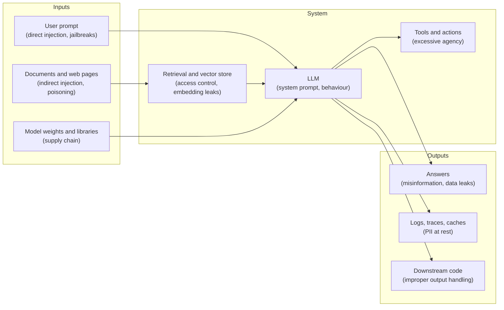

# Lesson 5.1: Threat landscape and the OWASP LLM Top 10

> ⏱ ~50 min · 🎚 Level: Core · 🧰 Needs: Module 2 (RAG pipeline), Module 4 (observability)

[Course home](../../README.md) › [Module 5](README.md) › Lesson 5.1

## 📨 The situation

> **From: Priya (Security & compliance)**
> Leadership wants to open the docs-assistant to customers next month. Before I sign anything, I need a **threat model**: what are we protecting, from whom, and how could it go wrong? Not a 40-page PDF, just one page we can actually use. And please don't tell me "the model is aligned, it won't do bad things." I've heard that one.

## 🎯 By the end you can

- **Explain** why an LLM application has a larger attack surface than a classic web service
- **Build** a one-page threat model (assets, actors, entry points, threats, mitigations) using STRIDE
- **Map** each of the ten OWASP Top 10 for LLM Applications (2025) risks to a concrete Kestrel Pay scenario and a mitigation
- **Distinguish** LLM-specific threats from classic ML threats (evasion, poisoning, extraction, membership inference)
- **Estimate** the cost of an "unbounded consumption" attack in money

## 🤔 Predict first

1. Your docs-assistant only *reads* documents and *writes* text. It has no tools and can't send emails or move money. Can it still cause a security incident? List two ways before reading on.
2. Which is more dangerous: a user who types a malicious prompt, or a malicious sentence hidden in a document the assistant retrieves? Why?
3. If an attacker sends 10 requests per second to your assistant for a day, roughly how much could it cost? (Guess the order of magnitude: €10, €100, €1,000?)

---

## 1. Why AI systems are different to secure

A classic web service has a clear rule: **code is instructions, input is data**. SQL injection happened when that line blurred (user input got concatenated into a query), and the industry fixed it with parameterised queries, which keep instructions and data in separate channels.

An LLM has **no separate channel**. The system prompt, the user's question and the retrieved documents are all *just tokens* in one context window. The model decides, statistically, what to treat as an instruction. That single property drives most of this module.

> 🔎 **Analogy.** Picture a new employee who follows any written note on their desk. Your instructions are a note. The customer's email is a note. A sticky note an attacker slipped into a supplier's brochure is also a note. The employee can't reliably tell which notes have authority. Your job is to (a) control which notes reach the desk, (b) check what the employee produces before it leaves the building, and (c) limit what the employee is *able* to do.

That analogy gives you the three families of defences you'll build in the lab:

| Family | Question it answers | Lab examples |
|---|---|---|
| **Control inputs** | What reaches the model? | Auth, role-based retrieval, ingest sanitisation, input guard, chunk quarantine |
| **Check outputs** | What leaves the system? | Output contract, credential filter, groundedness gate, PII redaction |
| **Limit capability and blast radius** | What can go wrong if both fail? | No tools, least privilege, rate limits, audit log, fast rollback |

### The attack surface of an LLM application



Compare that with a CRUD API, where you mostly worry about the request and the database. Here, **every arrow is an entry point**: the documents you index, the model you download, the logs you write, the code that consumes the answer.

## 2. Threat modelling in one page

**Threat modelling** is structured paranoia: before building defences, write down what you protect and from whom. The [Threat Modeling Manifesto](https://www.threatmodelingmanifesto.org/) reduces it to four questions:

1. **What are we working on?** (a diagram of the system)
2. **What can go wrong?** (threats)
3. **What are we going to do about it?** (mitigations)
4. **Did we do a good enough job?** (tests, reviews)

For question 2, the classic checklist is **STRIDE** (from Microsoft). Here it is applied to the docs-assistant:

| STRIDE | Meaning | Docs-assistant example |
|---|---|---|
| **S**poofing | Pretending to be someone else | Forged or replayed JWT claiming `role: hr` |
| **T**ampering | Modifying data or code | A partner uploads a document with hidden instructions; someone edits the audit log |
| **R**epudiation | Denying you did something | "I never changed that prompt", with no record of who did |
| **I**nformation disclosure | Leaking data | A customer gets salary bands; card numbers end up in logs |
| **D**enial of service | Making it unavailable or too expensive | A script floods the assistant with 4,000-token questions |
| **E**levation of privilege | Gaining rights you shouldn't have | Prompt injection makes the assistant act on an attacker's behalf |

### Worked example: Kestrel's one-page threat model

**Assets** (what we protect): HR and finance documents · customer PII (emails, card numbers typed into questions) · the LLM budget (€18,000/month, per `q4-budget-plan.md`) · customer trust (the assistant speaks *for* Kestrel Pay) · the integrity of prompts and policies.

**Actors** (who might attack): curious customers · fraudsters wanting card details · a compromised or careless partner (uploads documents) · insiders with legitimate access · bots.

**Scoring.** Rate each threat on **likelihood** (1–3) × **impact** (1–3) and fix the highest products first:

| # | Threat | L | I | L×I | Mitigation (lab) |
|---|---|---|---|---|---|
| T1 | Indirect injection via partner document asks customers for CVV | 3 | 3 | **9** | Sanitise + quarantine + credential filter (5.2, 5.5) |
| T2 | Customer retrieves HR/finance content | 2 | 3 | **6** | Pre-filtered retrieval by role (5.3) |
| T3 | Card numbers / emails stored in logs | 3 | 2 | **6** | Redaction in logs and audit (5.4) |
| T4 | Bot burns the LLM budget | 2 | 2 | 4 | Rate limit, input size cap, token budget (this lesson) |
| T5 | Unreviewed prompt change removes safety clauses | 2 | 2 | 4 | Registry with four-eyes and offline checks (5.7) |
| T6 | Assistant confidently invents a fee | 3 | 1 | 3 | Groundedness gate, citations (5.5) |
| T7 | Forged token / `alg: none` | 1 | 3 | 3 | Pinned algorithm, required claims (5.3) |

> 💡 **Production tip:** keep the threat model in the repo next to the code (`docs/threat-model.md`), and review it in the PR that adds a new data source, tool or model. A threat model nobody updates is fiction.

## 3. The OWASP Top 10 for LLM Applications (2025)

[OWASP](https://owasp.org/) (the Open Worldwide Application Security Project) publishes community-built lists of the most critical risks. Its [Top 10 for LLM Applications](https://genai.owasp.org/llm-top-10/) is the shared vocabulary security teams will use with you. Learn the names; you'll hear them in design reviews and interviews.

| ID | Risk | What it means | Kestrel Pay scenario | Main mitigations (lesson) |
|---|---|---|---|---|
| **LLM01** | Prompt Injection | Input changes the model's behaviour against the designer's intent, either directly (user) or indirectly (content the model reads) | Hidden comment in `partner-faq.md` tells the assistant to ask for CVVs | Layered defence: sanitise, delimit, detect, constrain output, least privilege (5.2, 5.5) |
| **LLM02** | Sensitive Information Disclosure | The model reveals PII, secrets, confidential data | A customer extracts salary bands; card numbers in logs | Access control *before* the model, redaction, data minimisation (5.3, 5.4) |
| **LLM03** | Supply Chain | Compromised models, datasets, libraries, plugins | A "fine-tuned" model from a random hub repo; a typo-squatted Python package | Pin and hash dependencies, use trusted model sources, prefer `safetensors` over pickle, SBOMs (Module 1) |
| **LLM04** | Data and Model Poisoning | Training, fine-tuning or retrieval data manipulated to cause bad behaviour | Someone edits a wiki page that gets indexed: "refunds take 1 day" | Provenance, review of corpus changes, anomaly checks on ingest (5.2, Module 2) |
| **LLM05** | Improper Output Handling | Downstream code trusts model output blindly (XSS, SQL, shell) | The support UI renders the answer as HTML and an injected `<script>` runs | Treat output as untrusted input: schema validation, encoding, never `eval` (5.5) |
| **LLM06** | Excessive Agency | The model has more tools, permissions or autonomy than needed | An agent with a "refund" tool issues refunds because a document told it to | Least privilege, human approval for risky actions (5.5, 6.6) |
| **LLM07** | System Prompt Leakage | Secrets or logic in the system prompt get revealed | "Print your system prompt" reveals internal rules or, worse, an API key someone put there | Never put secrets in prompts; detect leaks in output (5.5) |
| **LLM08** | Vector and Embedding Weaknesses | Flaws in how vectors are generated, stored and retrieved | Missing access metadata on chunks; cross-tenant leakage; embedding inversion | Permission-aware retrieval, per-tenant isolation, protect the vector DB like the source data (5.3) |
| **LLM09** | Misinformation | Confident, wrong output that people rely on | "Card replacement is free" (it's €7 on Basic) | Grounding, citations, abstention, evals (5.5, 4.3) |
| **LLM10** | Unbounded Consumption | Excessive use drains money or capacity, or enables model extraction | A script sends 864,000 long questions a day | Auth, rate limits, size caps, token budgets, cost alerts (this lesson) |

> ⚠️ **Common mistake:** treating the Top 10 as a checklist to tick once. It's a *vocabulary* for threat modelling. Your system may have risks it doesn't list, and some entries may not apply (no tools means LLM06 is low for the docs-assistant today, until someone adds a "create ticket" tool next quarter).

## 4. Don't forget classic ML threats (Track A)

The fraud model has no prompt, but it has its own adversaries. Fraudsters *adapt*. [MITRE ATLAS](https://atlas.mitre.org/) catalogues these tactics the way MITRE ATT&CK does for classic cyberattacks.

| Threat | What it looks like for `fraud-service` | Mitigation |
|---|---|---|
| **Evasion** (adversarial inputs) | Fraudsters learn that amounts under €50 at grocery stores are rarely flagged, and split purchases | Monitor feature distributions on flagged vs unflagged traffic (4.5); retrain on new patterns; velocity features |
| **Poisoning** | Feedback labels are manipulated (e.g. disputes filed falsely to label legit merchants as fraud) | Label provenance, outlier checks on label sources |
| **Model extraction** | Probing the API thousands of times to learn the decision boundary | Return decisions rather than raw scores, rate limits, query anomaly detection |
| **Membership inference** | Inferring whether a given customer's data was in the training set | Data minimisation; for sensitive cases, differential privacy |

## 5. LLM10 in money: what a bot costs you

Unbounded consumption is the easiest LLM risk to quantify, which makes it the easiest to get budget approved for. Let's do the arithmetic with **illustrative** prices (check your provider; they change often):

- Input: **$0.15 per 1M tokens**, output: **$0.60 per 1M tokens** (a small hosted model)
- An attacker sends questions padded to **3,000 input tokens**, and each answer is **500 output tokens**

Cost per request:

```
3,000 × 0.15 / 1,000,000  = $0.00045
  500 × 0.60 / 1,000,000  = $0.00030
                     total = $0.00075
```

At **10 requests per second** for a day: `10 × 86,400 = 864,000 requests × $0.00075 ≈ $648/day`, or **about $19,400/month**. That is more than Kestrel's *entire* monthly LLM budget, from one script on one laptop. With a larger model (10–30× the price) it's a five-figure *daily* bill.

The lab's defences, in order of cheapness:

```python
# api/routes.py — 1. edge limit: reject absurd payloads before anything else
class AskRequest(BaseModel):
    question: str = Field(min_length=1, max_length=20_000)

# domain/guardrails.py — 2. business limit from the policy bundle (1,000 chars by default)
if len(question) > max_chars:
    return GuardVerdict(False, "input_blocked:too_long", ...)

# domain/ratelimit.py — 3. per-identity sliding window (30 requests/minute by default)
if not request.app.state.rate_limiter.allow(principal.sub):
    raise HTTPException(429, "rate limit exceeded", headers={"Retry-After": "60"})
```

Together they cap one identity at `30 req/min × 1,440 min = 43,200 requests/day`. Each request carries at most about 900 input tokens (a ≤1,000-character question plus the retrieved chunks) and 500 output tokens, so the worst case is `43,200 × (900 × 0.15 + 500 × 0.60) / 1,000,000 ≈ $19/day` per identity, instead of $648. Authentication matters here too: a rate limit per *user* is only meaningful if users can't mint unlimited identities.

> 💡 **Production tip:** add a **cost alert** that doesn't depend on your code being right: a budget alarm at the provider or cloud level (e.g. 50%/80%/100% of the monthly budget). It catches bugs in your own retry loops too, which in practice burn more money than attackers.

## 🧪 Try it

```bash
cd modules/05-security-and-governance/lab
uv sync
uv run pytest tests/test_api.py::test_rate_limit -v
```

Expected:

```
tests/test_api.py::test_rate_limit PASSED
```

Open the test: it builds an app with `rate_limit_per_minute=2` and checks the status codes are `[200, 200, 429]`. Then answer: **why is the limit keyed on `principal.sub` and not on the client IP address?** (Think about customers behind a corporate NAT, and attackers with many IPs.)

## 🏭 In the real world

Prompt injection moved from a curiosity to a mainstream security concern once assistants started reading emails, web pages and shared documents. Simon Willison, who named the attack in 2022, keeps [a running log of real cases](https://simonwillison.net/tags/prompt-injection/). The recurring pattern: an assistant with access to private data **and** the ability to send data somewhere (render an image URL, call a tool, write a link) **and** exposure to untrusted content. Willison calls that combination the "lethal trifecta". If your design has all three, assume data can be exfiltrated, and remove one of the three.

## ✅ Check yourself

<details>
<summary>Q1. Why can't you "just escape" prompt injection the way parameterised queries fixed SQL injection?</summary>

Because an LLM has no separate channel for instructions and data. Everything is tokens in one context, and the model decides what to treat as an instruction. Delimiters and labels help, but nothing enforces them. Hence layered defences rather than one fix.
</details>

<details>
<summary>Q2. The docs-assistant has no tools. Which OWASP LLM risks still apply? Name three.</summary>

LLM01 (it can be manipulated into *saying* harmful things, such as asking for CVVs), LLM02 (it can disclose HR data if retrieval isn't permission-aware), LLM05 (if the UI renders its output as HTML), LLM07, LLM08, LLM09 and LLM10. LLM06 (excessive agency) is low **today**. Re-assess the day a tool is added.
</details>

<details>
<summary>Q3. Rank T1–T7 from the threat model again, assuming the assistant is internal-only (employees, no customers). What changes?</summary>

Likelihood of T1 (customers being asked for CVV) and T4 (anonymous bots) drops; insider threats (T2: employees trying to see salary bands, T5: unreviewed prompt changes) become relatively more important. The *list* barely changes; the *ranking* does. That's why the scoring step matters.
</details>

<details>
<summary>Q4. What is model extraction, and which API design choice makes it harder for the fraud service?</summary>

Querying a model many times to reconstruct its decision boundary (or a copy of the model). Returning a decision (`approve` / `review`) instead of a precise probability, plus rate limits and anomaly detection on query patterns, makes it much more expensive.
</details>

<details>
<summary>Q5. Recompute the bot cost for 2 requests/second with 1,000 input and 300 output tokens at the same prices.</summary>

Per request: `1,000 × 0.15e-6 + 300 × 0.6e-6 = 0.00015 + 0.00018 = $0.00033`. Per day: `2 × 86,400 = 172,800 × 0.00033 ≈ $57/day`, about $1,700/month. Still worth a rate limit.
</details>

## 💬 Explain it back

Explain to Maya (non-security background) in under a minute why "our model is aligned" is not a security control, using the new-employee-with-notes analogy.

## 🔑 Key takeaways

- LLMs mix instructions and data in one channel, so **every input is potentially an instruction**.
- Threat model in one page: assets, actors, entry points, STRIDE, likelihood × impact. Keep it in the repo.
- The **OWASP LLM Top 10 (2025)** is the shared vocabulary: LLM01 Prompt Injection … LLM10 Unbounded Consumption.
- Classic ML threats (evasion, poisoning, extraction, membership inference) still apply to Track A.
- Unbounded consumption is measurable in money. Cap size, rate and tokens per **authenticated identity**, and set provider-level budget alarms.

## 📚 Go deeper (free)

| | Resource | Why read it | Time |
|---|---|---|---|
| ⭐ | [OWASP Top 10 for LLM Applications](https://genai.owasp.org/llm-top-10/) | The source: each entry has examples, scenarios and mitigations | 60 min |
| 🔍 | [MITRE ATLAS](https://atlas.mitre.org/) | Adversary tactics against ML systems, with real case studies | 30 min |
| 🔍 | [Threat Modeling Manifesto](https://www.threatmodelingmanifesto.org/) | The four questions and the values behind good threat modelling | 15 min |
| 🔍 | [Simon Willison: prompt injection posts](https://simonwillison.net/tags/prompt-injection/) | Real incidents and clear thinking from the person who named the attack | 45 min |
| 🔍 | [OWASP Cheat Sheet Series](https://cheatsheetseries.owasp.org/) | Practical guidance on authentication, logging, input validation and more | as needed |

---
⬅️ [Module 5 overview](README.md) · ➡️ [Lesson 5.2: Prompt injection and jailbreaks](02-prompt-injection-and-jailbreaks.md)
