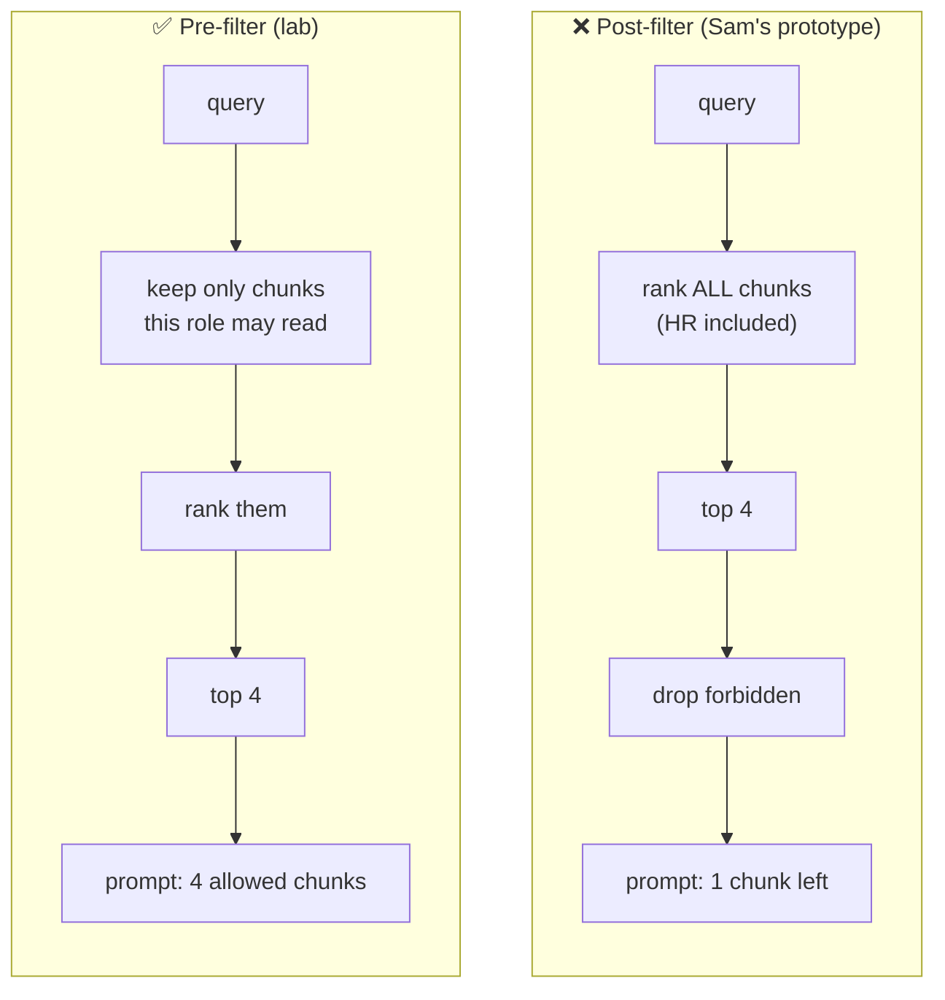

# Lesson 5.3: Authentication and authorization

> ⏱ ~55 min · 🎚 Level: Core · 🧰 Needs: lesson 0.3 (HTTP), lesson 2.5 (vector search), lesson 5.1

[Course home](../../README.md) › [Module 5](README.md) › Lesson 5.3

## 📨 The situation

> **From: Priya (Security & compliance)**
> Two findings from the pre-launch review. First: `/v1/ask` has no authentication at all, so anyone on the network can call it. Second, and worse: Sam's prototype puts *every* document in one index and adds "the user is a customer, do not reveal HR information" to the prompt. That's not access control, that's a polite request. I need the assistant to answer only from documents each user is allowed to read, enforced in code.

## 🎯 By the end you can

- **Distinguish** authentication (who are you?) from authorization (what may you do?)
- **Read and validate** a JWT correctly, and **explain** the `alg: none` and key-confusion attacks
- **Implement** a FastAPI auth dependency with pinned algorithm and required claims
- **Implement** permission-aware retrieval that filters *before* ranking, and explain why post-filtering leaks
- **Protect** a vector store: tenant isolation, metadata filters, caches, and embeddings as sensitive data

## 🤔 Predict first

1. A JWT is "signed". Does that mean its contents are secret?
2. Sam's approach: retrieve the top 4 chunks from *all* documents, then drop any the user can't see. What can go wrong? Name at least two things.
3. A customer asks about salary bands. Should the assistant say "You don't have access to that" or "I can't find that"? Why?

---

## 1. Authentication vs authorization

| | Authentication (**AuthN**) | Authorization (**AuthZ**) |
|---|---|---|
| Question | Who are you? | What are you allowed to do or see? |
| Evidence | Password + MFA, passkey, client certificate, signed token | Roles, attributes, relationships, policies |
| Failure | HTTP **401** Unauthorized (really "unauthenticated") | HTTP **403** Forbidden, or, for data, "not found" |
| Lab code | `adapters/tokens.py`, `get_principal` in `api/routes.py` | `domain/access.py`, `domain/retrieval.py` |

> 🔎 **Analogy:** a hotel. The front desk checks your passport and gives you a key card (**authentication**: the key card is your token). The key card opens your room and the gym, but not other rooms or the kitchen (**authorization**). A forged key card is an authentication failure; walking into the kitchen with a valid card is an authorization failure.

The rule that ties them together: **authorization must use the identity established by authentication, and nothing the user (or the model) can edit.** The role comes from a verified token claim, never from the request body or the prompt.

## 2. Tokens and JWTs

In production, users log in to an **identity provider** (IdP) such as Okta, Microsoft Entra ID, Keycloak or Auth0, using **OpenID Connect** (OIDC, an identity layer on top of OAuth 2.0). The IdP issues a short-lived **access token**. Your service only *verifies* tokens; it never sees passwords.

A **JWT** (JSON Web Token, [RFC 7519](https://datatracker.ietf.org/doc/html/rfc7519)) is three base64url-encoded parts separated by dots:

```
eyJhbGciOiJIUzI1NiIsInR5cCI6IkpXVCJ9 . eyJzdWIiOiJhbGljZSIsInJvbGUiOiJjdXN0b21lciIs… . 3q2-7Wd…
            header                                     payload (claims)                      signature
{"alg":"HS256","typ":"JWT"}           {"sub":"alice","role":"customer","iss":"kestrel-auth",
                                       "aud":"docs-assistant","iat":1764583200,"exp":1764586800}
```

| Claim | Meaning | Why you must check it |
|---|---|---|
| `sub` | Subject: the user id | It's the identity for rate limits and audit |
| `role` | Custom claim: the user's role | Drives authorization |
| `iss` | Issuer | Reject tokens minted by some other system |
| `aud` | Audience: which service this token is for | A token for `billing-service` must not work here |
| `exp` | Expiry time | Stolen tokens stop working |
| `iat` | Issued-at | Sanity checks, max token age |

> ⚠️ **Common mistake:** putting secrets or PII in JWT claims. A JWT is **signed, not encrypted**: anyone holding it can base64-decode the payload. Paste a token into [jwt.io](https://jwt.io/introduction) and see.

### Symmetric vs asymmetric signing

| | **HS256** (HMAC + SHA-256) | **RS256 / ES256 / EdDSA** |
|---|---|---|
| Keys | One shared secret signs *and* verifies | Private key signs; public key verifies |
| Who can mint tokens | Anyone who can verify (every service holding the secret) | Only the IdP |
| Use when | One service issues and checks its own tokens (this lab) | Many services verify tokens from a central IdP (production) |

### The two classic JWT attacks

**1. `alg: none`.** The JWT spec allows an "unsecured" token with `"alg": "none"` and an empty signature. Early libraries read the algorithm *from the token header* and happily accepted unsigned tokens. An attacker writes `{"role": "hr"}`, sets `alg: none`, and they're in.

**2. Key confusion (RS256 → HS256).** The server expects RS256 and verifies with its *public* key. The attacker signs a token with HS256 *using the public key as the HMAC secret* (it's public, after all). A library that picks the algorithm from the header verifies the HMAC with that same public key, and it matches.

**One fix for both: never let the token choose the algorithm.** Pin it:

```python
# adapters/tokens.py
claims = jwt.decode(
    token,
    secret,
    algorithms=["HS256"],          # pinned: never read the algorithm from the token
    audience=audience,
    issuer=issuer,
    leeway=30,                     # seconds of clock skew, not minutes
    options={"require": ["exp", "iat", "sub", "role", "iss", "aud"]},
)
role = claims["role"]
if role not in ROLE_ACCESS:        # a valid signature is not authorization
    raise TokenError("unknown role")
```

[RFC 8725, JWT Best Current Practices](https://datatracker.ietf.org/doc/html/rfc8725) lists these and other checks. It's short and worth reading once.

### The FastAPI dependency

```python
# api/routes.py
def get_principal(request: Request, credentials = Depends(HTTPBearer(auto_error=False))) -> Principal:
    if credentials is None or credentials.scheme.lower() != "bearer":
        raise HTTPException(401, "missing bearer token", headers={"WWW-Authenticate": "Bearer"})
    try:
        return decode_token(credentials.credentials, settings.jwt_secret, issuer=..., audience=...)
    except TokenError as exc:
        log.warning("auth_failed", reason=str(exc))                     # detail goes to logs
        raise HTTPException(401, "invalid or expired token", ...) from exc  # generic message to the client

@router.post("/v1/ask")
async def ask(body: AskRequest, principal: Principal = Depends(get_principal), ...): ...
```

Every protected route declares `Depends(get_principal)`. Forgetting it on a new route is the classic bug, so test it: `test_ask_requires_token` asserts a 401 without a token.

> 💡 **Production tip:** JWTs can't easily be revoked before `exp`. Keep access tokens **short-lived** (5–60 minutes) with refresh tokens held by the IdP. If you must revoke immediately (a stolen laptop), keep a small deny-list of token ids (`jti`) checked on each request.

> 💡 **Production tip:** the lab refuses to start with the development secret when `KESTREL_ENV=prod` (see `config.py`). Make insecure defaults **impossible** in production, not just discouraged.

## 3. Authorization models

| Model | Idea | Example | Good for |
|---|---|---|---|
| **RBAC** (role-based) | Permissions attached to roles; users have roles | `hr` can read `hr` documents | Small number of stable roles (this lab) |
| **ABAC** (attribute-based) | Policies over user, resource and context attributes | "Employees in Spain may read `es-` docs during their employment" | Rules that depend on department, region, time |
| **ReBAC** (relationship-based) | Permissions follow relationships in a graph | "You can read a doc if you're a member of a team that owns it" (Google Drive-style sharing) | Collaborative, per-document sharing |

The lab uses RBAC, with a single source of truth and **deny by default**:

```python
# domain/access.py
ROLE_ACCESS = {
    "customer": frozenset({"public"}),
    "employee": frozenset({"public", "employee"}),
    "engineer": frozenset({"public", "employee", "engineering"}),
    "hr":       frozenset({"public", "employee", "hr"}),
    "finance":  frozenset({"public", "employee", "finance"}),
}

def allowed_levels(role: str) -> frozenset[str]:
    try:
        return ROLE_ACCESS[role]
    except KeyError as exc:      # deny by default: unknown role is an error, not "public"
        raise UnknownRoleError(f"unknown role: {role!r}") from exc
```

## 4. Permission-aware retrieval: filter **before** ranking

This is the most important idea in the lesson. In a RAG system, **retrieval is the authorization boundary**: whatever reaches the prompt can reach the user, because the model can always be persuaded to repeat its context.

> ⚠️ **Common mistake:** enforcing permissions in the prompt ("the user is a customer, don't reveal HR data"). The model *can* be talked out of it (lesson 5.2). Authorization is a property of what you **put into** the context, never of what you **ask the model** to leave out.



Why post-filtering is worse, even when the filter is "correct":

1. **Leaks through behaviour.** If 3 of the top 4 results for "salary band staff engineer" are HR chunks, the customer gets fewer, worse results. Answer quality, latency and result counts now depend on content they can't see. That's a side channel.
2. **Fragile.** Every new code path (a debug endpoint, a "related documents" widget, the semantic cache) must remember to apply the filter. Pre-filtering makes the forbidden chunks *unreachable* instead.
3. **Worse answers.** You asked for 4 chunks and got 1, so recall drops for exactly the users with the least access.

The lab's retriever never even iterates over forbidden chunks:

```python
# domain/retrieval.py
def search(self, query: str, allowed: frozenset[str], k: int = 4) -> list[ScoredChunk]:
    idx, idf, avg_len = self._partition(allowed)
    ...
    for i in idx:            # ← pre-filter: forbidden chunks are not even iterated
        ...
```

### The subtle one: statistics leak too

BM25 (and TF-IDF) weight terms by **inverse document frequency**: rare words score higher. If IDF were computed over the *whole* corpus, the word "salary" would be rarer or more common depending on HR documents a customer can't read, so a customer's scores would shift when HR adds a document. The lab computes statistics **per permission partition**:

```python
@lru_cache(maxsize=64)
def _partition(self, allowed: frozenset[str]):
    """Indices + IDF + avg length computed ONLY over chunks this role may see."""
```

and `test_idf_statistics_do_not_depend_on_forbidden_documents` proves a customer's scores are **identical** whether or not HR documents exist. Is this attack practical? Barely. But this is the habit to build: *nothing a user can observe should depend on data they can't access.*

### Don't confirm existence

Notice the refusal for a customer asking about salary bands:

```json
{ "answer": "I can't find that in the documents available to you.", "refused": true, "reason": "model_abstained" }
```

not "Access denied: this information is restricted to HR". The second version confirms the document exists, which is itself information (imagine "Access denied: *Project Falcon layoffs*"). For data, the right response to "not allowed" usually looks like "not found". (For *actions*, a 403 is fine and clearer.)

## 5. Protecting the vector store (OWASP LLM08)

In production, retrieval runs on a vector database (Qdrant, pgvector, Weaviate, Pinecone, …), and the same principles apply with more moving parts.

| Risk | Mitigation |
|---|---|
| Chunks lose their access metadata during ingestion | Make `access` (and `tenant_id`) **required** fields in the chunk schema; refuse to index without them. In the lab, `Chunk` has no default for `access`. |
| Query forgets the filter | Apply the filter **inside** the vector DB query (e.g. a Qdrant payload filter, a SQL `WHERE` with pgvector) via one shared function, never in application code after retrieval. Better: Postgres **row-level security**, so the database enforces it even for queries that forget. |
| Cross-tenant leakage (B2B) | Separate collections/indexes per tenant for strong isolation; payload filters for many small tenants. Test with two tenants that share vocabulary. |
| **Embeddings treated as harmless** | They aren't: [Morris et al. (2023)](https://arxiv.org/abs/2310.06816) showed text can be largely reconstructed from its embedding. Protect vectors with the same access controls and encryption as the source text. |
| Semantic cache serves one role's answer to another | Include the user's **permission set** in the cache key (lesson 3.5). A cached HR answer must never be a "hit" for a customer asking a similar question. |
| Deleted documents live on | Deletion must propagate to the index *and* every cache. Test it. |
| Direct network access to the DB | Private network, authentication on the DB API, no public endpoint, encryption at rest (lesson 5.4). |

## 🧪 Try it

```bash
cd modules/05-security-and-governance/lab
uv run pytest tests/test_tokens.py tests/test_rbac.py -v
```

Expected: all pass, including `test_alg_none_rejected` and `test_customer_salary_question_is_refused_and_hr_text_never_reaches_prompt`.

Now break the pre-filter on purpose (lab **💥 Break it** #5). In `src/kestrel_docs_assistant/domain/retrieval.py`, change `for i in idx:` to `for i in range(len(self.chunks)):` and run:

```bash
uv run pytest tests/test_rbac.py -q
```

Expected: several failures such as `AssertionError: customer got salary-bands#0 (hr)`. Undo with `git checkout -- src/`.

Finally, mint tokens for two roles and compare:

```bash
uv run python scripts/ask.py --role customer "What is the monthly LLM API budget for Q4?"
uv run python scripts/ask.py --role finance  "What is the monthly LLM API budget for Q4?"
```

## 🏭 In the real world

Enterprise search and RAG products typically sync **access control lists (ACLs)** from the source systems (SharePoint, Google Drive, Confluence) along with the content, and apply them at query time. It's called "permission-aware" or "document-level security" retrieval. The hard engineering problem is usually not the filter but **freshness**: when someone loses access to a folder, how fast does the index find out? Ask that question in any design review of a RAG system over private documents.

## ✅ Check yourself

<details>
<summary>1. A teammate decodes a JWT with <code>jwt.decode(token, options={"verify_signature": False})</code> "just to read the role". What's wrong?</summary>

The role is then attacker-controlled: anyone can create a token claiming `role: hr`. Claims are only trustworthy after signature, `exp`, `iss` and `aud` validation. Never authorize on unverified claims.
</details>

<details>
<summary>2. Explain the RS256 → HS256 key-confusion attack and the one-line fix.</summary>

The attacker signs a token with HS256 using the server's *public* RSA key as the HMAC secret. A library that takes the algorithm from the token header verifies it with that same public key, and it matches. Fix: pin the algorithm (`algorithms=["RS256"]`) so the header can't choose.
</details>

<details>
<summary>3. Give two concrete ways post-filtering leaks information even if the final filter is correct.</summary>

(a) Result counts and quality change depending on how many forbidden chunks ranked highly. (b) Latency differences. (c) Any code path that forgets the filter (cache, debug endpoint) leaks directly. (d) Corpus statistics like IDF reflect forbidden documents.
</details>

<details>
<summary>4. Why does the lab return "I can't find that" rather than "access denied" for a customer's salary question?</summary>

"Access denied" confirms the information exists and is restricted, which is itself a disclosure. For data access, "not found" is the safer default.
</details>

<details>
<summary>5. You add a semantic cache in front of the assistant. Which field must be part of the cache key, and why?</summary>

The user's permission set (or role/tenant). Otherwise an HR user's cached answer about salary bands can be served to a customer whose similar question is a cache "hit", bypassing retrieval-time authorization entirely.
</details>

## 💬 Explain it back

Explain to Sam, in four sentences, why "tell the model not to reveal HR data" is not access control, and what you replaced it with.

## 🔑 Key takeaways

- **AuthN** proves identity (401 on failure); **AuthZ** decides access (403, or "not found" for data).
- JWTs are signed, not encrypted. Validate signature, `exp`, `iss`, `aud` and required claims, and **pin the algorithm**.
- Deny by default: unknown roles are errors.
- In RAG, **retrieval is the authorization boundary**. Filter by permission *before* ranking, never in the prompt and never after generation.
- Treat vector stores, embeddings and caches as copies of the source data: same access control, same encryption, same deletion.

## 📚 Go deeper (free)

| | Resource | Why read it | Time |
|---|---|---|---|
| ⭐ | [RFC 8725: JSON Web Token Best Current Practices](https://datatracker.ietf.org/doc/html/rfc8725) | Short, authoritative list of JWT pitfalls and checks | 30 min |
| 🔍 | [FastAPI: Security tutorial](https://fastapi.tiangolo.com/tutorial/security/) | OAuth2 and JWT in FastAPI, step by step | 45 min |
| 🔍 | [jwt.io introduction](https://jwt.io/introduction) | Visual explanation of JWT structure, with a decoder | 10 min |
| 🔍 | [OWASP Cheat Sheet Series](https://cheatsheetseries.owasp.org/) | Authentication, authorization and session management cheat sheets | 30 min |
| 🔍 | [Morris et al., "Text Embeddings Reveal (Almost) As Much As Text" (2023)](https://arxiv.org/abs/2310.06816) | Why embeddings are sensitive data | 30 min |

---
⬅️ [Lesson 5.2: Prompt injection and jailbreaks](02-prompt-injection-and-jailbreaks.md) · ➡️ [Lesson 5.4: Privacy: PII and encryption](04-privacy-pii-and-encryption.md)
