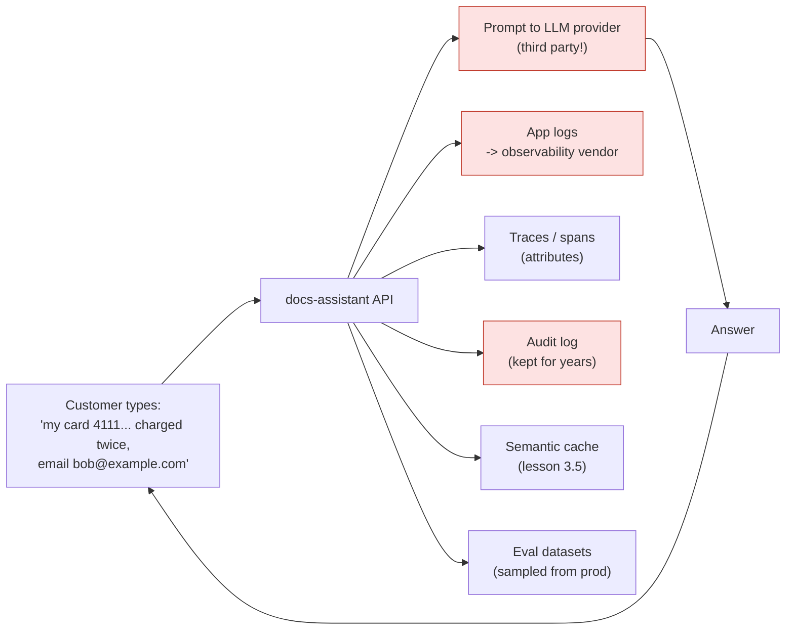
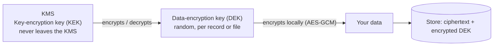

# Lesson 5.4: Privacy: PII and encryption
<!-- id: l-5-4 -->

> ⏱ ~50 min · 🎚 Level: Core · 🧰 Needs: lesson 1.4 (structured logging), lesson 5.3

[Course home](../../README.md) › [Module 5](README.md) › Lesson 5.4

## 📨 The situation

> **From: Priya (Security & compliance)**
> I grepped last week's logs for 16-digit numbers. Customers type their full card numbers into the assistant ("my card 4111… was charged twice"), and we log every question verbatim. That puts our entire logging stack in PCI scope, and the logs go to a third-party observability vendor. Also, the question text is sent as-is to the LLM provider. Fix the data flows, then tell me where data is encrypted and where it isn't.

## 🎯 By the end you can

- **Identify** every place personal data flows in an LLM application, including the non-obvious ones
- **Choose** between redaction, masking, pseudonymisation, tokenisation and encryption
- **Implement** checksum-validated PII detection (Luhn for cards, mod-97 for IBANs) and redaction in prompts, logs, responses and audit records
- **Measure** a redactor's precision and recall, and explain why recall dominates for logs
- **Explain** encryption in transit (TLS, mTLS) and at rest (disk, database, field-level, envelope encryption with a KMS)

## 🤔 Predict first

1. List every place a card number typed into the assistant could end up. Aim for at least five. <!-- id: p-5-4-1 -->
2. Is hashing an email address (`sha256("bob@example.com")`) a good way to anonymise it in logs? <!-- id: p-5-4-2 -->
3. Your redactor catches 95% of email addresses. Is that good? <!-- id: p-5-4-3 -->

---

## 1. What counts as personal data, and why fintech is stricter

**PII** (personally identifiable information) is the US-flavoured term; the EU's **GDPR** uses **personal data**: *any information relating to an identified or identifiable natural person*. That's broader than people expect: an email, a phone number, a customer id, an IP address, a device id, or a combination like "senior engineer in the Lisbon office who joined in March".

Kestrel Pay has a second regime on top: **PCI DSS** (the Payment Card Industry Data Security Standard). Any system that stores, processes or transmits the **PAN** (primary account number, the card number) is "in scope" for its controls, and **sensitive authentication data** such as the CVV must never be stored after authorisation. A log line containing a card number makes the logging pipeline, its storage and everyone who can read it part of that scope. That's an expensive mistake, and why Priya grepped first.

| Data type | Examples in the handbook / lab | Regime |
|---|---|---|
| Direct identifiers | Name, email, phone (`salary-bands.md` contact) | GDPR |
| Financial | Card number (PAN), IBAN | PCI DSS (PAN), GDPR |
| Sensitive authentication data | CVV, PIN, one-time passcodes | PCI DSS: never store |
| Quasi-identifiers | Job level + office + start date | GDPR (identifiable in combination) |
| Confidential business data | Salary bands, budgets | Company policy, not personal data per se |

## 2. Map the data flows first

Before writing any regex, draw where data goes. For the docs-assistant:



Seven destinations for one question, and only one of them (the answer) is the one you were thinking about. The ones people forget most often are **traces** (span attributes often capture full prompts), **caches**, and **evaluation datasets** built by sampling production traffic.

The guiding principle is **data minimisation** (GDPR Article 5): collect and keep only what you need. In order of preference:

1. **Don't collect it.** The UI can warn "never type card numbers here" and block 16-digit inputs client-side.
2. **Remove it as early as possible** (redact at the edge).
3. **Replace it** with something less sensitive (pseudonymise/tokenise).
4. **Protect what remains** (encrypt, restrict access, set retention).

## 3. Redact, mask, pseudonymise, tokenise, encrypt

| Technique | `bob@example.com` becomes | Reversible? | Use when |
|---|---|---|---|
| **Redaction** | `[EMAIL]` | No | Logs, prompts to third parties, analytics. You need to know *that* there was an email, not which one |
| **Masking** | `b**@example.com`, card `•••• 1111` | No | Showing users a hint of their own data |
| **Pseudonymisation** | `<EMAIL_1>` (consistent within a session), or `HMAC(key, email)` | With the key or mapping | Joining records across logs without exposing the value; LLM prompts that must refer to "the same email" twice |
| **Tokenisation** | `tok_8f3a…`, with the real value in a separate vault | Yes, via the vault | Payment systems: most services handle tokens, only the vault sees PANs |
| **Encryption** | Ciphertext | Yes, with the key | Storing data you genuinely need later |

> ⚠️ **Common mistake:** "we hash emails, so they're anonymous". A plain `sha256(email)` can be reversed with a dictionary: hash a list of a billion known emails and look up matches. Under GDPR, hashed identifiers are usually still **pseudonymous personal data**, not anonymous. If you need a joinable identifier, use a **keyed** hash (HMAC with a secret key kept in a KMS), and still treat it as personal data.

## 4. Detecting PII: regex + checksums, NER, and measuring

### Regex alone is noisy, checksums fix much of it

"13 to 19 digits" also matches order ids, timestamps and transaction numbers. Real card numbers satisfy the **Luhn checksum**; real IBANs satisfy **ISO 7064 mod 97-10**. Validating them removes most false positives.

**Luhn, by hand**, for the standard Visa test number `4111 1111 1111 1111`: starting from the rightmost digit, double every second digit; if a doubled value exceeds 9, subtract 9; sum everything; valid if the sum is divisible by 10.

```
digits (right→left):  1  1  1  1  1  1  1  1  1  1  1  1  1  1  1  4
double every 2nd:     1  2  1  2  1  2  1  2  1  2  1  2  1  2  1  8
sum = 8×1 + 7×2 + 8 = 8 + 14 + 8 = 30   → 30 % 10 == 0 → valid ✅
```

Change the last digit to 2 and the sum becomes 31: invalid, so the lab leaves `4111 1111 1111 1112` alone (it might be an order number).

```python
# domain/pii.py
def luhn_valid(number: str) -> bool:
    digits = [int(d) for d in number if d.isdigit()]
    if not 13 <= len(digits) <= 19:
        return False
    checksum = 0
    for i, d in enumerate(reversed(digits)):
        if i % 2 == 1:
            d *= 2
            if d > 9:
                d -= 9
        checksum += d
    return checksum % 10 == 0

def iban_valid(iban: str) -> bool:
    compact = iban.replace(" ", "").upper()
    rearranged = compact[4:] + compact[:4]                       # move country + check digits to the end
    numeric = "".join(str(int(ch, 36)) for ch in rearranged)     # A=10 … Z=35
    return 15 <= len(compact) <= 34 and int(numeric) % 97 == 1
```

Detectors run in priority order (email → IBAN → card → phone) and a span claimed by one can't be claimed by another, so a card number never gets half-redacted as a phone number.

### Names need NER

Regex can't recognise "Elena Ruiz" as a name. That takes **named entity recognition** (NER), a statistical model that labels spans as `PERSON`, `LOCATION` and so on. [Microsoft Presidio](https://microsoft.github.io/presidio/) combines NER (via spaCy) with pattern recognisers and checksums, and supports many entity types and languages. The lab includes it as an optional extra (`uv sync --extra presidio`) and *documents the gap* with a test:

```python
def test_salary_doc_contact_is_redacted_in_hr_answers():
    ...
    # Names need NER (e.g. Presidio): regex alone cannot find them. That gap is a lesson, not a bug.
    assert "Elena Ruiz" in redact(text)
```

> 💡 **Production tip:** write tests for what your redactor *misses*, too. A test that pins a known gap prevents someone from believing it's covered, and turns green-to-red the day you fix it.

### Measure it like a classifier

A redactor is a classifier, so measure **precision** (of what you redacted, how much was really PII?) and **recall** (of all the PII, how much did you redact?) on a labelled sample of *your* data.

**Worked example.** Kestrel logs 1,000,000 lines a day; 2% contain an email, so there are 20,000 emails. A redactor with 95% recall leaks **1,000 emails per day** into the logging vendor, about 365,000 a year. For logs and prompts to third parties, **recall is the metric that matters**: a false positive costs a slightly less useful log line; a false negative is a data breach. For user-facing answers, precision matters more, because over-redaction ruins answers (`test_does_not_redact_lookalikes` checks that dates, salary ranges and transaction ids survive).

## 5. Redact at every exit

The lab applies one function, `redact`, at every boundary from the data-flow diagram:

```python
# 1. Prompts to the LLM provider (policy flag redact_pii_in_prompts)
prompt_question = redact(question) if policy.redact_pii_in_prompts else question

# 2. Responses (policy flag redact_pii_in_responses)
answer_text = redact(output.answer) if policy.redact_pii_in_responses else output.answer

# 3. Application logs: a structlog processor, so no call site can forget
def _redact_processor(_logger, _name, event_dict: dict) -> dict:
    return redact_structure(event_dict)

# 4. Audit records: redacted before anything touches disk
record = {..., **redact_structure(fields), "prev_hash": self._last_hash}
```

Logging is handled by a **processor** in the pipeline, not by remembering to call `redact()` at each `log.info(...)`. Make the safe path the default path.

What did the customer's card number turn into? From the lab's audit log:

```json
{"seq": 3, "event": "ask", "actor": "alice", "role": "customer",
 "question": "My card [CARD] was charged twice, email me at [EMAIL]", ...}
```

> ⚠️ **Common mistake:** redacting the logs but not the **traces**. OpenTelemetry spans for LLM calls often record the full prompt and completion as attributes (lesson 4.4). Apply the same redaction in a span processor, or don't record content at all in production.

> 💡 **Production tip:** before sending prompts to an external LLM provider, check the contract: data retention period, whether your data is used for training (usually opt-out or off by default for business APIs), region of processing (data residency), and a data processing agreement (DPA). Redaction reduces what you need to trust them with.

## 6. Encryption in transit

**In transit** means data moving over a network: browser → API, API → LLM provider, service → vector database.

- **TLS** (Transport Layer Security, the "S" in HTTPS) encrypts and authenticates the connection. Use TLS 1.2 minimum, prefer 1.3, and don't hand-tune cipher lists: start from [Mozilla's SSL configuration generator](https://ssl-config.mozilla.org/).
- **HSTS** (HTTP Strict Transport Security) tells browsers to never use plain HTTP for your domain.
- **mTLS** (mutual TLS): both sides present certificates, so service A can prove to service B who it is. Service meshes (Istio, Linkerd) automate it inside Kubernetes. It's how "only the docs-assistant may call the vector DB" gets enforced at the network layer.
- Terminate TLS at the edge (load balancer, ingress), but **keep encrypting inside** the cluster too ("zero trust"): an attacker on the internal network shouldn't see plaintext prompts.

In the lab, `uvicorn` runs plain HTTP on localhost, which is fine on your laptop. In production, TLS is terminated by the ingress (lesson 6.1), with certificates issued and rotated automatically (e.g. Let's Encrypt via cert-manager).

## 7. Encryption at rest

**At rest** means data in storage: disks, databases, object storage, backups, the vector index, the audit log.

| Layer | What it protects against | What it does NOT protect against |
|---|---|---|
| **Disk / volume encryption** (cloud default) | Stolen physical disks, decommissioned hardware | Anyone with access to the running system or the database |
| **Database / storage encryption** (TDE, bucket encryption with KMS keys) | Raw storage access, backups copied elsewhere | Users and services with legitimate DB credentials |
| **Application / field-level encryption** | DB admins, leaked DB dumps, overly broad queries | The application itself (it holds the key) |

Most of the security value is in **who can use the key**. Cloud key management services (AWS KMS, Google Cloud KMS, Azure Key Vault) keep master keys in hardware, log every use, and let you grant decrypt permission to exactly one service.

### Envelope encryption

Encrypting large data directly with a KMS key is slow and expensive (every byte goes to the KMS). Instead:



1. Generate a random **DEK** locally and encrypt the data with it (fast, local AES).
2. Ask the KMS to encrypt the DEK with the **KEK**. Store the encrypted DEK next to the ciphertext.
3. To decrypt: send the encrypted DEK to the KMS (logged, permission-checked), get the DEK back, decrypt locally.

Rotating the KEK means re-encrypting small DEKs, not terabytes of data. And **crypto-shredding**: to "delete" data that also lives in backups you can't edit, delete its key, and every copy becomes unreadable. It's a common technique for GDPR erasure across immutable storage.

A minimal field-level example (not part of the lab's dependencies; see 🚀 Extend it #5 in the lab):

```python
from cryptography.fernet import Fernet   # AES-128-CBC + HMAC, authenticated

key = Fernet.generate_key()              # in production: a DEK from your KMS, never in code
f = Fernet(key)
token = f.encrypt(b"My card 4111 1111 1111 1111 was charged twice")
f.decrypt(token)                         # only code holding the key can read it
```

> ⚠️ **Common mistake:** keeping the encryption key next to the data (same bucket, same env file, same DB). That's a locked door with the key taped to it. Keys live in a KMS or secret manager, with separate access permissions and audit logs.

## 🧪 Try it

```bash
cd modules/05-security-and-governance/lab
uv run pytest tests/test_pii.py -v
uv run python -c "
from kestrel_docs_assistant.domain.pii import redact
print(redact('Card 5555-5555-5555-4444, IBAN GB82 WEST 1234 5698 7654 32, call +34 600 123 456'))
print(redact('Order 4111 1111 1111 1112 shipped 2026-08-14'))
"
```

Expected:

```
Card [CARD], IBAN [IBAN], call [PHONE]
Order 4111 1111 1111 1112 shipped 2026-08-14
```

Then do lab step 6 (ask a question with a card number through the API and inspect `artifacts/audit.jsonl`) and confirm the raw number appears **nowhere**: `grep -c 4111 artifacts/audit.jsonl` should print `0`.

**Measure it yourself:** write 20 sentences, 10 with PII in unusual formats (`bob [at] example.com`, `+34600123456`, a card with dots `4111.1111.1111.1111`) and 10 PII-free with lookalikes. Compute precision and recall for `redact`. Which formats does it miss? Try `+34600123456 4111.1111.1111.1111` too: the greedy phone pattern swallows the neighbouring digits, the 23-digit match fails the length check, and **nothing** gets redacted. Adjacent values confusing a regex is a classic real-world recall bug, and exactly why you test on realistic text instead of one value per line.

## 🏭 In the real world

Payment companies generally keep raw card numbers inside a small, heavily controlled **card vault** and hand every other system a token, precisely so that most of the company is *out* of PCI scope. The same architectural idea, "most services never see the sensitive value", is the best long-term answer for PII in LLM systems as well: redact or tokenise at the edge, and let only the few components that truly need the real value hold it.

## ✅ Check yourself

<details>
<summary>Q1. Name five places a card number typed into the assistant can end up, beyond the answer. <!-- id: c-5-4-1 --></summary>

The prompt sent to the LLM provider, application logs (and the log vendor), traces/spans, the audit log, the semantic cache, evaluation datasets sampled from production, backups of all of these, and error reports (e.g. exception trackers capturing request bodies).
</details>

<details>
<summary>Q2. Why is <code>sha256(email)</code> not anonymisation? What would you use for a joinable identifier? <!-- id: c-5-4-2 --></summary>

Anyone can hash a large list of known emails and match them (a dictionary attack), so the hash is reversible in practice and remains personal data. Use a keyed hash (HMAC with a secret in a KMS) for joinability, and still treat it as pseudonymous personal data.
</details>

<details>
<summary>Q3. Run Luhn on <code>4111 1111 1111 1112</code>. <!-- id: c-5-4-3 --></summary>

From the right: 2, 1×2=2, 1, 2, 1, 2, 1, 2, 1, 2, 1, 2, 1, 2, 1, 4×2=8. Sum = 2 + 7×2 + 7×1 + 8 = 2 + 14 + 7 + 8 = 31. 31 % 10 ≠ 0, so it's invalid and not redacted.
</details>

<details>
<summary>Q4. For logs, which matters more, precision or recall? For user-facing answers? <!-- id: c-5-4-4 --></summary>

Logs: recall. A miss is a leak; a false positive just makes a log line slightly less useful. Answers: precision matters more, because over-redaction destroys useful content (dates, prices, ids), though recall still matters for genuinely sensitive values.
</details>

<details>
<summary>Q5. What is envelope encryption and what does it make cheap? <!-- id: c-5-4-5 --></summary>

Data is encrypted locally with a random data key (DEK); the DEK is encrypted by a master key (KEK) held in a KMS. Bulk encryption stays fast and local, KEK rotation only re-wraps small DEKs, every decrypt is logged by the KMS, and deleting a DEK crypto-shreds its data everywhere, including backups.
</details>

## 💬 Explain it back
<!-- id: e-5-4 -->

Priya asks: "Is our audit log PCI-safe now?" Answer in four sentences: what you changed, how you know it works (which test), what's still not covered (names), and what you'd do next.

## 🔑 Key takeaways

- Map **every** data flow first: prompts, logs, traces, audit, caches, eval sets, backups.
- Minimise: don't collect → redact early → pseudonymise/tokenise → encrypt what remains.
- Regex + **checksums** (Luhn, mod-97) for structured PII; NER (e.g. Presidio) for names. Measure precision and recall; for logs, **recall** is what matters.
- Make redaction the default path (logging processor, audit writer), not something each call site must remember.
- TLS in transit (mTLS between services); at rest, **who can use the key** matters more than the algorithm. Use envelope encryption with a KMS.

## 📚 Go deeper (free)

| | Resource | Why read it | Time |
|---|---|---|---|
| ⭐ | [Microsoft Presidio documentation](https://microsoft.github.io/presidio/) | Production-grade PII detection and anonymisation, with clear concepts | 45 min |
| 🔍 | [OWASP Cheat Sheet Series](https://cheatsheetseries.owasp.org/) | "Logging", "Cryptographic Storage" and "Transport Layer Security" cheat sheets | 45 min |
| 🔍 | [Mozilla SSL Configuration Generator](https://ssl-config.mozilla.org/) | Sensible TLS settings for every common server | 10 min |
| 🔍 | [Carlini et al., "Extracting Training Data from Large Language Models" (2020)](https://arxiv.org/abs/2012.07805) | Why PII in training or fine-tuning data can come back out | 40 min |
| 🔍 | [OWASP LLM02: Sensitive Information Disclosure](https://genai.owasp.org/llm-top-10/) | LLM-specific disclosure scenarios and mitigations | 20 min |

---
⬅️ [Lesson 5.3: Authentication and authorization](03-authentication-and-authorization.md) · ➡️ [Lesson 5.5: Guardrails and groundedness](05-guardrails-and-groundedness.md)
