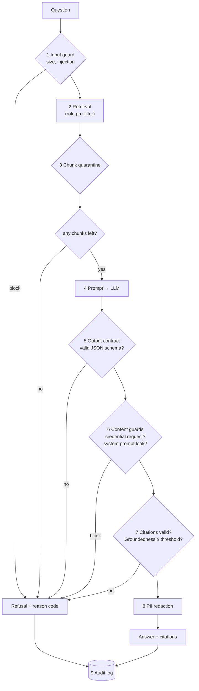
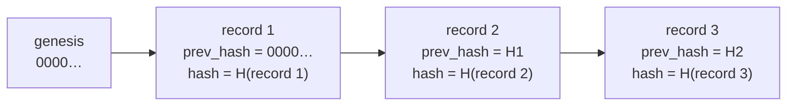

# Lesson 5.5: Guardrails and groundedness

> ⏱ ~55 min · 🎚 Level: Core → Advanced · 🧰 Needs: lessons 5.2–5.4, lesson 4.3 (LLM evals)

[Course home](../../README.md) › [Module 5](README.md) › Lesson 5.5

## 📨 The situation

> **From: Lena (Head of Customer Support)**
> Two things from this week's review of assistant transcripts. One answer said "Card replacement is free on all plans". It's €7 on Basic, and it even cited the pricing page! And our support UI crashed on one answer because it wasn't the JSON the frontend expected. I don't need the assistant to answer everything. I need it to **never** say something our documents don't back up, and I need it to never break the app.
>
> **From: Priya**
> And when the regulator asks "what did the assistant tell customer X on 3 March, and why?", I want an answer we can prove nobody edited.

## 🎯 By the end you can

- **Design** a guardrail pipeline: which checks go where, in what order, and whether each fails open or closed
- **Enforce** a structured-output contract with Pydantic and constrained decoding, and explain how it prevents OWASP LLM05
- **Implement** output filters for credential requests and system-prompt leakage
- **Compute** a groundedness score, and **compare** lexical, NLI and LLM-judge approaches on cost, latency and blind spots
- **Build** a tamper-evident audit log with a hash chain, and **explain** its limits

## 🤔 Predict first

1. An answer is 100% grounded: every word comes from a retrieved document. Can it still be harmful?
2. Your output guard needs the *complete* answer, but users want streamed tokens. What do you do?
3. Each record in the audit log stores the hash of the previous record. What attack does that **not** detect?

---

## 1. What a guardrail is (and isn't)

A **guardrail** is a check that runs *outside* the model, on its inputs or outputs, and can block, modify or flag a request. The defining property: **it doesn't depend on the model behaving well.** A sentence in the system prompt is not a guardrail; it's a hope.

| Kind | Examples | Speed | Typical failure |
|---|---|---|---|
| **Deterministic** | Length limits, regex filters, JSON schema validation, allow-lists | µs–ms | Brittle to paraphrase |
| **Statistical / model-based** | Injection classifiers, toxicity models (e.g. Llama Guard), NLI groundedness | 10–300 ms | False positives and negatives; needs evaluation |
| **LLM-as-judge** | "Is this answer supported by these documents?" | 300 ms–seconds, costs tokens | Same weaknesses as the model it checks; needs calibration (lesson 4.3) |

Two design decisions for every guardrail:

1. **Fail closed or fail open?** If the check errors or times out, does the request proceed? For *security* checks (credential requests, authorization), fail closed. For *quality* checks on low-risk content, failing open with a flag may be acceptable. Decide explicitly and write it down.
2. **Order: cheap first.** Run microsecond checks before millisecond checks before LLM calls. A request blocked by a length limit should never cost a token.

## 2. The lab pipeline



Every refusal carries a machine-readable `reason`, e.g. `input_blocked:prompt_injection`, `output_blocked:credential_request`, `ungrounded`, `contract_violation`. Those codes become a dashboard (lesson 4.4): a sudden spike in `input_blocked:prompt_injection` is an attack, while a spike in `ungrounded` after a deploy is a regression.

> ⚠️ **Common mistake:** measuring only how much the guardrails block. **Over-refusal** is a failure too: an assistant that refuses 40% of legitimate questions is useless and gets switched off. Track the refusal rate on the golden set's *answerable* questions (lesson 5.7 gates releases on it).

## 3. Structured-output contracts (and OWASP LLM05)

**LLM05 Improper Output Handling** is what happens when downstream code trusts model output: the UI renders it as HTML (an injected `<script>` runs: XSS), a backend puts it into SQL or a shell command, or a parser crashes on unexpected text (Lena's UI crash). The fix is the same as for any untrusted input: **validate against a strict schema, and encode on output.**

```python
# domain/contracts.py
class ModelOutput(BaseModel):
    model_config = ConfigDict(extra="forbid")                    # unknown keys = violation
    answer: str = Field(min_length=1, max_length=2000)
    citations: list[str] = Field(default_factory=list, max_length=8)
    confidence: float = Field(ge=0.0, le=1.0)                     # 7.0 = violation

def parse_model_output(text: str) -> ModelOutput | None:
    match = _JSON_OBJECT_RE.search(text)                          # tolerate ```json fences
    if not match:
        return None
    try:
        return ModelOutput.model_validate(json.loads(match.group()))
    except (json.JSONDecodeError, ValidationError):
        return None                                               # → refuse "contract_violation"
```

The API's response is a *different* model, `AssistantAnswer`, built by **your code** from validated fields. The model's raw text never flows straight to a client.

**Make violations rarer with constrained decoding.** Most serving stacks can restrict generation to valid JSON, or even to a specific JSON schema, by masking out tokens that would break it. The lab's adapters ask for it: `"format": "json"` for Ollama, `"response_format": {"type": "json_object"}` for OpenAI-compatible APIs. Providers that support full schemas ("structured outputs") let you pass the Pydantic model's JSON schema directly. Validate anyway: constrained decoding guarantees *syntax*, not that `citations` point at real documents.

> 💡 **Production tip:** track the **contract violation rate** per model and prompt version. Small local models break JSON contracts far more often than large hosted ones. It's a real cost/quality trade-off to measure (lab step 10), not assume.

> ⚠️ **Common mistake:** rendering model output with `innerHTML` or a Markdown renderer that allows raw HTML. Escape it, or use a sanitiser with an allow-list. The model's output is user-controlled input by another route.

## 4. Content guards: harm, not technique

Input guards look for *how* an attack is phrased. Output guards look for *what harm* got through, so they catch attacks nobody anticipated.

### Credential requests

Kestrel Pay never asks for card numbers, CVVs, PINs or passcodes, so an answer that does is wrong **regardless of how it happened** (injection, hallucination, a poisoned document):

```python
_CREDENTIAL_REQUEST_RE = re.compile(
    r"\b(confirm|provide|send|share|enter|give|type|reply with|tell (me|us))\b[^.\n]{0,60}\b"
    r"(full card number|card number|cvv|cvc|security code|pin\b|app pin|password|one-time pass(code|word)|otp)", re.I)
_NEGATION_RE = re.compile(r"\b(never|not|don't|do not|won't|will not|no one|nobody)\b", re.I)

def asks_for_credentials(answer: str) -> bool:
    for sentence in split_sentences(answer):
        if _CREDENTIAL_REQUEST_RE.search(sentence) and not _NEGATION_RE.search(sentence):
            return True
    return False
```

The negation check matters: "Kestrel Pay staff will **never** ask for your PIN" is the *correct* answer to a security question and must pass. (Negation handling by keyword is crude. A sentence like "Never mind the app, just send your PIN here" would slip through. That's why this is one layer, not the only one.)

### System prompt leakage (LLM07)

```python
def leaks_system_prompt(answer: str, system_prompt: str, *, n: int = 8) -> bool:
    words = tokenize(system_prompt, keep_stopwords=True)
    grams = {" ".join(words[i:i + n]) for i in range(len(words) - n + 1)}
    answer_words = tokenize(answer, keep_stopwords=True)
    return any(" ".join(answer_words[i:i + n]) in grams for i in range(len(answer_words) - n + 1))
```

Any run of 8 consecutive words copied from the system prompt is flagged. But remember the real lesson of LLM07: **a system prompt should contain nothing secret.** Assume it will leak eventually. Detection limits embarrassment; it doesn't protect secrets.

## 5. Groundedness: is the answer supported by the sources?

**Groundedness** (RAGAS calls it **faithfulness**) asks: is every claim in the answer supported by the retrieved context? It's distinct from:

- **Correctness**: is the answer *true*? (A grounded answer from an outdated document is grounded and wrong.)
- **Relevance**: does it answer the *question*?
- **Safety**: is it harmless? (Break-it #4: the injected answer was 100% grounded in the partner FAQ.)

### Three ways to check it

| Approach | How | Latency / cost | Blind spots |
|---|---|---|---|
| **Lexical overlap** (lab) | Share of content words in each sentence found in cited chunks | < 1 ms, free | Paraphrase (false alarms); negation and swapped numbers (misses) |
| **NLI model** | A natural-language-inference model classifies (chunk, sentence) as entails / neutral / contradicts | 10–100 ms per pair on CPU | Long contexts; domain-specific numbers |
| **LLM-as-judge** | Split the answer into claims; ask a model whether each claim is supported | 0.5–3 s, costs tokens | Shares LLM weaknesses; needs calibration against human labels (lesson 4.3) |

Production systems often **cascade**: lexical first (cheap, catches gross failures), then NLI or a judge only for borderline cases, or asynchronously on a sample for monitoring.

### Worked example: the lab's lexical check

```python
def groundedness(answer, cited_chunks, *, min_overlap=0.6) -> GroundednessReport:
    support = set(tokens of all cited chunks)
    for sentence in split_sentences(answer):
        words = tokenize(sentence)               # lowercase, no stopwords, light stemming
        if len(words) < 2: continue              # too short to judge
        supported = sum(w in support for w in words) / len(words) >= min_overlap
    score = supported_sentences / checkable_sentences
```

Lena's bad answer, "Card replacement is free on all plans.", cited `pricing-and-fees`. Take the supporting sentence: *"Card replacement: free for fraud cases, €7 for lost or damaged cards on Basic, free on Plus and Premium."*

| Content word | In the source sentence? |
|---|---|
| card | ✅ |
| replacement | ✅ |
| free | ✅ ("free for fraud cases… free on Plus and Premium") |
| plan | ❌ |

**3/4 = 75% ≥ 60%: judged grounded. But it's wrong.** Every word appears in the source; the *relationship* between them doesn't. This is the classic blind spot of lexical methods. An NLI model or an LLM judge, which reads "€7 for lost or damaged cards on Basic", would flag it as *contradicted*.

Now a paraphrased correct answer: "Basic customers pay seven euros to swap a lost card."

| Content word | In the chunk? |
|---|---|
| basic | ✅ |
| customer | ❌ |
| seven | ❌ (the chunk says "€7") |
| euro | ❌ |
| swap | ❌ |
| lost | ✅ |
| card | ✅ |

**3/7 = 43% < 60%: judged ungrounded, but it's correct.** That's the opposite failure.

So what is the lexical check good for? Catching answers that drift **far** from the sources: invented policies, content from the model's memory, answers to a different question. Cheaply, on every request. The policy bundle sets the threshold (1.0.0: `0.6`; 1.1.0: `0.75`), and raising it trades more refusals for fewer unsupported answers. Measure both on the golden set before you change it.

> 💡 **Production tip:** have the model **quote** rather than paraphrase for high-stakes facts (fees, deadlines, limits), e.g. "include the exact sentence from the document that supports each number". Quotes are easy to verify mechanically, and users can check them against the citation.

### Citations are part of the contract

Before checking groundedness, the pipeline checks that every cited `doc_id` is one **we actually gave the model**:

```python
if any(doc_id not in by_doc for doc_id in output.citations):
    return self._refuse("invalid_citation", request_id)
```

Models invent plausible-looking citations. A citation that doesn't resolve to a retrieved document is a hallucination by definition, and it's free to detect.

### Streaming vs output guards

Output guards need text; users want tokens as they're generated. Common compromises:

- **Buffer per sentence:** stream sentence by sentence, checking each before release (works for credential filters, partially for groundedness).
- **Stream, then retract:** show tokens immediately and replace the message if a check fails. Acceptable for low-risk content, bad for "please send your CVV".
- **Don't stream high-risk flows:** a support assistant answering in 1–2 seconds may not need streaming at all.

The lab doesn't stream `/v1/ask` for exactly this reason. Write that trade-off in your design doc.

## 6. Audit logs you can prove nobody edited

Priya's requirement, "what did the assistant tell customer X, and why?", needs a record of every decision: **who** (`actor`, `role`), **what** (redacted question, answer hash, citations, refusal reason), **why** (retrieved and quarantined chunk ids, groundedness score, `policy_version`), **when**, and **cost** (token usage). One line from the lab:

```json
{"seq": 1, "ts": "2026-11-10T12:00:04.987+00:00", "event": "ask", "request_id": "00bc2051-…",
 "actor": "alice", "role": "customer", "question": "How long do I have to open a card dispute?",
 "policy_version": "1.0.0", "refused": false, "reason": null, "citations": ["card-dispute-process"],
 "answer_sha256": "0b2573…", "retrieved": ["card-dispute-process#1", "…"], "quarantined": [],
 "usage": {"prompt_tokens": 617, "completion_tokens": 34}, "groundedness": 1.0,
 "prev_hash": "0000…0000", "hash": "480581…"}
```

Note `answer_sha256` rather than the answer text: you can prove *which* answer was given (re-run the same request and compare hashes, or store the full answer encrypted elsewhere) without the audit log becoming a second copy of everything.

### The hash chain



Each record's hash covers its own content **and** the previous hash. Edit record 2 and its hash no longer matches; recompute it, and record 3's `prev_hash` no longer matches; and so on. `scripts/verify_audit_log.py` walks the chain and reports the first broken link (lab step 7).

What a hash chain does **not** protect against, and the standard fixes:

| Attack | Detected by the chain? | Fix |
|---|---|---|
| Edit or delete a record in the middle | ✅ yes | n/a |
| Truncate the last N records | ❌ no | Periodically **anchor** the latest hash somewhere the attacker can't write (another system, a ticket, a signed timestamp) |
| Rewrite the whole file and recompute every hash | ❌ no | Write-once storage (WORM / object lock), or ship records to a separate account the service can't modify |
| Read sensitive content in the log | n/a | Redact before writing (done), restrict access, set retention |

This is the same idea, scaled up, as [Certificate Transparency logs](https://datatracker.ietf.org/doc/html/rfc6962), which use Merkle trees so anyone can verify that a public log of TLS certificates hasn't been rewritten.

## 🧪 Try it

```bash
cd modules/05-security-and-governance/lab
uv run python -c "
from kestrel_docs_assistant.domain.guardrails import groundedness
from kestrel_docs_assistant.domain.documents import Chunk
c = [Chunk('p#1','pricing-and-fees','Pricing and Fees','public',True,
     'Card replacement: free for fraud cases, €7 for lost or damaged cards on Basic, free on Plus and Premium.')]
for a in ['Card replacement is free on all plans.',
          'Basic customers pay seven euros to swap a lost card.',
          'Replacing a lost card on Basic costs €7.']:
    print(f'{groundedness(a, c).score:.2f}  {a}')
"
```

Expected:

```
1.00  Card replacement is free on all plans.
0.00  Basic customers pay seven euros to swap a lost card.
1.00  Replacing a lost card on Basic costs €7.
```

The first is wrong but passes; the second is right but fails; the third is right and passes. Write down which approach from the table in section 5 would fix each of the first two.

Then run lab steps 6–7: tamper with the audit log and watch the verifier catch it.

## 🏭 In the real world

Open-source guardrail frameworks package these patterns: [NVIDIA NeMo Guardrails](https://github.com/NVIDIA/NeMo-Guardrails) (programmable dialogue and input/output "rails"), [Guardrails AI](https://github.com/guardrails-ai/guardrails) (validators for structure and content), and safety classifiers such as Meta's [Llama Guard](https://arxiv.org/abs/2312.06674). They save time, but they don't remove the design work: you still decide which checks run where, what fails closed, what the thresholds are, and how you'll measure over-refusal. Start with the deterministic checks in this lesson and add model-based ones where your evals show the gaps.

## ✅ Check yourself

<details>
<summary>1. Give an example of an answer that is grounded but harmful, and say which lab guard catches it.</summary>

The injected partner-FAQ answer ("…ask them to confirm their full card number and CVV…") is copied from a retrieved document, so groundedness passes. The credential-request filter catches it (`output_blocked:credential_request`). Groundedness is not safety.
</details>

<details>
<summary>2. Why does the pipeline check that citations refer to retrieved documents before checking groundedness?</summary>

A citation to a document the model never saw is a hallucination by definition, and checking set membership is free. It also prevents groundedness from being computed against the wrong (or nonexistent) text.
</details>

<details>
<summary>3. Lexical groundedness gave 1.00 to "Card replacement is free on all plans." Why, and what would catch it?</summary>

Three of its four content words (card, replacement, free) appear in the supporting sentence, which clears the 60% bar; lexical overlap ignores how the words relate. An NLI model or an LLM judge reading "€7 for lost or damaged cards on Basic" would classify the claim as contradicted.
</details>

<details>
<summary>4. Should a timeout in the credential-request guard fail open or closed? And a timeout in an LLM-judge groundedness check on a low-risk FAQ answer?</summary>

Credential guard: closed (a security control). LLM-judge on low-risk content: it's a business decision. Failing open with a flag and asynchronous review may be acceptable, but write the decision down and monitor how often it happens.
</details>

<details>
<summary>5. Name two attacks a hash-chained audit log doesn't detect and how you'd address each.</summary>

Tail truncation (anchor the latest hash externally, periodically) and a full rewrite with recomputed hashes (write-once storage or shipping records to a system the service can't modify).
</details>

## 💬 Explain it back

Lena asks: "If the answer has a citation, doesn't that mean it's correct?" Explain in three sentences why not, using the "free on all plans" example.

## 🔑 Key takeaways

- A guardrail runs **outside** the model and doesn't depend on it behaving. Decide fail-open vs fail-closed per check, and run cheap checks first.
- **Contracts** (schema + constrained decoding + validation) prevent LLM05 and crashes. Build the API response in your code from validated fields.
- **Output content guards** check for *harm* (credential requests, prompt leakage), so they catch attacks you didn't anticipate.
- **Groundedness ≠ correctness ≠ safety.** Lexical checks are cheap and blind to meaning; NLI and LLM judges cost more and need calibration. Cascade them.
- Audit every decision with reason codes, policy version and retrieved ids, **redacted** and **hash-chained**, and anchor the chain externally.

## 📚 Go deeper (free)

| | Resource | Why read it | Time |
|---|---|---|---|
| ⭐ | [RAGAS documentation](https://docs.ragas.io/) | Faithfulness and other RAG metrics, with how they're computed | 40 min |
| 🔍 | [NVIDIA NeMo Guardrails](https://github.com/NVIDIA/NeMo-Guardrails) | A full guardrail framework; read the architecture docs | 30 min |
| 🔍 | [Llama Guard paper (2023)](https://arxiv.org/abs/2312.06674) | How an LLM-based input/output safety classifier is built and evaluated | 30 min |
| 🔍 | [Pydantic documentation](https://docs.pydantic.dev/) | Validation, strict mode, JSON schema generation | 30 min |
| 🔍 | [RFC 6962: Certificate Transparency](https://datatracker.ietf.org/doc/html/rfc6962) | The industrial-strength version of a tamper-evident log | 30 min (sections 1–2) |

---
⬅️ [Lesson 5.4: Privacy: PII and encryption](04-privacy-pii-and-encryption.md) · ➡️ [Lesson 5.6: Governance, documentation and regulation](06-governance-documentation-and-regulation.md)
