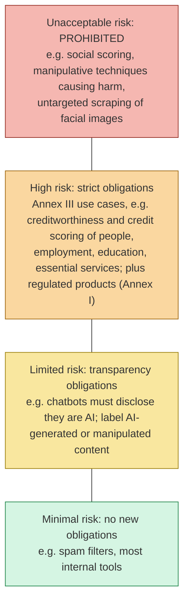

# Lesson 5.6: Governance, documentation and regulation
<!-- id: l-5-6 -->

> ⏱ ~60 min · 🎚 Level: Core · 🧰 Needs: lesson 4.1 (classification metrics), lesson 4.2 (thresholds)

[Course home](../../README.md) › [Module 5](README.md) › Lesson 5.6

> ⚖️ **Not legal advice.** This lesson explains regulatory frameworks so you can have informed conversations with your legal and compliance teams. Laws change and their application depends on facts. Always confirm with qualified counsel and the official texts linked below.

## 📨 The situation

> **From: Omar (Risk)**
> The board's risk committee meets in two weeks. They'll ask three questions about the fraud model: *What exactly is it for? Does it treat some customers unfairly? Are we compliant with the EU AI Act?* "The data scientist says it's fine" won't fly. I need documents I can hand them.
>
> **From: Priya**
> Same for the docs-assistant. And customers have to be told they're talking to an AI.

## 🎯 By the end you can

- **Write** a model card and a datasheet that answer the questions risk committees and auditors actually ask
- **Run** a group fairness audit, **interpret** false-positive and true-positive rate gaps, and **explain** why fairness metrics can conflict
- **Choose** explanation methods for tabular models (coefficients, SHAP) and for RAG (citations as provenance)
- **Place** an AI system in the EU AI Act's risk tiers, including the specific treatment of credit scoring vs fraud detection
- **Map** your controls to the NIST AI RMF functions (Govern, Map, Measure, Manage) and the Generative AI Profile

## 🤔 Predict first

1. Legitimate customers paying abroad are flagged as fraud more often than those paying at home. Is that automatically unfair? What would you need to know? <!-- id: p-5-6-1 -->
2. Can a model have equal false-positive rates across groups **and** be equally well calibrated for each group, if the groups' fraud rates differ? <!-- id: p-5-6-2 -->
3. Under the EU AI Act, is a fraud-detection model a "high-risk" AI system? <!-- id: p-5-6-3 -->

---

## 1. Governance is documentation plus decisions

**AI governance** sounds bureaucratic, but at its core it answers three questions with evidence:

1. **What is this system for, and what is it *not* for?** (scope)
2. **How do we know it works, for whom, and where it fails?** (evaluation, fairness, limitations)
3. **Who decided it was acceptable, based on what, and how do we notice when that changes?** (accountability, monitoring)

The engineering habit that makes it cheap: **documentation as code**. Model cards and datasheets live in the repo, are reviewed in pull requests, and parts of them (metrics, fairness tables) are *generated* by scripts in CI, so they can't silently drift from reality.

## 2. Model cards and datasheets

### Model cards

[*Model Cards for Model Reporting*](https://arxiv.org/abs/1810.03993) (Mitchell et al., 2019) proposed a short, standard document shipped with every model. The lab's [filled-in example](lab/docs/model-card-fraud-service.md) uses these sections:

| Section | The question it answers | From the Kestrel card |
|---|---|---|
| Intended use | What is it for? | Route risky transactions to **review** or step-up auth |
| Out of scope | What must it never be used for? | Credit decisions, account closure, decisions without human review |
| Model details | What is it, exactly? | Logistic regression, 10 features; `chargeback_filed` excluded (leakage) |
| Data | What was it trained and evaluated on? Gaps? | Synthetic, one home country, no card-testing pattern |
| Metrics | How good, by which measure? | PR-AUC (low base rate), flag rate (review workload) |
| **Fairness** | Does performance differ across groups? | Table by `domestic` / `abroad` (below) |
| Explainability | Can a reviewer see why? | Top-3 feature contributions per flag |
| Risks and monitoring | What can go wrong, how will we notice? | Drift (PSI), feedback loops, regulatory notes |
| Change log | Who approved what, when? | Version, date, approver |

> ⚠️ **Common mistake:** writing "intended use" vaguely ("fraud detection"). The **out-of-scope** list is where you prevent misuse: the day someone wants to reuse the fraud score to set credit limits, the card says no, and explains why that's a different regulatory category.

### Datasheets for datasets

[*Datasheets for Datasets*](https://arxiv.org/abs/1803.09010) (Gebru et al.) does the same for data: motivation, composition, collection, preprocessing, uses, distribution, maintenance. For a RAG system, the "dataset" is your **corpus**. The lab's [handbook datasheet](lab/docs/datasheet-handbook.md) records that the corpus contains PII (one contact), confidential content (salary bands, budget), external untrusted content with a known injection payload, and a rule that deletions must propagate to caches.

For LLM applications, teams increasingly also write a **system card**: a model card for the *whole system* (model + prompts + retrieval + guardrails + human processes), because that's what users actually interact with.

## 3. Fairness: auditing the fraud model

### Which harm, for whom?

Start from **harms**, not metrics. For a fraud model:

- A **false positive** blocks or delays a *legitimate* payment. The customer is embarrassed at a checkout, maybe stranded abroad.
- A **false negative** lets fraud through. The customer (or Kestrel) loses money.

So the natural per-group metrics are the **false-positive rate** (FPR: share of legitimate transactions wrongly flagged) and the **true-positive rate** (TPR: share of fraud caught).

The synthetic data has no protected attributes on purpose. But `country_mismatch` (paying from abroad) is a **proxy**: it correlates with nationality and migrant status, which are protected characteristics under EU non-discrimination law. Removing protected attributes from a model does not remove their influence when proxies remain. That's why you audit outcomes, not just inputs.

### The audit (real numbers from the lab)

```bash
uv run --extra governance python scripts/fairness_audit.py
```

| Group | Transactions | Fraud rate | FPR | TPR | Flag rate |
|---|---|---|---|---|---|
| abroad | 733 | 7.4% | **20.9%** | 55.6% | 23.5% |
| domestic | 14,267 | 1.1% | **0.2%** | 1.9% | 0.2% |

How to read it:

1. **FPR ratio = 20.9 / 0.2 ≈ 98×.** A legitimate customer abroad is about 98 times more likely to be wrongly flagged.
2. **Is the gap "explained" by base rates?** Fraud *is* more common abroad: 7.4% vs 1.1%, about 6.7×. Some gap in flag rates is expected and defensible. A 98× gap in *errors on legitimate customers* is far larger than the base-rate gap. The single global threshold (`P(fraud) ≥ 0.10`) pushes almost every abroad transaction near or over the line.
3. **Look at the other group's harm too.** Domestic TPR is **1.9%**: the model catches almost no domestic fraud at this threshold. Because the domestic group is 19× larger, that's where most fraud losses are. "Fair" and "effective" both fail here.

The model card records the **decision** that came out of this table (stay in shadow mode, evaluate per-segment thresholds and a stronger model, use step-up authentication instead of hard declines abroad, re-audit every release). That's the governance part: a named person accepting or rejecting a documented risk.

### Why fairness metrics conflict

Common group fairness definitions:

| Definition | Requires equal across groups… | Intuition |
|---|---|---|
| **Demographic parity** | Flag rate | Same share of each group gets flagged |
| **Equal opportunity** | TPR | Fraud is caught equally often in each group |
| **Equalized odds** | TPR **and** FPR | Errors are equally distributed |
| **Predictive parity / calibration** | Precision, or "a 10% score means 10% fraud" in each group | Scores mean the same thing for everyone |

A well-known result ([Kleinberg et al., 2016](https://arxiv.org/abs/1609.05807); Chouldechova, 2017): **when base rates differ between groups, a classifier cannot in general be calibrated within each group and also have equal FPR and FNR across groups**, except in degenerate cases such as a perfect predictor. With 7.4% vs 1.1% fraud rates, you *must* choose which property matters most for this use case, and document why. That's a product, risk and legal decision informed by engineering, not one engineering can make alone.

> 💡 **Production tip:** [Fairlearn](https://fairlearn.org/)'s `MetricFrame` computes any metric per group in one line and plugs into scikit-learn. Make the fairness table a CI artifact, regenerated on every training run and diffed in the PR, like a test coverage report.

> ⚠️ **Common mistake:** "fixing" fairness by using the protected attribute or its proxy to set per-group thresholds without legal review. Explicit group-dependent treatment can itself be unlawful discrimination in some contexts. Alternatives that often help more: better features (so the model relies less on the proxy), different *actions* (step-up auth instead of a decline), and human review for the affected segment.

## 4. Explainability

| Need | Method | Kestrel example |
|---|---|---|
| **Global**: how does the model behave overall? | Coefficients (linear models), permutation importance, partial dependence | Risk publishes the logistic regression's standardised coefficients |
| **Local**: why *this* decision? | Per-feature contributions (`coef × value` for linear models), [SHAP](https://shap.readthedocs.io/) values for any model | Each flag shows its top 3 contributions: "new device, crypto exchange, 03:00" |
| **RAG answers**: why does the assistant say this? | **Citations as provenance**: which documents (and passages) the answer came from | `AssistantAnswer.citations` with `doc_id` and `title`, validated against retrieved chunks |

For an interpretable model like logistic regression, the explanation *is* the model. For complex models, post-hoc methods like SHAP *approximate* the model's behaviour, so they're useful, but they're explanations of an approximation.

For LLM answers, be honest about what a citation explains: it shows **where the information came from**, not *how* the model reasoned. It's still the most useful explanation you can give a user or an auditor, because it can be **checked**: a human can open the document and verify the claim, which is why lesson 5.5 rejects citations to documents that weren't retrieved. (Model-generated "reasoning" text is not a reliable explanation of the model's actual computation; don't present it as one.)

## 5. The EU AI Act

The [EU AI Act (Regulation (EU) 2024/1689)](https://eur-lex.europa.eu/eli/reg/2024/1689/oj) is the first comprehensive AI law. It's **risk-based**: obligations scale with the risk of the *use case*, not with the technology.



**High-risk obligations** (for providers, broadly): a risk management system, data governance, technical documentation, automatic **logging / record-keeping**, transparency to deployers, **human oversight**, and accuracy, robustness and cybersecurity, followed by a conformity assessment. Much of this module (audit logs, guardrails, documentation, evals) is the engineering substrate for those obligations.

**General-purpose AI (GPAI) models**, the foundation models themselves, have separate obligations for their *providers* (documentation, copyright policy, and more for models with systemic risk). If you build on someone else's model, you mostly *consume* that documentation.

### Credit scoring vs fraud detection: read the exact text

Annex III lists as high-risk AI systems intended to evaluate the **creditworthiness** of natural persons or establish their **credit score**, and the same point explicitly **excludes** AI systems used **for the purpose of detecting financial fraud**. So, as a starting point:

| Kestrel system | Likely starting classification | Notes to discuss with Legal |
|---|---|---|
| `fraud-service` | Not high-risk under the creditworthiness use case (fraud-detection exclusion) | GDPR still applies, including rules on automated decisions with significant effects (Article 22) when payments are blocked without human involvement; non-discrimination law; payment-services rules. The exclusion is narrow: reuse the score for credit limits and you're in the high-risk category. |
| `docs-assistant` | Limited risk: **transparency** | Users must be informed they're interacting with an AI system (Article 50), unless obvious. Add a clear disclosure in the UI. |
| A future model that sets credit limits | **High-risk** (Annex III, creditworthiness) | Full high-risk obligations before deployment. |

> ⚠️ **Common mistake:** classifying a system once and forgetting. Classification follows the **use**, so a scope change (the fraud score "also used for credit limits") can move a system into a different tier overnight. That's exactly why the model card's *out-of-scope* section and the change log matter.

**Timeline.** The Act entered into force on 1 August 2024 and applies in stages: prohibitions from February 2025, GPAI obligations from August 2025, and most remaining obligations, including Annex III high-risk systems, from August 2026, with some product-related high-risk rules later. The EU institutions have proposed adjustments to parts of this timeline, so **check the current official status** before planning a compliance date.

## 6. NIST AI Risk Management Framework

The US [NIST AI RMF 1.0](https://www.nist.gov/itl/ai-risk-management-framework) is **voluntary** and not a law, but it's widely used as a common structure for AI risk programmes, in and outside the US. It defines characteristics of trustworthy AI (valid and reliable; safe; secure and resilient; accountable and transparent; explainable and interpretable; privacy-enhanced; fair, with harmful bias managed) and four functions:

| Function | Meaning | Where you did it in this course |
|---|---|---|
| **Govern** | Culture, policies, roles, accountability across the lifecycle | Policy registry with four-eyes review (5.7), model card approvals, change logs |
| **Map** | Understand context, intended use, stakeholders, risks | Threat model (5.1), intended use / out of scope (this lesson), EU AI Act classification |
| **Measure** | Analyse and track risks with metrics and tests | Golden-set evals (4.3), fairness audit, red-team regression tests (5.2), groundedness |
| **Manage** | Prioritise and act on risks; respond and recover | Guardrails, rollback (5.7, 4.6), incident response (6.5), monitoring and drift alerts (4.5) |

NIST's **Generative AI Profile** ([NIST AI 600-1](https://doi.org/10.6028/NIST.AI.600-1), 2024) applies the framework to generative AI and lists risks that are unique to or worsened by it. Among them: **confabulation** (confident false output, i.e. lesson 5.5's groundedness), **data privacy** (5.4), **information security** (including prompt injection, 5.2), **harmful bias and homogenisation** (this lesson), **information integrity**, **intellectual property**, and **value chain and component integration** (third-party models and data, i.e. supply chain). It also suggests concrete actions per risk, and it's an excellent checklist for an LLM system review.

> 🔎 **Under the hood:** if your organisation wants a *certifiable* management system for AI, look at **ISO/IEC 42001** (2023), the AI management system standard. It plays the role for AI that ISO/IEC 27001 plays for information security.

## 🧪 Try it

```bash
cd modules/05-security-and-governance/lab
uv run --extra governance python scripts/fairness_audit.py
```

Expected (seed 42, baseline data):

```
          transactions  fraud_rate  false_positive_rate  true_positive_rate  flag_rate
group
abroad             733       0.074                0.209               0.556      0.235
domestic         14267       0.011                0.002               0.019      0.002

FPR ratio abroad/domestic: 98.4x
```

Now experiment. In `scripts/fairness_audit.py`, change `THRESHOLD = 0.10` to `0.05`, then `0.20`, and fill in a table: overall flag rate, FPR abroad, FPR domestic, TPR domestic. Which threshold would you recommend to Omar, and what would you put in the model card's "Decision" paragraph? There's no single right answer; there *is* a wrong one: not writing down the trade-off.

## 🏭 In the real world

Model cards spread quickly after the 2019 paper: Hugging Face shows one on every model page, and major model providers publish model and system cards for their flagship releases. Read two of them for models you use and compare them to the sections above. You'll notice which questions get detailed answers (benchmarks) and which get vague ones (intended use, limitations). Make your internal cards better than that on the second kind.

## ✅ Check yourself

<details>
<summary>Q1. Why audit <code>country_mismatch</code> when it isn't a protected attribute? <!-- id: c-5-6-1 --></summary>

It's a proxy: it correlates with nationality and migrant status. Excluding protected attributes doesn't prevent disparate outcomes when proxies remain, so you audit the outcomes by the proxy.
</details>

<details>
<summary>Q2. The abroad group's fraud rate is 6.7× higher, but its FPR is 98× higher. What does that tell you, and what would you try? <!-- id: c-5-6-2 --></summary>

The gap in errors on legitimate customers is far larger than the base-rate difference explains; the single global threshold amplifies it. Try better features and models (so the score relies less on the proxy), different actions (step-up authentication instead of declines), threshold analysis per segment *with legal review*, and human review for affected cases. Document the decision either way.
</details>

<details>
<summary>Q3. State the fairness impossibility result in one sentence. <!-- id: c-5-6-3 --></summary>

When base rates differ between groups, a (non-perfect) classifier can't simultaneously be calibrated within each group and have equal false-positive and false-negative rates across groups. You have to choose and justify which property matters.
</details>

<details>
<summary>Q4. Under the EU AI Act, why is the fraud model likely not high-risk while a credit-limit model likely is? <!-- id: c-5-6-4 --></summary>

Annex III lists creditworthiness evaluation and credit scoring of natural persons as high-risk, and explicitly excludes AI systems used to detect financial fraud. Classification follows the use, so reusing the fraud score for credit limits would move it into the high-risk category. (Confirm with Legal; GDPR and other laws apply regardless.)
</details>

<details>
<summary>Q5. Map each to a NIST AI RMF function: (a) the registry's four-eyes rule, (b) the fairness audit, (c) rollback, (d) the out-of-scope section. <!-- id: c-5-6-5 --></summary>

(a) Govern, (b) Measure, (c) Manage, (d) Map.
</details>

## 💬 Explain it back
<!-- id: e-5-6 -->

Write the three-sentence answer Omar will read to the board for "Does the fraud model treat some customers unfairly?". Include one number, one decision and one follow-up.

## 🔑 Key takeaways

- Governance = documented scope + evidence + accountable decisions. Keep it **as code**, reviewed and partly generated in CI.
- **Model cards** (especially *out of scope*) and **datasheets** answer the questions auditors ask; system cards extend them to whole LLM applications.
- Fairness starts from **harms**. Audit outcomes by group *and proxy*; with different base rates, fairness definitions conflict, so choose deliberately and document it.
- For RAG, **citations are the explanation**: provenance a human can check.
- EU AI Act: risk tiers by **use case**. Credit scoring is high-risk; fraud detection is explicitly excluded from that category; chatbots carry transparency duties. NIST AI RMF (Govern, Map, Measure, Manage) and AI 600-1 give a practical structure. Confirm everything with Legal.

## 📚 Go deeper (free)

| | Resource | Why read it | Time |
|---|---|---|---|
| ⭐ | [NIST AI RMF](https://www.nist.gov/itl/ai-risk-management-framework) and [AI 600-1 Generative AI Profile](https://doi.org/10.6028/NIST.AI.600-1) | A practical, free structure for AI risk management, with concrete GenAI risks and actions | 90 min |
| 🔍 | [Mitchell et al., "Model Cards for Model Reporting"](https://arxiv.org/abs/1810.03993) | The original model card proposal: short and still the best template | 30 min |
| 🔍 | [Gebru et al., "Datasheets for Datasets"](https://arxiv.org/abs/1803.09010) | The question list for documenting data | 30 min |
| 🔍 | [Fairlearn](https://fairlearn.org/) | User guide on fairness concepts plus the `MetricFrame` API | 45 min |
| 🔍 | [Christoph Molnar, *Interpretable Machine Learning*](https://christophm.github.io/interpretable-ml-book/) | The free book on explainability methods, including SHAP and their limits | as needed |
| 🔍 | [EU AI Act: official text (EUR-Lex)](https://eur-lex.europa.eu/eli/reg/2024/1689/oj) and the [AI Act Explorer](https://artificialintelligenceact.eu/) | The law itself, plus a navigable, searchable version | as needed |

---
⬅️ [Lesson 5.5: Guardrails and groundedness](05-guardrails-and-groundedness.md) · ➡️ [Lesson 5.7: Prompt and policy registry](07-prompt-and-policy-registry.md)
