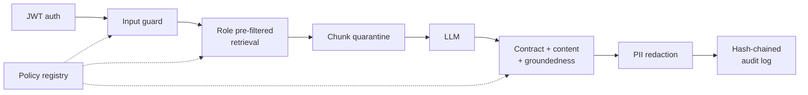

# Module 5: Security and Governance
<!-- id: m-5 -->

> ⏱ ~12 hours (7 lessons × 45–60 min + a 3–4 h lab) · Track B focus (`docs-assistant`), with Track A governance

[Course home](../../README.md) › Module 5

## 🧭 Where you are

```mermaid
flowchart LR
    M0["0 · Foundations"] --> M1["1 · Prototype → Production"] --> M2["2 · Data & Model Pipelines"] --> M3["3 · Serving & Optimization"] --> M4["4 · Evaluation & Monitoring"] --> M5["5 · Security & Governance<br/>📍 YOU ARE HERE"] --> M6["6 · Scaling & Operations"] --> C["🏆 Capstone"]
    classDef done fill:#d5f5e3,stroke:#1e8449,color:#145a32
    classDef here fill:#fdebd0,stroke:#d35400,stroke-width:3px,color:#6e2c00
    classDef todo fill:#f2f3f4,stroke:#99a3a4,color:#515a5a
    class M0,M1,M2,M3,M4 done
    class M5 here
    class M6,C todo
```

## 📨 The story so far

The docs-assistant works: it retrieves the right documents (Module 2), it's fast and cheap enough (Module 3), and you can measure its quality and roll back bad releases (Module 4). Leadership wants to open it to **customers**.

> **From: Priya (Security & compliance)**
> Before the docs-assistant goes anywhere near customers: nobody gets an answer without a valid token, a customer can **never** see HR or finance content, that partner FAQ with the hidden instructions can't hurt us, no card numbers in our logs, and every answer, and every prompt change, leaves a trail an auditor can trust.
>
> **From: Omar (Risk)**
> And the board wants to know whether the fraud model treats some customers unfairly, and where we stand on the EU AI Act.

This module turns "it works" into "it's safe to put in front of customers, and we can prove it".

## 🎯 Module objectives

By the end of this module you can:

1. **Threat-model** an LLM application and map its risks to the **OWASP Top 10 for LLM Applications (2025)**
2. **Defend** against direct and indirect **prompt injection** with independent layers, and prove each layer works with tests
3. **Implement** JWT authentication and **permission-aware retrieval** that filters before ranking
4. **Keep PII out** of prompts, logs, responses and audit trails, and explain encryption in transit and at rest
5. **Build guardrails**: structured-output contracts, content filters, groundedness checks and a tamper-evident audit log
6. **Document and govern** AI systems: model cards, datasheets, fairness audits, explanations, and the EU AI Act / NIST AI RMF
7. **Release prompt and policy changes** through review, offline checks, activation and rollback

## 📖 Lessons

| # | Lesson | You'll learn | ⏱ |
|---|---|---|---|
| 5.1 | [Threat landscape and the OWASP LLM Top 10](01-threat-landscape-and-owasp-llm-top-10.md) | Attack surface of AI systems, one-page threat models (STRIDE), the OWASP LLM Top 10, classic ML threats, what a bot costs | 50 min |
| 5.2 | [Prompt injection and jailbreaks](02-prompt-injection-and-jailbreaks.md) | Direct vs indirect injection vs jailbreaks, where payloads hide, layered defences, proving each layer | 55 min |
| 5.3 | [Authentication and authorization](03-authentication-and-authorization.md) | JWT done right (`alg: none`, key confusion), RBAC, pre-filter vs post-filter retrieval, vector store protection | 55 min |
| 5.4 | [Privacy: PII and encryption](04-privacy-pii-and-encryption.md) | Data-flow mapping, redaction vs tokenisation, Luhn and IBAN checksums, measuring redaction, TLS, envelope encryption | 50 min |
| 5.5 | [Guardrails and groundedness](05-guardrails-and-groundedness.md) | Guardrail design, output contracts (LLM05), content filters, groundedness methods and blind spots, hash-chained audit logs | 55 min |
| 5.6 | [Governance, documentation and regulation](06-governance-documentation-and-regulation.md) | Model cards, datasheets, fairness audits and their trade-offs, explainability, EU AI Act, NIST AI RMF and AI 600-1 | 60 min |
| 5.7 | [Prompt and policy registry](07-prompt-and-policy-registry.md) | Versioned bundles, four-eyes review, offline checks, activation, rollback, evals that can see your change | 45 min |

## 🛠 Lab 5: Lock down the assistant

[**→ Open the lab**](lab/README.md) · ⏱ 3–4 h · runs offline, no API keys

You get a docs-assistant that runs against a deliberately **gullible** fake model, one that obeys any instruction it finds in a document. You'll run it, attack it, switch defences off one at a time to see what each one does, and extend it.

### ✅ Definition of Done

- [ ] `uv run pytest -q` passes in `modules/05-security-and-governance/lab` (55 tests)
- [ ] You ran the Break-it experiments and can explain which layer stopped the partner-FAQ attack in each case
- [ ] You showed that a customer can't get salary-band content, and that HR text never reaches a customer's prompt
- [ ] You tampered with the audit log and the verifier caught it
- [ ] You blocked bundle 2.0.0, activated 1.1.0 and rolled back
- [ ] You can explain the fraud model's fairness table and its EU AI Act classification in two minutes
- [ ] You completed at least one 🚀 extension, with a test

## 📊 Self-assessment

Rate yourself before and after the module: **1** = never heard of it · **2** = I've heard of it · **3** = I can do it with notes · **4** = I could teach it.

| Skill | Before | After |
|---|---|---|
| Name and explain the OWASP LLM Top 10 risks with an example each | | |
| Write a one-page threat model with likelihood × impact | | |
| Explain direct vs indirect injection, and why no single defence works | | |
| Validate a JWT correctly and explain `alg: none` and key confusion | | |
| Implement permission-aware retrieval and explain why post-filtering leaks | | |
| Redact PII with checksums and measure precision/recall | | |
| Explain envelope encryption and crypto-shredding | | |
| Design a guardrail pipeline (order, fail-open vs closed, reason codes) | | |
| Compare lexical, NLI and LLM-judge groundedness checks | | |
| Build and verify a hash-chained audit log, and name its limits | | |
| Write a model card and run a fairness audit | | |
| Classify a system under the EU AI Act and map controls to NIST AI RMF | | |
| Release and roll back a prompt/policy bundle safely | | |

## 🎤 Interview corner

System-design questions this module prepares you for. Try answering out loud in 5 minutes each before looking at the lessons again.

1. **"Design a RAG assistant over a company's internal documents where different employees have different permissions."** Cover ACL sync, pre-filtering in the vector DB, per-tenant isolation, caches keyed by permissions, deletion propagation, and "not found" vs "forbidden". (5.3)
2. **"Our assistant summarises customer emails. How do you defend it against prompt injection?"** Cover the indirect injection threat model, layers, least privilege (no tools that can send data), output checks, measuring false positives, and red-team regression tests. (5.2, 5.5)
3. **"How do you stop PII from leaking through an LLM application?"** Cover the data-flow map (prompts, logs, traces, caches, evals), redaction at the edge, checksums and NER, recall measurement, provider contracts, and encryption with a KMS. (5.4)
4. **"How would you let non-engineers change the system prompt safely?"** Cover immutable versioned bundles, a UI that opens PRs, four-eyes review, automated evals with hard security gates, canary, audited rollback, and `policy_version` on every response. (5.7)
5. **"Is our fraud model fair? Is it high-risk under the EU AI Act?"** Cover harms-first metrics (FPR/TPR by group and proxy), the impossibility result, documented decisions, the fraud-detection exclusion vs credit scoring, and GDPR still applying. (5.6)

## 📝 After the lessons

- [Module 5 quiz](quiz.md): 14 questions, including spaced review from Modules 2–4
- [Module 5 cheat sheet](cheatsheet.md): one page to review before the capstone

---
⬅️ [Module 4: Evaluation and Monitoring](../04-evaluation-and-monitoring/README.md) · ➡️ [Module 6: Scaling and Operations](../06-scaling-and-operations/README.md)
