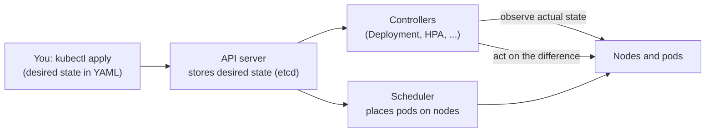
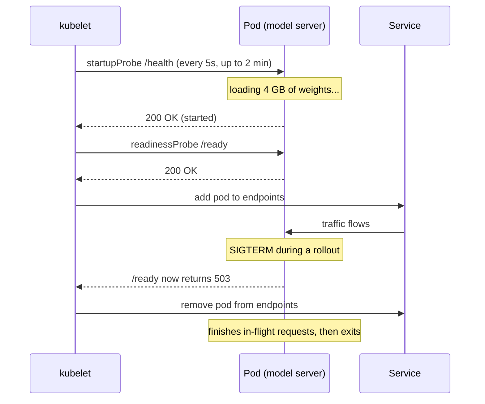
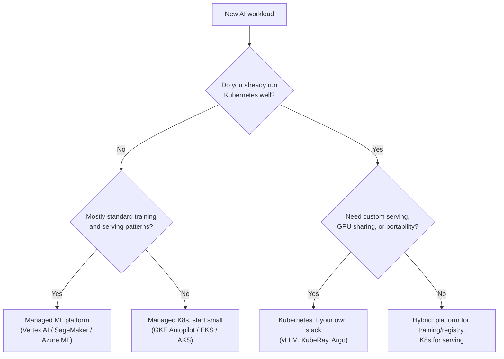

# Lesson 6.1: Kubernetes and managed ML platforms
<!-- id: l-6-1 -->

> ⏱ ~60 min · 🎚 Level: Core · 🧰 Needs: lesson 1.5 (containers)

[Course home](../../README.md) › [Module 6](README.md) › Lesson 6.1

## 📨 The situation

> **From: Diego (SRE / platform lead)**
> Nice container! Now the real world: we run ~40 services on Kubernetes across three zones.
> Your fraud-service has to survive a node dying at 03:00, scale for the evening peak, and roll out without dropping a single card authorisation.
> Also, someone in leadership read about SageMaker and Vertex AI and asked why we don't "just use that".
> Can you explain both before our architecture review on Thursday?

## 🎯 By the end you can

- **Explain** what Kubernetes does with the *desired-state reconciliation* model, in one sentence
- **Read and write** the core objects an AI service needs: Deployment, Service, ConfigMap/Secret, HPA, PodDisruptionBudget
- **Configure** startup, readiness and liveness probes correctly, and explain why getting them wrong causes outages
- **Set** CPU/memory requests and limits and predict what happens when a pod exceeds them
- **Structure** manifests per environment with Kustomize base + overlays
- **Compare** EKS, GKE, AKS and ECS, and **decide** when a managed ML platform (Vertex AI, SageMaker, Azure ML) beats DIY

## 🤔 Predict first

1. Your service's liveness probe checks that the database is reachable. The database has a 30-second blip. What does Kubernetes do to your 20 pods? <!-- id: p-6-1-1 -->
2. A pod requests 250m CPU and has no CPU limit. The node has spare CPU. Can the pod use 2 full CPUs? <!-- id: p-6-1-2 -->
3. "Managed Kubernetes" (EKS/GKE/AKS): which parts does the cloud manage, and which are still yours? <!-- id: p-6-1-3 -->

Keep your answers and check them at the end.

---

## 1. Why you need an orchestrator at all

In Module 1 you ran `docker run` on one machine. Production asks harder questions:

| Question | Without an orchestrator | With Kubernetes |
|---|---|---|
| Which machine runs which container? | You decide, by hand | The **scheduler** places pods using their resource requests |
| A container crashes at 03:00 | Someone gets paged and restarts it | The kubelet restarts it; the Deployment replaces lost pods |
| A whole machine dies | Outage until someone moves things | Pods are rescheduled on healthy nodes |
| Traffic triples at 18:00 | Buy bigger machines in advance | The **HPA** adds pods; the cluster autoscaler adds nodes |
| New version | Stop, swap, pray | **Rolling update**: replace pods a few at a time, health-checked |
| Where is service X? | Hard-coded IPs | A **Service** gives a stable DNS name and load-balances |

**Analogy.** Kubernetes is like a thermostat, not a remote control. You don't say "turn on the heater". You say "I want 21 °C" and the thermostat keeps checking and correcting. In Kubernetes you declare *desired state* ("3 replicas of image v1, each with 250m CPU") and controllers loop forever, comparing it with actual state and fixing the difference.



This reconciliation loop is the one idea to remember. It explains self-healing (actual < desired, so create pods), rolling updates (desired changed, so converge step by step), and why you should never fix production by hand with `kubectl edit`: the next `apply` from Git silently reverts you.

> 🔎 **Under the hood:** Kubernetes descends from Google's internal cluster managers Borg and Omega. The ACM Queue article *Borg, Omega, and Kubernetes* (linked below) explains why containers plus declarative APIs won.

## 2. The objects an AI service actually needs

You don't need all ~60 Kubernetes resource types. For a model-serving or RAG service, these cover 95% of the work. All of them are in your lab under `lab/k8s/base/`.

| Object | What it is | In plain words | Lab file |
|---|---|---|---|
| **Pod** | One or more containers sharing network and storage | "One running copy of my app" | (created by the Deployment) |
| **Deployment** | Manages identical pods through ReplicaSets | "Keep N copies of version X running; roll out changes safely" | `deployment.yaml` |
| **Service** | Stable virtual IP + DNS name in front of matching pods | "A phone number that always reaches a healthy copy" | `service.yaml` |
| **ConfigMap / Secret** | Configuration injected as env vars or files | "Settings outside the image" (Secret = sensitive) | generated by `kustomization.yaml` |
| **HorizontalPodAutoscaler** | Changes replica count from metrics | "Add pods when busy, remove when idle" | `hpa.yaml` |
| **PodDisruptionBudget** | Limits *voluntary* evictions | "Never drain me below 1 pod during node upgrades" | `pdb.yaml` |
| **Namespace** | A folder for resources, with quotas and access rules | "kestrel-dev vs kestrel-prod" | set by overlays |
| **Ingress / Gateway** | HTTP routing from outside the cluster | "api.kestrelpay.example/score → fraud-service" | not in the lab (cluster-specific) |

Here is the heart of `lab/k8s/base/deployment.yaml`, annotated:

```yaml
spec:
  replicas: 2
  strategy:
    rollingUpdate:
      maxSurge: 25%
      maxUnavailable: 0          # never drop below desired capacity during a rollout
  template:
    spec:
      containers:
        - name: app
          image: kestrel-platform:0.1.0
          resources:
            requests: {cpu: 250m, memory: 256Mi}   # reserved by the scheduler
            limits:   {memory: 512Mi}              # hard ceiling: exceed it and you're OOMKilled
          startupProbe:   {httpGet: {path: /health, port: http}, periodSeconds: 5, failureThreshold: 24}
          readinessProbe: {httpGet: {path: /ready,  port: http}, periodSeconds: 5, failureThreshold: 2}
          livenessProbe:  {httpGet: {path: /health, port: http}, periodSeconds: 10, failureThreshold: 3}
```

## 3. Probes: three questions, three probes

Kubernetes asks your container three different questions. Mixing them up is one of the most common causes of self-inflicted outages.

| Probe | The question | On failure | Typical check |
|---|---|---|---|
| **startupProbe** | "Have you finished starting?" | Keeps waiting (up to `periodSeconds × failureThreshold`), then restarts | Process up; weights loaded |
| **readinessProbe** | "Should I send you traffic *right now*?" | Removed from the Service's endpoints. **Not restarted** | Warm, not overloaded, not draining |
| **livenessProbe** | "Are you stuck beyond repair?" | Container **restarted** | Process responds at all |



Why this matters so much for AI services:

- **Model servers start slowly.** Loading a multi-GB model can take minutes. Without a `startupProbe`, the liveness probe kills the pod before it ever finishes loading, and it restarts forever (`CrashLoopBackOff`). The lab allows 24 × 5 s = 2 minutes.
- **Readiness is for overload and draining.** An LLM server with a full request queue can report "not ready" to shed traffic to its siblings, without being restarted.

> ⚠️ **Common mistake:** checking dependencies (database, vector DB, LLM API) in the **liveness** probe. When the dependency blips, *every* pod fails liveness at once, Kubernetes restarts them all, and a 30-second blip becomes a 5-minute outage with cold caches. Liveness checks the process only. Dependencies belong (carefully) in readiness, or better, in your graceful-degradation logic (lesson 1.3).

That's the answer to Predict question 1: all 20 pods get restarted, roughly at the same time.

In the lab, `/health` is dumb on purpose, and `/ready` returns 503 when `KESTREL_READY=false`:

```python
@router.get("/health")
async def health() -> dict[str, str]:
    """Liveness: keep it dumb. Never check dependencies here."""
    return {"status": "ok"}
```

> 💡 **Production tip:** add a `preStop` hook (the lab sleeps 5 s) and a sensible `terminationGracePeriodSeconds`. When a pod is told to stop, the load balancer may keep sending it traffic for a few seconds. The pause lets endpoints update so in-flight card authorisations aren't dropped.

## 4. Requests, limits and what happens when you exceed them

- **Requests** are what the scheduler *reserves* on a node. A node with 4 CPUs fits 16 pods requesting 250m each. HPA percentages are relative to requests.
- **Limits** are hard ceilings enforced at runtime.

| Resource | Exceeding the limit means | Consequence |
|---|---|---|
| CPU | The container is **throttled** (slowed down) | Latency spikes, no crash |
| Memory | The container is **OOMKilled** | Restart, failed in-flight requests |
| GPU | Requested as whole devices (`nvidia.com/gpu: 1`); no overcommit | Covered in lesson 6.3 |

The lab sets a memory limit but **no CPU limit**. That's a deliberate, common production choice: CPU throttling causes mysterious tail latency, while a pod using idle CPU harms no one as long as requests are honest. So for Predict question 2: yes, the pod can burst to 2 CPUs if the node has spare capacity, and it's guaranteed only its 250m.

> ⚠️ **Common mistake:** requests far below real usage. The scheduler packs too many pods onto a node, they fight for CPU, and p95 latency doubles under load, which looks like a code problem but isn't. Set requests from measured usage (lesson 3.4), for example p90 CPU under realistic load.

## 5. One base, many environments: Kustomize overlays

Dev and prod are *mostly* the same, and the differences must be intentional and reviewable. Kustomize (built into `kubectl`) does this without templates:

```
lab/k8s/
  base/                 shared: deployment, service, hpa, pdb, configmap
  overlays/dev/         namespace kestrel-dev, 1 replica, fake secret, DEBUG logs
  overlays/prod/        namespace kestrel-prod, 3 replicas, pinned image, node pool, no secret
  rollout/              prod + Argo Rollouts canary (lesson 6.4)
```

Two Kustomize features do a lot of production work for you:

1. **`configMapGenerator` adds a content hash to the name** (`kestrel-platform-config-6694f4526g`). Change a config value, the name changes, the pod template changes, and Kubernetes rolls the pods. Without that, pods keep running with stale config.
2. **Secrets are generated only in dev.** Prod gets its Secret from a secret manager such as [External Secrets Operator](https://external-secrets.io/) or Sealed Secrets, never from Git (Module 5).

**Helm vs Kustomize** in one line: Helm is a *package manager with templates* (great for distributing software like Prometheus to many users); Kustomize is *patching plain YAML* (great for your own services). Many teams install third-party software with Helm and deploy their own services with Kustomize.

> 💡 **Production tip:** in prod, pin images by **digest** (`image@sha256:...`), not by tag. Tags are mutable; digests are not. This is the container version of the versioned, sha256-checked model artifacts from lesson 1.5.

## 6. Managed Kubernetes: EKS, GKE, AKS, and ECS as an alternative

Running the Kubernetes *control plane* yourself (API server, etcd, scheduler) is hard and unrewarding. Every major cloud runs it for you:

| | Amazon **EKS** | Google **GKE** | Azure **AKS** |
|---|---|---|---|
| Control plane | Managed | Managed | Managed |
| "Even less to manage" mode | EKS with Fargate (serverless pods) | **GKE Autopilot** (Google manages nodes) | Virtual nodes / managed node options |
| Typical node autoscaling | Cluster Autoscaler or [Karpenter](https://karpenter.sh/) | Built-in node autoscaling | Built-in cluster autoscaler |
| GPU nodes | Yes (GPU instance types) | Yes (GPU node pools) | Yes (GPU node pools) |
| Fits best if you already use | AWS | Google Cloud | Azure |

**What stays yours, even on managed Kubernetes** (Predict question 3): your manifests, node pool sizing, upgrades of your workloads, network policies, RBAC, secrets handling, observability, cost, and incidents. "Managed" removes the control plane, not operations.

**Amazon ECS** is AWS's own, simpler container orchestrator. You define *task definitions* (≈ pod specs) and *services* (≈ Deployments + load balancing), optionally on Fargate with no servers to manage. It has fewer concepts and less flexibility.

| Choose… | When |
|---|---|
| **ECS (+ Fargate)** | Small team, all-in on AWS, a handful of stateless services, no GPU scheduling needs, no Kubernetes skills in-house |
| **Managed Kubernetes** | Many services, multiple teams, portability across clouds, GPU workloads, you want the Kubernetes ecosystem (Argo Rollouts, KEDA, KubeRay, vLLM operators) |
| **Serverless (Cloud Run, Lambda, Container Apps)** | Spiky, low-volume HTTP services; scale to zero matters more than control |

## 7. Managed ML platforms: Vertex AI, SageMaker, Azure ML

These platforms bundle the whole ML lifecycle as managed services. The building blocks map almost one-to-one onto what you built in this course:

| Lifecycle step | What you built in this course | Vertex AI | SageMaker | Azure ML |
|---|---|---|---|---|
| Notebooks | Your laptop | Workbench | Studio | Notebooks / compute instances |
| Training jobs | `uv run python train.py` | Custom training jobs | Training jobs | Command jobs |
| Pipelines | `orchestration/` DAG (lesson 6.2) | Vertex AI Pipelines | SageMaker Pipelines | Azure ML pipelines |
| Experiment tracking and registry | MLflow (lesson 2.6) | Experiments + Model Registry | Experiments + Model Registry | Built-in MLflow tracking + registry |
| Serving | FastAPI + vLLM on Kubernetes | Endpoints | Real-time / serverless / async endpoints | Managed online endpoints |
| Monitoring | Prometheus + drift checks (Module 4) | Model Monitoring | Model Monitor | Model monitoring |
| Hosted foundation models | Ollama / OpenAI-compatible APIs | Model Garden | JumpStart / Bedrock (separate service) | Model catalog / Azure OpenAI |

**When a managed ML platform wins**

- A small ML team with no platform engineers: you rent the platform instead of building it.
- Bursty training with GPUs you don't want to own.
- Compliance teams already approved the cloud's ML services.

**When Kubernetes (DIY) wins**

- You already run Kubernetes well (Kestrel does: Diego's team).
- You need the latest serving stack (vLLM, SGLang) on your terms, or custom GPU sharing.
- Multi-cloud or on-prem constraints, or cost at scale: managed endpoints carry a markup over raw compute.



> ⚠️ **Common mistake:** treating this as all-or-nothing. Many teams use a managed platform for **training and the registry** and their own Kubernetes for **serving**, or the reverse. Choose per lifecycle step.

> 💡 **Production tip:** whatever you pick, keep your business logic platform-agnostic (the lab's `domain/` has zero framework imports). Then the platform decision is reversible, which is exactly what leadership should hear on Thursday.

## 🧪 Try it

In the [lab](lab/README.md):

1. **Step 1:** run the service, then restart it with `KESTREL_READY=false`. Confirm `/health` → 200 while `/ready` → 503. Explain what Kubernetes would do with that pod (keep it, send it no traffic).
2. **Step 3:** run `diff <(kubectl kustomize k8s/overlays/dev) <(kubectl kustomize k8s/overlays/prod)` and list every difference. Expected: namespace, replica count, HPA bounds, PDB, image name/tag, resources, nodeSelector, the dev-only Secret, and the log level in the ConfigMap (with a different hash suffix).
3. **Step 7 (optional):** on kind, delete a pod and watch the Deployment replace it: `kubectl -n kestrel-dev get pods -w`.

## 🏭 In the real world

Most production AI platforms you'll meet have this shape: managed Kubernetes for stateless APIs and model servers, a separate GPU node pool for inference (lesson 6.3), a managed database and vector store outside the cluster, and a managed or self-hosted ML platform for training. The interesting design decisions are rarely "Kubernetes or not". They are **where the state lives**, **how releases are gated** (lesson 6.4), and **who gets paged** (lesson 6.5).

## ✅ Check yourself

<details><summary>Q1. In one sentence, what does a Kubernetes controller do? <!-- id: c-6-1-1 --></summary>

It continuously compares the desired state stored in the API server with the actual state of the cluster and takes actions to remove the difference (the reconciliation loop).
</details>

<details><summary>Q2. Your model server takes 90 seconds to load weights. Liveness is checked every 10 s with failureThreshold 3, and there is no startupProbe. What happens? <!-- id: c-6-1-2 --></summary>

After about 30 s of failed liveness checks the container is restarted, before it ever finishes loading. It loops in `CrashLoopBackOff` forever. Fix: add a `startupProbe` with enough budget (for example `periodSeconds: 5`, `failureThreshold: 30`), which disables liveness checks until startup succeeds.
</details>

<details><summary>Q3. What's the difference between failing readiness and failing liveness? <!-- id: c-6-1-3 --></summary>

Failing readiness removes the pod from Service endpoints: no traffic, no restart. Failing liveness restarts the container. Use readiness for "temporarily unable to serve" (warming up, overloaded, draining) and liveness only for "stuck beyond repair".
</details>

<details><summary>Q4. Why does the lab set a memory limit but no CPU limit? <!-- id: c-6-1-4 --></summary>

Exceeding a CPU limit causes throttling, which shows up as unexplained tail latency. Using idle CPU above the request harms nobody, as long as requests reflect real usage. Exceeding memory can destabilise the whole node, so memory gets a hard limit (the container is OOMKilled instead).
</details>

<details><summary>Q5. Name two situations where ECS or a managed ML platform is a better choice than self-managed serving on Kubernetes. <!-- id: c-6-1-5 --></summary>

For example: a small AWS-only team with a few stateless services and no Kubernetes expertise (ECS + Fargate); a small ML team with bursty GPU training and standard serving needs (a managed ML platform). Any answer that weighs team skills, workload type and operational burden is good.
</details>

<details><summary>Q6. Why does the ConfigMap name end in a hash, and why does that matter for production safety? <!-- id: c-6-1-6 --></summary>

Kustomize hashes the ConfigMap contents into its name. A config change creates a new name, which changes the pod template and triggers a normal, health-checked rolling update. Config changes then go through the same safe rollout path as code changes, and old pods keep the old config until they are replaced.
</details>

## 💬 Explain it back
<!-- id: e-6-1 -->

Explain to Maya, who is not an engineer, why "the pod is alive but not ready" is a *good* state for a model server to be in sometimes. Use the restaurant analogy: a waiter who is on shift but not taking new tables right now.

## 🔑 Key takeaways

- Kubernetes is a **reconciliation loop**: you declare desired state and controllers converge on it. Never hand-edit production.
- An AI service needs about 7 objects: Deployment, Service, ConfigMap/Secret, HPA, PDB, Namespace, plus an Ingress/Gateway.
- **Startup, readiness and liveness answer different questions.** Never check dependencies in liveness.
- Requests drive scheduling and HPA; CPU over the limit throttles, memory over the limit kills.
- Base + overlays keep environment differences small, explicit and reviewable.
- "Managed" removes the control plane, not operations. Pick ECS, managed K8s or an ML platform **per lifecycle step**, based on team and workload.

## 📚 Go deeper (free)

| | Resource | Why read it | Time |
|---|---|---|---|
| ⭐ | [Kubernetes Basics tutorial](https://kubernetes.io/docs/tutorials/kubernetes-basics/) | Official hands-on intro: deploy, expose, scale, update | 1 h |
| ⭐ | [Configure liveness, readiness and startup probes](https://kubernetes.io/docs/tasks/configure-pod-container/configure-liveness-readiness-startup-probes/) | The canonical reference for section 3 | 20 min |
| 🔍 | [Kubernetes concepts](https://kubernetes.io/docs/concepts/) | Pods, workloads, services, config, scheduling in depth | as needed |
| 🔍 | [Kustomize](https://kustomize.io/) | Bases, overlays, generators, patches | 30 min |
| 🔍 | [Borg, Omega, and Kubernetes (ACM Queue)](https://queue.acm.org/detail.cfm?id=2898444) | Why Kubernetes looks the way it does, from its designers | 30 min |
| 🔍 | [Kubernetes the Hard Way](https://github.com/kelseyhightower/kubernetes-the-hard-way) | Build a cluster by hand to really understand the control plane | 1 day |
| 🔍 | [kind](https://kind.sigs.k8s.io/) | Local clusters in Docker, used in the lab | 10 min |
| 🔍 | [Amazon EKS](https://docs.aws.amazon.com/eks/) · [GKE](https://cloud.google.com/kubernetes-engine/docs) · [AKS](https://learn.microsoft.com/azure/aks/) · [Amazon ECS](https://docs.aws.amazon.com/ecs/) | Official docs; read each "what is" page and compare | 30 min |
| 🔍 | [Vertex AI](https://cloud.google.com/vertex-ai/docs) · [SageMaker](https://docs.aws.amazon.com/sagemaker/) · [Azure Machine Learning](https://learn.microsoft.com/azure/machine-learning/) | Map each platform's components onto the table in section 7 | 45 min |

---
⬅️ [Previous: Lesson 5.7 Prompt and policy registry](../05-security-and-governance/07-prompt-and-policy-registry.md) · ➡️ [Next: Lesson 6.2 Workflow orchestration](02-workflow-orchestration.md)
