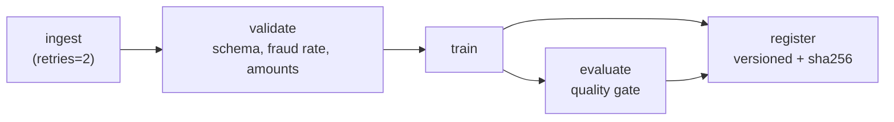
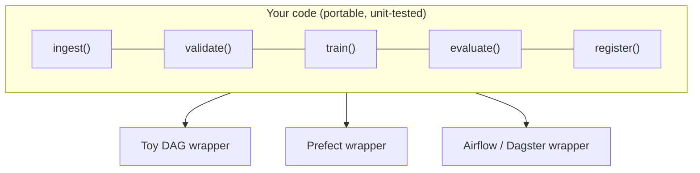

# Lesson 6.2: Workflow orchestration

> ⏱ ~50 min · 🎚 Level: Core · 🧰 Needs: lessons 2.1 (data pipelines) and 2.6 (experiment tracking)

[Course home](../../README.md) › [Module 6](README.md) › Lesson 6.2

## 📨 The situation

> **From: Sam (data scientist)**
> Confession: the fraud model is retrained by a cron job on my VM. It runs `retrain.sh` every Sunday at 02:00.
> Last month the data export was late, the script trained on half a week of data, and nobody noticed for 9 days.
> The month before, it failed halfway and left a broken model file in the registry folder.
> Diego says "use an orchestrator". There are like ten of them. Which one, and what do they actually *do*?

## 🎯 By the end you can

- **Explain** what an orchestrator adds on top of cron: dependencies, retries, failure isolation, backfills, observability
- **Model** an ML pipeline as a DAG, and **write** tasks that are idempotent and safe to retry
- **Compare** Airflow, Prefect, Dagster, Kubeflow Pipelines and Ray, and **choose** one for a given team and workload
- **Separate** business logic from orchestration code so you can switch tools later
- **Recognise** when you need *continuous training* and when CI/CD is enough (link to lesson 4.6)

## 🤔 Predict first

1. Sam's cron job trained on half a week of data and "succeeded". Which feature of an orchestrator would have stopped that, and which would not have?
2. A task writes `model.joblib` and then crashes before writing `metadata.json`. You retry it. What must be true about the task for the retry to be safe?
3. Is Ray an orchestrator like Airflow?

---

## 1. Cron is a timer, not an orchestrator

Cron answers exactly one question: *when* to start a command. Everything else is on you:

| Need | Cron | Orchestrator |
|---|---|---|
| Run B only after A succeeded | Chain with `&&` in a shell script | Declared dependencies (a DAG) |
| A flaky download | Script fails, nobody knows | Automatic retries with backoff |
| Step 3 fails | Steps 4–5 may run on garbage | Downstream tasks are **skipped** |
| "What ran last Sunday, and how long did it take?" | grep some log files | Run history, durations, logs per task in a UI |
| Re-run January for a bug fix | Hand-edit dates, hope | **Backfill** a date range |
| Data arrives late | Runs anyway on partial data | Sensors / data-aware triggers wait for the data |
| Alert on failure | Write it yourself | Built-in notifications |

The key word is **DAG**: *directed acyclic graph*. Tasks are nodes, dependencies are arrows, and there are no cycles (otherwise "what runs first?" has no answer).



This is the pipeline in `lab/orchestration/pipeline.py`. Notice that `register` depends on **both** `train` (it needs the model) and `evaluate` (it must not register a model that failed the gate).

Back to Predict question 1: an orchestrator by itself would *not* have caught the half-week of data. The run succeeded. What catches it is a **validation task** that fails loudly (lesson 2.1): "row count below 80% of last week's" or "max timestamp older than 24 h". The orchestrator's job is to make sure that when validation fails, training never runs and someone is alerted.

## 2. Build a tiny orchestrator to see the magic disappear

The lab includes a ~100-line engine (`lab/orchestration/dag.py`) so you can see that the core of every orchestrator is simple:

```python
def topological_order(self) -> list[str]:
    """Kahn's algorithm: repeatedly run tasks whose dependencies are all done."""
    indegree = {n: len(s.upstream) for n, s in self.tasks.items()}
    ready = sorted(n for n, d in indegree.items() if d == 0)
    order = []
    while ready:
        current = ready.pop(0)
        order.append(current)
        for name, spec in sorted(self.tasks.items()):
            if current in spec.upstream:
                indegree[name] -= 1
                if indegree[name] == 0:
                    ready.append(name)
    if len(order) != len(self.tasks):
        raise CycleError("cycle detected")
    return order
```

And the run loop does three things: retries, records, and **skips downstream of failures**:

```python
for name in self.topological_order():
    if any(runs[u].status != "success" for u in spec.upstream):
        runs[name] = TaskRun(name, "skipped")      # never train on unvalidated data
        continue
    for attempt in range(1, spec.retries + 2):     # retries for transient failures
        try:
            results[name] = spec.fn(results)
            ...
```

What real orchestrators add on top of this toy, and why you shouldn't build your own:

1. **Scheduling**: cron expressions, event triggers, data-aware triggers
2. **Distributed execution**: tasks run on workers, Kubernetes pods, or GPU nodes
3. **Persistent state**: survive a scheduler restart mid-run; resume from the failed task
4. **UI and observability**: run history, logs, durations, lineage
5. **Backfills and partitions**: "re-run every day of March"
6. **Caching**: skip a task whose inputs haven't changed

## 3. Tasks must be idempotent and atomic

Retries are only safe if running a task twice has the same effect as running it once. That's **idempotency**, the property the cron job lacked in Sam's second story.

| Non-idempotent (dangerous) | Idempotent (safe) |
|---|---|
| `INSERT` today's rows into the training table | `DELETE WHERE day = X; INSERT ...` or `MERGE` on a key |
| Write directly to `registry/latest/model.joblib` | Write to a new versioned folder, then flip a pointer |
| "Process new files since the last run" (depends on hidden state) | "Process the partition for date X" (explicit input) |
| Send the "model promoted" email in the training task | Separate notification task, deduplicated by run ID |

For Predict question 2, the lab's `register` task is designed for this:

```python
version = datetime.now(timezone.utc).strftime("%Y%m%dT%H%M%S")
target = workdir / "registry" / "fraud-model" / version      # new folder per run
joblib.dump(trained["model"], target / "model.joblib")
meta = {"sha256": ..., "data_sha256": ..., "metrics": metrics, "stage": "staging"}
(target / "metadata.json").write_text(json.dumps(meta))      # metadata last
```

A crash leaves at most an *incomplete new folder* that nothing points to. It never corrupts the current model. Consumers only trust folders that have `metadata.json`, which is written last. In object storage you'd do the same: write the artifacts, then write the manifest or flip the registry stage.

> ⚠️ **Common mistake:** passing big data between tasks *through the orchestrator* (for example Airflow XComs holding a DataFrame). Orchestrators move **references** (a path, a table name, a partition key); the data lives in storage. The lab passes Python objects only because it runs in one process.

> 💡 **Production tip:** make every task a function of explicit inputs, like `run(date="2026-11-08")`. "Explicit partition in, deterministic output out" makes retries, backfills and debugging trivial. This idea is often called *functional data engineering*.

## 4. The tools, honestly compared

| Tool | Mental model | Strengths | Watch out for | Typical ML use |
|---|---|---|---|---|
| **Apache Airflow** | Scheduled DAGs of tasks (Python-defined) | Most widely deployed; huge operator ecosystem; managed versions on all clouds | Heavier to run; historically task-centric rather than data-centric; local testing takes effort | Batch ETL + nightly retraining in data-platform teams |
| **Prefect** | Python functions become `@flow`s and `@task`s | Very Pythonic, little boilerplate; dynamic workflows; easy local runs | Fewer pre-built integrations than Airflow | Python-heavy ML teams wanting fast iteration |
| **Dagster** | **Assets** (tables, models) and how to materialise them | Data-aware: lineage, freshness, partitions as first-class; great local dev and testing | Asset thinking takes a shift if you're used to tasks | Teams that think in "the features table and the model are products" |
| **Kubeflow Pipelines** | Each step is a container on Kubernetes | Native to K8s; GPU steps; ML-specific (experiments, artifacts) | Needs a Kubernetes platform team; heavier setup | Large ML platforms already on Kubernetes |
| **Ray** | Distributed Python compute (tasks, actors), plus Train / Tune / Serve libraries | Scales Python across many machines; hyperparameter tuning; distributed training and batch inference | It's a *compute engine*, not a scheduler: no cron or backfill UI on its own | The heavy step inside a pipeline (distributed training, batch embedding) |

Predict question 3: **no**. Ray answers "how do I run this Python code across 50 machines?", while Airflow, Prefect and Dagster answer "what runs, when, in which order, and what happened?". A common pattern is *Airflow/Dagster/Prefect calling a Ray job* for the heavy step. (Argo Workflows is another Kubernetes-native option, often paired with Argo CD and Argo Rollouts.)

### Choosing: a decision table

| Your situation | Good default |
|---|---|
| Data team already runs Airflow for ETL | **Airflow**: add ML DAGs there and don't run two schedulers |
| Small Python ML team, greenfield, wants to move fast | **Prefect** or **Dagster** |
| Data quality, freshness and lineage are your main pain | **Dagster** (assets, freshness checks) |
| Everything is on Kubernetes, steps need GPUs, platform team exists | **Kubeflow Pipelines** (or Argo Workflows) |
| One step needs many machines (distributed training, batch inference over 100M docs) | Keep your orchestrator, run that step on **Ray** |
| Already on a cloud ML platform | Its native pipelines (Vertex AI Pipelines, SageMaker Pipelines, Azure ML pipelines), at least for training |

## 5. Keep business logic out of the orchestrator

The lab ships the same pipeline twice: once on the toy DAG (`pipeline.py`) and once as a Prefect flow (`prefect_flow.py`). Look at how little changes:

```python
# prefect_flow.py: reuses the exact same five functions
from prefect import flow, task
from orchestration import pipeline

ingest = task(pipeline.ingest, retries=2, retry_delay_seconds=5)
validate = task(pipeline.validate)
train = task(pipeline.train)
evaluate = task(pipeline.evaluate)
register = task(pipeline.register)

@flow(name="fraud-training", log_prints=True)
def fraud_training(workdir=Path("artifacts/prefect"), rows=20_000, seed=42):
    raw = ingest(workdir, rows, seed)
    trained = train(validate(raw), seed)
    return register(workdir, trained, evaluate(trained), raw)
```

The functions `ingest`, `validate`, `train`, `evaluate` and `register` are plain Python that you can unit-test (`tests/test_dag.py`) without any orchestrator. The orchestrator is a thin wrapper.



> ⚠️ **Common mistake:** 500-line Airflow DAG files with SQL, feature logic and model code inline. They are impossible to test without the scheduler and impossible to migrate. If your DAG file is more than wiring, refactor.

## 6. Continuous training vs CI/CD

From lesson 4.6: **CI/CD** ships *code* changes; **continuous training (CT)** produces new *models* from new *data* with unchanged code. The orchestrator owns CT:

| Trigger | Example | Guardrail |
|---|---|---|
| Schedule | Weekly retrain of the fraud model | Validation gate + quality gate before registration |
| Data volume | Retrain when 1M new labelled transactions exist | Check label delay (fraud labels arrive weeks late, lesson 6.7) |
| Drift alert | Data-drift monitor fires (lesson 4.5) | A human looks before auto-promotion |
| Performance drop | PR-AUC on recent labelled data falls | Same release process as code: canary (lesson 6.4) |

The pipeline *registers* models as `staging`. **Promotion to production is a separate, reviewed step** that goes through the canary in lesson 6.4. A retraining pipeline that deploys straight to production is a self-modifying system with no human in the loop.

> 💡 **Production tip:** the lab's quality gate compares PR-AUC with the **base rate** (it requires a 3× lift) instead of a magic absolute number. On imbalanced problems an absolute threshold quietly becomes meaningless when the fraud rate shifts. Better still, gate on "not worse than the current production model on the same holdout" (champion/challenger).

## 🧪 Try it

In the [lab](lab/README.md), step 6:

```bash
uv run python -m orchestration.pipeline --rows 20000
```

Expected: all five tasks ✅ and a new folder under `artifacts/pipeline/registry/fraud-model/`.

Then break it on purpose:

1. In `pipeline.py`, change the validation band to `0.05 <= fraud_rate <= 0.10` and run again. Expected: `❌ validate`, then `⏭ train`, `⏭ evaluate` and `⏭ register` are **skipped**, and the process exits with code 1. Nothing was registered. Revert.
2. Run `uv run pytest tests/test_dag.py -v` and read `test_failure_skips_downstream_and_retries`: a flaky task succeeds on its 3rd attempt while an independent branch keeps running.
3. (Optional) `uv sync --extra prefect && uv run python -m orchestration.prefect_flow`, then `uv run prefect server start` and look at the run in the UI.

## 🏭 In the real world

In most organisations the orchestrator choice was made before you arrived, usually by the data engineering team, and the right move is to **use what exists** unless it truly can't do the job. Running two schedulers means two places to look at 03:00. Where teams do choose fresh, the trend has been toward data-aware tools (assets, freshness, lineage) because ML failures are more often *bad data* than *failed tasks*.

## ✅ Check yourself

<details><summary>Q1. List three things an orchestrator gives you that cron does not.</summary>

Any three of: dependency ordering, retries with backoff, skipping downstream tasks on failure, run history and logs, backfills, data-aware triggers or sensors, alerting, distributed execution, caching.
</details>

<details><summary>Q2. What makes a task idempotent? Give an example of fixing a non-idempotent task.</summary>

Running it more than once has the same effect as running it once. Example: replace "append today's rows" with "delete the partition for date X, then insert", or with a `MERGE` on a primary key. Or write models to a new versioned folder and flip a pointer, instead of overwriting `latest/`.
</details>

<details><summary>Q3. A teammate wants to replace Airflow with Ray "because it's faster". What's the misunderstanding?</summary>

Ray is a distributed compute engine, not a workflow scheduler. It speeds up the heavy step but doesn't provide scheduling, backfills, run history or failure handling across steps. The usual design is the orchestrator triggering Ray jobs.
</details>

<details><summary>Q4. Why does the lab's `register` task depend on both `train` and `evaluate`?</summary>

It needs the trained model (from `train`), and it must only run if the quality gate in `evaluate` passed. Depending on `evaluate` means a failed gate skips registration automatically.
</details>

<details><summary>Q5. Your team uses Dagster. Product asks for a daily retrain with automatic deployment to production. What do you push back on?</summary>

Automatic *registration* is fine; automatic *promotion* to production should go through the same release process as code: an eval gate, then a canary with auto-rollback (lesson 6.4), with a human able to stop it. Also check that labels for the newest data actually exist, since fraud labels are delayed.
</details>

## 💬 Explain it back

Explain to Sam, using their two cron incidents, which *specific* orchestrator features and which *specific* tasks would have prevented each one. (Hint: one is about a validation task, the other about idempotent, atomic registration.)

## 🔑 Key takeaways

- Cron decides **when**. An orchestrator manages **what, in what order, with what retries, and what happened**.
- Pipelines are DAGs; a failed task must skip everything downstream of it.
- **Idempotent, explicitly-partitioned tasks** make retries and backfills safe. Write new versions, then flip pointers.
- Airflow, Prefect and Dagster schedule workflows; Kubeflow runs container steps on K8s; **Ray is compute, not a scheduler**.
- Keep business logic in plain, tested functions; the orchestrator is a thin wrapper.
- Retraining registers models; **promotion goes through the release process**.

## 📚 Go deeper (free)

| | Resource | Why read it | Time |
|---|---|---|---|
| ⭐ | [Dagster University](https://courses.dagster.io/) | Free courses that teach asset-based orchestration hands-on | 2–3 h |
| ⭐ | [MLOps Zoomcamp](https://github.com/DataTalksClub/mlops-zoomcamp) | Free course module on orchestrating ML pipelines end to end | 3 h |
| 🔍 | [Apache Airflow documentation](https://airflow.apache.org/docs/) | Concepts (DAGs, operators, scheduling) and best practices | 1 h |
| 🔍 | [Prefect documentation](https://docs.prefect.io/) | Flows, tasks, retries, caching, deployments | 45 min |
| 🔍 | [Kubeflow Pipelines](https://www.kubeflow.org/docs/components/pipelines/) | Container-native ML pipelines on Kubernetes | 45 min |
| 🔍 | [Ray documentation](https://docs.ray.io/) | Ray Core, Train, Tune, Serve, and KubeRay | 1 h |
| 🔍 | [Data Engineering Zoomcamp](https://github.com/DataTalksClub/data-engineering-zoomcamp) | Workflow orchestration module with real pipelines | 3 h |

---
⬅️ [Previous: Lesson 6.1 Kubernetes and managed platforms](01-kubernetes-and-managed-platforms.md) · ➡️ [Next: Lesson 6.3 GPUs, autoscaling and capacity](03-gpus-autoscaling-and-capacity.md)
