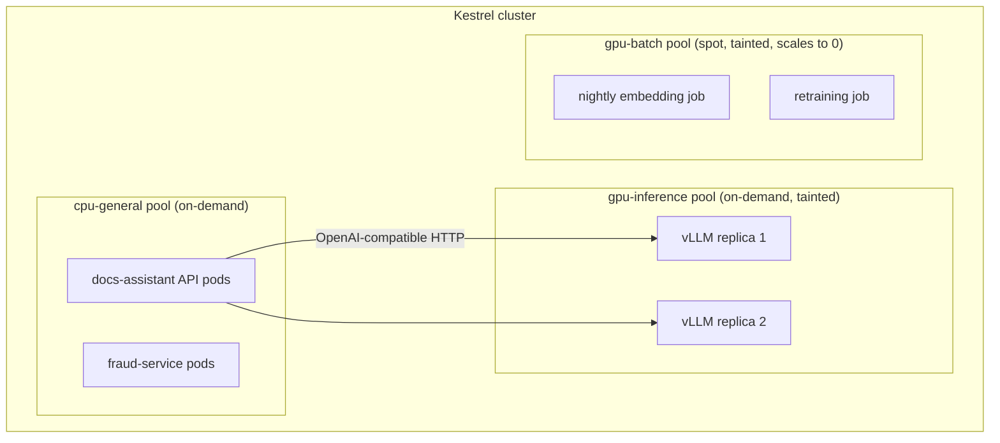
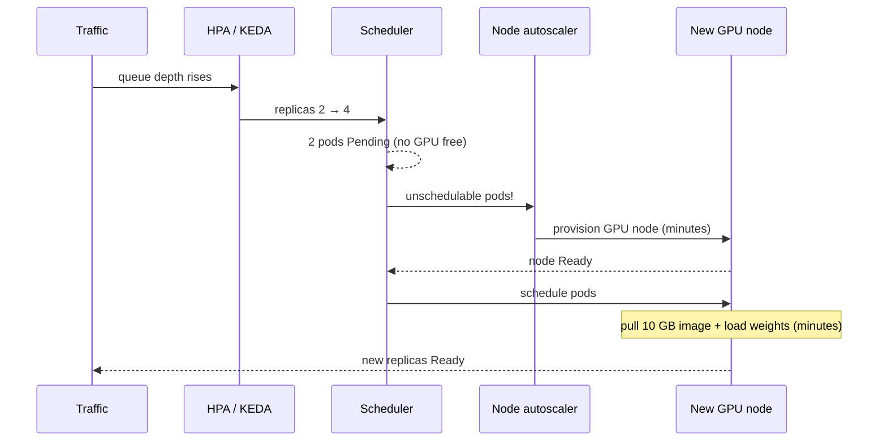

# Lesson 6.3: GPUs, autoscaling and capacity planning

> ⏱ ~60 min · 🎚 Level: Advanced · 🧰 Needs: lessons 3.2 (LLM inference), 3.5 (batching and autoscaling), 6.1

[Course home](../../README.md) › [Module 6](README.md) › Lesson 6.3

## 📨 The situation

> **From: Lena (Head of Customer Support)**
> The docs-assistant pilot is a hit. We want it for all 300 support agents and, in Q1, for customers in the app.
> Finance wants to know how many GPUs we need and what it costs per month, and Diego wants to know if the cluster can handle the evening peak.
> I can't give them "it depends". Can you give me a number and show your working?

## 🎯 By the end you can

- **Schedule** GPU workloads on Kubernetes using device resources, node pools, taints and tolerations
- **Explain** the layers of autoscaling (pods, nodes, events) and **pick the right scaling signal** for CPU services vs LLM servers
- **Use Little's Law** to turn traffic and latency into required concurrency
- **Compute** replicas and monthly cost from first principles, and **defend** every assumption
- **Plan headroom** for failures, cold starts and growth

## 🤔 Predict first

1. Your LLM server's GPU sits at 100% "utilisation" in `nvidia-smi`, but latency is fine. Should the autoscaler add a replica?
2. The assistant gets 20 requests/s and each takes 3 s end to end. How many requests are in flight at any moment?
3. Can two pods share one GPU by each requesting `nvidia.com/gpu: 0.5`?

---

## 1. GPUs on Kubernetes: the mechanics

Kubernetes doesn't know about GPUs out of the box. A **device plugin** (usually installed by the [NVIDIA GPU Operator](https://docs.nvidia.com/datacenter/cloud-native/gpu-operator/latest/index.html), together with drivers and monitoring) advertises them as an extended resource, `nvidia.com/gpu`. Pods request GPUs like CPU, with one big difference: **GPUs are whole, integer, non-overcommittable units.**

```yaml
# A vLLM server pod spec (excerpt)
spec:
  nodeSelector:
    kestrel.example.com/pool: gpu-inference     # only GPU nodes
  tolerations:
    - key: nvidia.com/gpu                       # GPU nodes are tainted so that
      operator: Exists                          # ordinary pods can't land on them
      effect: NoSchedule
  containers:
    - name: vllm
      image: vllm/vllm-openai:<pinned-version>
      resources:
        limits:
          nvidia.com/gpu: 1                     # integer only: 0.5 is invalid
          memory: 32Gi
```

Three ideas make GPU scheduling work:

| Mechanism | What it does | Why you need it |
|---|---|---|
| **Node pools** | Groups of identical nodes (for example `cpu-general`, `gpu-inference`, `gpu-batch-spot`) | Different hardware for different workloads; scale and pay for each pool separately |
| **Taints + tolerations** | GPU nodes *repel* pods unless the pod *tolerates* the taint | Stops a log shipper from taking the last slot on a €2/hour GPU node |
| **nodeSelector / affinity** | Pods *attract* to matching nodes | Puts the model server on the right GPU type |

Predict question 3: **no**. `nvidia.com/gpu` must be an integer. Sharing is possible through other mechanisms:

- **MIG (Multi-Instance GPU)** on supported datacenter GPUs splits one GPU into isolated slices that appear as separate devices. Real isolation, fixed slice sizes.
- **Time-slicing** (configured in the device plugin) lets several pods take turns on one GPU. No memory isolation, so one pod can starve or crash another. Fine for dev, risky for production.
- **Serve several models in one server process.** Often the most efficient option.



> 💡 **Production tip:** run **interactive inference on on-demand nodes** and **batch work (embeddings, retraining, evals) on spot/preemptible nodes** that scale to zero. Spot capacity is much cheaper but can disappear with short notice, so batch jobs must checkpoint and be idempotent (lesson 6.2).

## 2. The layers of autoscaling

"Autoscaling" means three different controllers, and you usually need all of them:

| Layer | Tool | Scales | Reacts in |
|---|---|---|---|
| **Pods** | HorizontalPodAutoscaler (HPA) | Number of replicas, from metrics | Seconds to a minute |
| **Pods, event-driven** | [KEDA](https://keda.sh/) | Replicas from queue length, Prometheus queries…, **including to zero** | Seconds |
| **Pod size** | VerticalPodAutoscaler (VPA) | Requests/limits per pod (mostly as a recommender) | Restarts pods |
| **Nodes** | Cluster Autoscaler or [Karpenter](https://karpenter.sh/) | Number (and type) of nodes, when pods are `Pending` | 1–5+ minutes |



The diagram exposes the real problem with GPU autoscaling: **cold start**. A new LLM replica can take several minutes (new node + large image + loading weights into GPU memory). Your autoscaler is always reacting to the past. The mitigations:

- Keep a **minimum replica count** sized for normal load, and only autoscale the peak.
- Scale *ahead* of known peaks (scheduled scaling before the 18:00 rush).
- Pre-pull images or bake them into node images; cache weights on local or network disks close to the GPU.
- Keep `target_utilization` below 100% so existing replicas absorb spikes while new ones start.

## 3. Pick the right scaling signal

The lab's HPA scales the CPU-bound scoring service on **CPU at 70% of requests**. That's a fine signal *for a CPU-bound service*. For LLM servers it's the wrong one.

| Signal | Good for | Why / why not for LLMs |
|---|---|---|
| CPU utilisation | CPU-bound APIs (fraud scoring) | An LLM server's CPU is mostly idle while the GPU works |
| GPU "utilisation" (`nvidia-smi`) | Rough health check | It only says *a kernel was running*, not how much useful capacity is left. With continuous batching the GPU looks "100% busy" at low and high load alike |
| **Requests waiting in queue** | LLM servers ✅ | Direct measure of "more demand than capacity". Scale up when it stays above 0 |
| **In-flight (running) requests** per replica | LLM servers ✅ | Compare with the batch size your latency SLO tolerates |
| **KV-cache usage** | LLM servers ✅ | Near 100% means new requests must wait or evict others |
| Latency (TTFT, p95) | Alerting ✅, scaling ⚠️ | Lags, and is noisy; good as a guardrail, poor as the primary signal |

Predict question 1: **no**, not on that evidence. 100% in `nvidia-smi` with healthy latency and an empty queue means the GPU is doing its job. Scale on queue depth and in-flight requests (vLLM exposes these as Prometheus metrics), using KEDA or an HPA with custom metrics.

> ⚠️ **Common mistake:** scaling LLM servers on GPU utilisation. You either never scale up (it's always "100%") or you thrash. Scale on demand signals.

## 4. Little's Law: the one formula of capacity planning

> **L = λ × W**: the average number of requests *in the system* equals the arrival rate times the average time each spends in the system.

It holds for any stable system: shops, call centres, and model servers.

**Worked example** (Predict question 2): the assistant receives **λ = 20 requests/s** at peak. Each request spends **W = 3 s** (retrieval + prefill + generating ~250 tokens). Then:

```
L = 20 req/s × 3 s = 60 requests in flight at any moment
```

If one vLLM replica keeps latency inside the SLO with up to ~16 concurrent sequences (you measure this in a load test, lesson 3.4), then you need at least 60 / 16 ≈ 3.75 → **4 replicas** just for the peak, before any headroom. Little's Law turns "how fast" questions into "how many at once" questions, which is what GPU memory and batch slots care about.

## 5. A capacity plan you can defend

Lena asked for a number *with working*. Here is the method implemented in `lab/src/kestrel_platform/capacity.py`, step by step.

**Step 1: cost of one request in GPU-seconds.** A replica serving many requests at once has an *aggregate* throughput for prefill (reading the prompt) and decode (generating tokens). Measure both under load (lesson 3.4). With illustrative numbers for a small (~8B) model on one mid-range datacenter GPU:

| Input | Value | Source |
|---|---|---|
| Input tokens / request | 800 | Prompt + retrieved chunks (Module 2 logs) |
| Output tokens / request | 250 | Answer length (logs) |
| Prefill throughput / replica | 20,000 tokens/s | Load test (illustrative) |
| Decode throughput / replica | 2,500 tokens/s aggregate | Load test (illustrative) |

```
GPU-seconds per request = 800 / 20,000 + 250 / 2,500 = 0.04 + 0.10 = 0.14 s
```

Notice decode dominates: output tokens are ~6× more expensive than input tokens here. That's why capping answer length is often the cheapest optimisation there is.

**Step 2: busy replicas at peak.**

```
busy replicas = peak rps × GPU-s per request = 20 × 0.14 = 2.8
```

**Step 3: add headroom.** Running at 100% means any spike queues up and latency explodes (queueing theory: wait time grows sharply as utilisation approaches 1). Target **60%**:

```
replicas = ceil(2.8 / 0.6) = ceil(4.67) = 5
```

**Step 4: survive failures (N+1).** Never fewer than 2 replicas, ideally in different zones, so losing one replica or zone doesn't take the assistant down. At average load (6 req/s) you need `ceil(6 × 0.14 / 0.6) = ceil(1.4) = 2`, which matches the N+1 floor.

**Step 5: money.** At an illustrative €1.20 per replica-hour and 730 hours per month:

| Scenario | Replicas | Monthly cost |
|---|---|---|
| Provision for peak, 24/7 | 5 | 5 × 1.20 × 730 = **€4,380** |
| Perfect autoscaling at average load (lower bound) | 2 | 2 × 1.20 × 730 = **€1,752** |
| Realistic | somewhere between | depends on how spiky the day is and how fast you scale |

**Step 6: cross-check with Little's Law.** At peak, 60 requests are in flight (section 4). Five replicas means 12 per replica, inside the ~16 the load test tolerated. ✅ The two methods agree, which gives you confidence.

Run it yourself:

```bash
uv run python scripts/capacity_plan.py
uv run python scripts/capacity_plan.py --peak-rps 60 --avg-rps 15     # Q1: customers in the app
```

> ⚠️ **Common mistake:** using a vendor's peak throughput figure (measured at huge batch sizes with tiny prompts) as your per-replica capacity. Your prompts, your answer lengths and your **latency SLO** determine usable throughput. Always measure with a realistic load test.

> 💡 **Production tip:** put the plan in a version-controlled file (`cost_assumptions.toml` in the lab) and regenerate it whenever the model, prompt or traffic changes. **A model change is a capacity change**: a model that is 30% slower per request needs 30% more replicas. (The postmortem in `lab/runbooks/` is exactly this failure.)

## 6. API or self-hosted? Put both on one page

Lesson 3.3 introduced unit economics. The lab's `scripts/cost_report.py` puts the comparison in front of Finance. With the lab's placeholder prices:

| Option | LLM cost / month | Comment |
|---|---|---|
| Hosted API, small model | ≈ €4,300 | Zero ops; quality must pass your evals |
| Hosted API, large model | ≈ €71,000 | Best quality; cost scales linearly with traffic |
| Self-hosted ~8B (autoscaled) + €2,000 ops | ≈ €3,800 | Cheapest at this volume *if* quality is acceptable; you now own on-call |

And the sensitivity row Finance always asks about: if traffic triples, API cost roughly triples (linear), while self-hosted cost grows more slowly (fixed ops overhead plus whole-replica steps). That's the general shape: **APIs win at low or uncertain volume; self-hosting wins at high, steady volume**, as long as quality holds. Break-even is a number you can compute (the report does), not a vibe.

> ⚠️ **Common mistake:** comparing API price against GPU price only. Self-hosting also costs engineering time: upgrades, on-call, capacity work, security patches. The lab adds an explicit `ops_overhead_per_month`. Leaving it out makes self-hosting look artificially cheap.

## 🧪 Try it

In the [lab](lab/README.md), step 9:

1. `uv run python scripts/capacity_plan.py`. Check every printed number against section 5 by hand.
2. Lena's Q1 plan: customers in the app triple the traffic. Run `--peak-rps 60 --avg-rps 18`. Expected: about 14 replicas at peak (`ceil(60 × 0.14 / 0.6) = 14`).
3. Edit `cost_assumptions.toml`: set `output_tokens = 120` (a "be concise" instruction plus `max_tokens`). Regenerate the report. Which option got cheaper by the biggest *percentage*, and why? (Hint: decode dominates GPU-seconds, and output tokens are the expensive ones on API price lists.)

## 🏭 In the real world

GPU capacity is often limited by *availability*, not budget: specific GPU types can be scarce in a region. Teams therefore reserve or commit to baseline capacity (cheaper, guaranteed), burst onto on-demand, and push batch work to spot. The planning maths above is the same; the inputs are just more constrained.

## ✅ Check yourself

<details><summary>Q1. Why are GPU nodes usually tainted?</summary>

So that only pods that explicitly tolerate the taint (GPU workloads) are scheduled there. Otherwise ordinary pods would take capacity on expensive GPU nodes, and GPU pods could end up `Pending`.
</details>

<details><summary>Q2. Name a better autoscaling signal than GPU utilisation for an LLM server, and why.</summary>

Requests waiting in the queue, in-flight requests per replica, or KV-cache usage. They measure demand against usable capacity. GPU utilisation only shows that kernels are running, and it looks near 100% under continuous batching at many load levels.
</details>

<details><summary>Q3. 12 requests/s, 2.5 s average latency. How many concurrent requests? With 10 concurrent requests per replica allowed by your SLO, how many replicas before headroom?</summary>

L = 12 × 2.5 = 30 in flight; 30 / 10 = 3 replicas before headroom (more with a utilisation target and N+1).
</details>

<details><summary>Q4. Using the lab's formula: 1,000 input tokens, 100 output tokens, prefill 20,000 tok/s, decode 2,500 tok/s, peak 10 rps, target utilisation 0.5. How many replicas?</summary>

GPU-s = 1000/20000 + 100/2500 = 0.05 + 0.04 = 0.09 s. Busy = 10 × 0.09 = 0.9. Replicas = ceil(0.9 / 0.5) = 2, which is also the N+1 minimum.
</details>

<details><summary>Q5. Why is the "autoscaled" monthly cost a lower bound?</summary>

It assumes capacity follows average load perfectly. In reality scaling lags demand (cold starts of minutes), you keep headroom, traffic is spiky, and replicas come in whole units. So real cost lands between the autoscaled and the fixed-peak figures.
</details>

## 💬 Explain it back

Write Lena a three-sentence answer: how many GPUs, what it costs, and the one assumption that, if wrong, changes the answer the most. (Hint: look at which input moves the result most when you change it by 20%.)

## 🔑 Key takeaways

- GPUs are **integer, non-overcommittable** resources; use node pools, taints/tolerations and selectors. Share with MIG or one multi-model server, not fractions.
- Autoscaling has layers: **pods (HPA/KEDA), nodes (Cluster Autoscaler/Karpenter)**. GPU cold starts take minutes, so keep a baseline and scale ahead of known peaks.
- Scale LLM servers on **queue depth, in-flight requests or KV-cache usage**, not GPU utilisation.
- **Little's Law (L = λW)** turns throughput and latency into concurrency.
- Capacity = peak load × cost per request ÷ target utilisation, with an N+1 floor. Measure throughput yourself.
- Compare API vs self-hosted **including ops cost**, and show the break-even point.

## 📚 Go deeper (free)

| | Resource | Why read it | Time |
|---|---|---|---|
| ⭐ | [How to Scale Your Model (Google DeepMind)](https://jax-ml.github.io/scaling-book/) | Rigorous, readable maths of accelerator throughput, especially the inference chapter | 2 h |
| ⭐ | [Kubernetes: Schedule GPUs](https://kubernetes.io/docs/tasks/manage-gpus/scheduling-gpus/) | Official guide to device plugins and GPU requests | 15 min |
| 🔍 | [NVIDIA GPU Operator](https://docs.nvidia.com/datacenter/cloud-native/gpu-operator/latest/index.html) | Drivers, device plugin, MIG and time-slicing configuration | 45 min |
| 🔍 | [Horizontal Pod Autoscaling](https://kubernetes.io/docs/tasks/run-application/horizontal-pod-autoscale/) | How HPA computes replicas; custom and external metrics | 30 min |
| 🔍 | [KEDA](https://keda.sh/) | Event-driven autoscaling, including scale-to-zero | 30 min |
| 🔍 | [Karpenter](https://karpenter.sh/) | Fast, flexible node provisioning | 30 min |
| 🔍 | [vLLM documentation](https://docs.vllm.ai/) | Production metrics and deployment on Kubernetes | 45 min |
| 🔍 | [SRE Book: Handling Overload](https://sre.google/sre-book/handling-overload/) | Why utilisation targets and load shedding matter | 30 min |

---
⬅️ [Previous: Lesson 6.2 Workflow orchestration](02-workflow-orchestration.md) · ➡️ [Next: Lesson 6.4 Release engineering and SLOs](04-release-engineering-and-slos.md)
