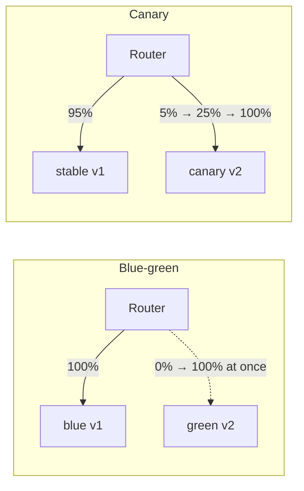
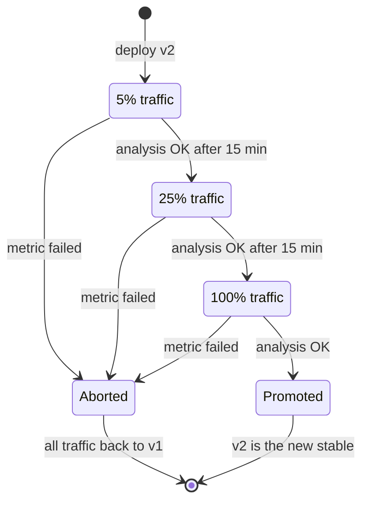
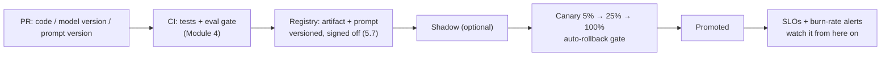

# Lesson 6.4: Release engineering and SLOs
<!-- id: l-6-4 -->

> ⏱ ~70 min · 🎚 Level: Core → Advanced · 🧰 Needs: lessons 4.4 (observability) and 4.6 (progressive delivery)

[Course home](../../README.md) › [Module 6](README.md) › Lesson 6.4

## 📨 The situation

> **From: Omar (Risk analyst, business owner of fraud-service)**
> Last quarter a "small" model update went out on a Tuesday afternoon and declined 3% of good customers for two hours before anyone noticed.
> I'm not against shipping new models. I'm against shipping them to *everyone at once*.
> Diego says we can release to 5% first and roll back automatically. How does the system *know* the new version is worse?
> And how much "worse" are we allowed to be before someone gets paged?

## 🎯 By the end you can

- **Separate** *deploy* from *release*, and **choose** between rolling, blue-green, canary, shadow and feature-flag releases
- **Design** an automatic rollback gate: which metrics, which thresholds, how long to wait
- **Reason about small samples** in canary analysis ("fail fast, pass slow") with confidence intervals
- **Define** SLIs, SLOs and error budgets for latency, error rate and **groundedness**
- **Write** multi-window burn-rate alerts and explain why they page less and catch more

## 🤔 Predict first

1. A canary has served 40 requests and 1 failed (2.5%). Your limit is 1%. Roll back? <!-- id: p-6-4-1 -->
2. Your SLO is 99.9% availability over 30 days. How many minutes of total downtime is that? <!-- id: p-6-4-2 -->
3. Why not just page whenever the error rate exceeds 0.1% for 5 minutes? <!-- id: p-6-4-3 -->

---

## 1. Deploy ≠ release

- **Deploy**: the new version is *running* somewhere in production.
- **Release**: users' traffic *reaches* it.

Separating the two is the whole idea of progressive delivery: you deploy, then release gradually while measuring, and you can un-release in seconds without redeploying.

| Strategy | How it works | Rollback | Cost | Best for |
|---|---|---|---|---|
| **Recreate** | Stop all old pods, start new ones | Redeploy the old version (slow) | Downtime | Dev only |
| **Rolling update** | Replace pods a few at a time (Kubernetes default) | Roll forward or back, pod by pod (minutes) | No extra capacity | Low-risk changes |
| **Blue-green** | Run the full new stack (green) next to the old (blue); switch traffic at once | Switch back (seconds) | 2× capacity during the switch | Big-bang changes needing instant rollback; schema-compatible apps |
| **Canary** | Send a small % of traffic to the new version, measure, increase | Shift traffic back (seconds) | Small extra capacity | **Default for model and service releases** |
| **Shadow (dark launch)** | Copy real traffic to the new version; responses are discarded | Nothing to roll back | Double compute for mirrored traffic | Validating a new model on real inputs with zero user risk (lesson 4.6) |
| **Feature flag** | Code for both paths ships; a runtime flag picks one per user/segment | Flip the flag (seconds) | Code complexity | Prompt changes, UI changes, per-customer rollouts |



For ML releases, combine them: **shadow** first (does v2 behave sanely on real inputs?), then **canary** (does it behave well *with real consequences*?), with the model version behind a **flag** for instant kill.

> ⚠️ **Common mistake:** forgetting that blue-green and canary run **two versions at the same time**. If v2 writes data v1 can't read (a new database column, a changed feature schema, a new embedding model in a shared vector index), rollback breaks. Use *expand → migrate → contract*: first add things compatibly, then switch readers, then remove the old. For embeddings: write a new index next to the old one; never re-embed in place.

## 2. The anatomy of an automatic rollback gate

Kestrel's deployment process (`datasets/handbook/deployment-process.md`) says: canary at **5% for 15 minutes, then 25%, then 100%**; roll back automatically if the **error rate exceeds 1%** or **p95 latency rises more than 20%** over the baseline.

In the lab that policy is implemented twice: once for a real cluster (`lab/k8s/rollout/`, Argo Rollouts) and once as plain Python you can run on a laptop (`lab/src/kestrel_platform/canary.py`).

```yaml
# lab/k8s/rollout/rollout.yaml (excerpt)
strategy:
  canary:
    stableService: kestrel-platform-stable
    canaryService: kestrel-platform-canary
    analysis:                       # runs in the background for the whole rollout
      startingStep: 1
      templates:
        - templateName: kestrel-canary-health
    steps:
      - setWeight: 5
      - pause: {duration: 15m}
      - setWeight: 25
      - pause: {duration: 15m}
      - setWeight: 100
```

```yaml
# lab/k8s/rollout/analysis-template.yaml (excerpt)
metrics:
  - name: error-rate
    interval: 1m
    failureLimit: 1
    successCondition: len(result) == 0 || isNaN(result[0]) || result[0] <= 0.01
    provider:
      prometheus:
        query: |
          sum(rate(kestrel_requests_total{rollouts_pod_template_hash="{{args.canary-hash}}",status=~"5.."}[2m]))
          / sum(rate(kestrel_requests_total{rollouts_pod_template_hash="{{args.canary-hash}}"}[2m]))
  - name: p95-latency-ratio        # canary p95 / stable p95 must stay ≤ 1.20
    ...
```



**What to put in the gate.** A canary only protects you against failures it *measures*. Layer the checks:

| Layer | Metric | Example threshold |
|---|---|---|
| Technical health | 5xx/timeout rate, p95/p99 latency, OOM restarts | ≤ 1%, ≤ 1.2× stable |
| ML behaviour | Score distribution, decline rate, refusal rate, output length | Decline rate ≤ 1.5× stable |
| LLM quality | Groundedness or faithfulness on sampled answers (LLM-as-judge, Module 4) | ≥ 0.95 on the sample |
| Business | Conversion, escalations to human support, chargebacks (slow!) | Usually too slow for the gate: watch after promotion |

For the fraud model, Omar's nightmare (declining good customers) is an **ML behaviour** metric. Error rate and latency would have stayed perfectly green. Lab exercise *Extend it #2* adds exactly this decline-rate guardrail.

## 3. Small samples: fail fast, pass slow

At 5% traffic a canary may have served only a few dozen requests when the first analysis runs. Look at Predict question 1: **1 error in 40 requests**. The observed rate is 2.5%, but is the true rate above 1%?

We need a **confidence interval** for a proportion. The lab uses the **Wilson score interval**, which behaves well at small *n* and near 0, exactly where canaries live:

```python
def wilson_interval(errors: int, total: int, z: float = 1.96) -> tuple[float, float]:
    p = errors / total
    denom = 1 + z**2 / total
    centre = (p + z**2 / (2 * total)) / denom
    half = z * math.sqrt(p * (1 - p) / total + z**2 / (4 * total**2)) / denom
    return max(0.0, centre - half), min(1.0, centre + half)
```

| Canary result | 95% interval for the true error rate | Decision (limit 1%) |
|---|---|---|
| 1 / 40 | ≈ [0.4%, 12.9%] | **HOLD**: could be fine, could be terrible |
| 1 / 10 | ≈ [1.8%, 40.4%] | **ROLLBACK**: even the optimistic bound is above 1% |
| 0 / 200 | ≈ [0%, 1.9%] | **HOLD**: can't yet *prove* it's under 1% |
| 0 / 1,309 | ≈ [0%, 0.29%] | **PROMOTE** (if latency is also fine) |

The decision rule in `canary.py`:

```python
low, high = wilson_interval(canary.errors, canary.requests)
if low > policy.max_error_rate:                                    # fail fast
    return ROLLBACK
if high <= policy.max_error_rate and canary.requests >= policy.min_requests:   # pass slow
    return PROMOTE
return HOLD                                                         # collect more traffic
```

- **Fail fast:** roll back as soon as you're confident it's bad, even on tiny samples. Bad releases hurt real users every minute.
- **Pass slow:** only promote when you're confident it's good. With zero errors you need roughly **380+ clean requests** before the 95% upper bound drops below 1%. Proving "rare" takes data.

> 🔎 **Under the hood:** "≥ 380 requests" comes from the Wilson upper bound with 0 errors, roughly z²/(n+z²) ≤ 0.01, so n ≥ 3.84 × 99 ≈ 380. It's a good intuition pump: to prove an error rate below *x*, you need about 4/*x* clean samples.

Latency needs enough samples too: a p95 from 20 requests is basically "the second-slowest request". The lab requires at least 100 samples per version before judging latency.

> ⚠️ **Common mistake:** canaries that only run off-peak. Load-dependent regressions (a model 35% slower per request) look fine at 14:00 and melt at 18:00. Read `lab/runbooks/postmortem-example.md`: it's exactly this. Pair canaries with load tests for any change in model size or features.

## 4. SLIs, SLOs, SLAs: speaking the same language

| Term | Definition | Kestrel example |
|---|---|---|
| **SLI** (indicator) | A measured ratio of *good events / valid events* | Share of `/v1/score` requests answered successfully in < 150 ms |
| **SLO** (objective) | A target for an SLI over a window | 99% of scoring requests succeed in < 150 ms, over 30 days |
| **SLA** (agreement) | A contract with consequences (refunds, penalties) | The card network contract; looser than your SLO |
| **Error budget** | 1 − SLO: the amount of "bad" you are *allowed* | 1% of requests may be slow or failed this month |

Three SLOs for the Kestrel platform, one per kind:

| SLI | SLO (30 days) | How it's measured |
|---|---|---|
| **Error rate**: fraud-service non-5xx responses | 99.9% | Prometheus counters (`kestrel_requests_total`) |
| **Latency**: docs-assistant time-to-first-token < 2 s | 95% | Histogram from the streaming endpoint |
| **Groundedness**: answers whose claims are supported by retrieved documents | 98% | Daily sample of ~500 answers judged by the calibrated LLM judge from lesson 4.3 |

Groundedness is the interesting one. It's an SLO on *quality*, not uptime. The maths is identical (good events / valid events). Only the measurement is sampled and delayed, so you alert on it more slowly.

**Predict question 2.** 99.9% over 30 days means a 0.1% error budget: 0.001 × 30 × 24 × 60 = **43.2 minutes** of total downtime per month. (99.99% = 4.3 minutes. Each extra "9" costs roughly 10× more engineering.)

### Error budgets turn reliability into a decision rule

```bash
uv run python -m kestrel_platform.slo --objective 0.999 --total 10000000 --bad 4200
# Allowed bad events: 10,000   actual: 4,200
# Budget consumed: 42.0%   remaining: 58.0%
```

An **error budget policy** agreed with product owners in advance:

- Budget remaining → ship features, run experiments, release models normally.
- Budget nearly exhausted → only low-risk changes; canaries get longer.
- Budget exhausted → **release freeze** except reliability fixes, until the window recovers.

That ends the eternal "features vs stability" argument: the budget decides, not whoever shouts loudest.

## 5. Burn-rate alerts: page on what matters

Predict question 3: paging on "error rate > 0.1% for 5 minutes" (the SLO threshold itself) fires on every tiny blip, which consumes a negligible slice of the monthly budget. It trains people to ignore pages. Meanwhile a slow leak at 0.09% never fires but quietly burns most of the budget.

**Burn rate** = how fast you're spending the budget relative to "exactly on budget".

```
burn rate = observed error ratio / (1 − SLO)

burn 1    → you'll spend exactly 100% of the budget by the end of the 30 days
burn 14.4 → in 1 hour you spend 14.4 × 1h / 720h = 2% of the monthly budget
```

The SRE Workbook's multi-window, multi-burn-rate recipe (implemented in `slo.py`):

| Alert | Long window | Short window | Burn rate | Budget spent if sustained | Action |
|---|---|---|---|---|---|
| Fast burn | 1 h | 5 min | ≥ 14.4 | 2% in 1 hour | **Page** |
| Medium burn | 6 h | 30 min | ≥ 6 | 5% in 6 hours | **Page** |
| Slow burn | 3 days | 6 h | ≥ 1 | 10% in 3 days | **Ticket** |

Why **two windows**? The long window proves the problem is *significant*. The short window proves it's *still happening*. Without the short window, an alert keeps firing for up to an hour after you've already fixed the problem.

```python
def evaluate_burn_alerts(slo, error_ratios, rules=DEFAULT_RULES):
    fired = []
    for rule in rules:
        long_burn = burn_rate(error_ratios.get(rule.long_window, 0.0), slo)
        short_burn = burn_rate(error_ratios.get(rule.short_window, 0.0), slo)
        if long_burn >= rule.threshold and short_burn >= rule.threshold:   # BOTH must agree
            fired.append(FiredAlert(rule, long_burn, short_burn))
    return fired
```

In Prometheus this becomes recording rules for the error ratio over 5m, 30m, 1h, 6h and 3d, and alert rules combining pairs of them with `and`.

> 💡 **Production tip:** for **low-traffic** or **sampled** SLIs (groundedness from 500 judged answers a day), fast-burn pages are noisy. 1 bad answer in 10 samples is a "10% error rate". Use slow-burn tickets, or a minimum event count before alerting.

> ⚠️ **Common mistake:** SLOs nobody agreed on. An SLO is a *product decision* ("how unreliable can this be before users care?"), signed off with the business owner. Omar should sign the fraud-service SLO, Lena the docs-assistant ones.

## 6. Models and prompts follow the same path

From the deployment handbook: *"Model and prompt changes follow the same process as code changes."* Concretely:



The **eval gate** (offline, before release) and the **canary gate** (online, during release) catch different things. The eval gate catches quality regressions on known cases. The canary catches what only real traffic reveals: latency under load, new input distributions, integration bugs.

## 🧪 Try it

In the [lab](lab/README.md), steps 4 and 5:

1. `uv run python scripts/simulate_canary.py --fault errors`. Expected: rollback at the first 5% analysis with `canary 1/10 = 10.00%, 95% CI [1.79%, 40.42%]`.
2. `--fault latency`: holds at 5% (too few latency samples), rolls back at 25% when the p95 comparison becomes possible.
3. `--fault none`: holds through 5% and 25%, then **PROMOTES** at 100% with a CI around [0%, 0.29%].
4. SLO CLI: `uv run python -m kestrel_platform.slo --ratio 1h=0.02 --ratio 5m=0.03` → fast-burn page. Then `--ratio 1h=0.02 --ratio 5m=0.0005` → nothing. Explain why.
5. Render the rollout: `kubectl kustomize k8s/rollout | grep -A3 setWeight`.

## 🏭 In the real world

Progressive delivery tooling is widely available: Argo Rollouts and Flagger on Kubernetes, and native traffic-splitting in most cloud load balancers, service meshes and managed ML endpoints (which can split traffic between model variants). The hard part is never the tool. It's **choosing metrics that capture what users care about** and **having enough traffic to judge them**. The SLO and burn-rate approach in this lesson comes from Google's public SRE books, and many organisations adopt it nearly verbatim.

## ✅ Check yourself

<details><summary>Q1. What's the difference between deploying and releasing, and why separate them? <!-- id: c-6-4-1 --></summary>

Deploying makes the new version run in production; releasing sends user traffic to it. Separating them lets you release gradually, measure, and un-release in seconds (shift traffic back) without a new deployment.
</details>

<details><summary>Q2. Canary: 2 errors in 25 requests, limit 1%. Hold or rollback? Reason with the interval. <!-- id: c-6-4-2 --></summary>

The observed rate is 8%; the Wilson 95% lower bound is about 2.2%, which is above 1%, so **rollback** (fail fast). Even optimistically, the canary is worse than allowed.
</details>

<details><summary>Q3. Why does "pass slow" need roughly 380 clean requests for a 1% limit? <!-- id: c-6-4-3 --></summary>

With zero errors, the 95% upper bound is about z²/(n + z²) with z² ≈ 3.84. It falls below 0.01 only when n ≳ 380. Fewer clean requests are still compatible with a true error rate above 1%.
</details>

<details><summary>Q4. A 99.5% monthly SLO: how many bad requests are allowed out of 20 million? What fraction of the budget does burn rate 6 spend in 6 hours? <!-- id: c-6-4-4 --></summary>

Budget = 0.5% × 20M = 100,000 bad requests. Burn 6 for 6 h spends 6 × 6/720 = 5% of the monthly budget.
</details>

<details><summary>Q5. Why use both a long and a short window in a burn-rate alert? <!-- id: c-6-4-5 --></summary>

The long window ensures the problem is significant (it consumed a meaningful slice of the budget). The short window ensures it's still happening, so the alert resets quickly after recovery instead of paging about a problem that's already fixed.
</details>

<details><summary>Q6. Which canary metric would have caught Omar's incident (3% of good customers declined), and why wouldn't error rate or latency? <!-- id: c-6-4-6 --></summary>

A decline-rate (or score-distribution) guardrail comparing canary against stable. The service returned fast, valid 200 responses; they were just *wrong*. Technical health metrics can't see quality regressions.
</details>

## 💬 Explain it back
<!-- id: e-6-4 -->

Explain to Omar, without formulas, why the canary sometimes *waits* even when it has seen zero errors, and why it sometimes rolls back after just one error. (Hint: "proving something is rare takes many observations; proving something is common takes few".)

## 🔑 Key takeaways

- **Deploy ≠ release.** Canary is the default for model and service releases; shadow first for risky models; flags for instant kill.
- Versions coexist during rollouts: keep data and schema changes **backward compatible** (expand → migrate → contract).
- Gate on **technical + ML-behaviour + quality** metrics. A canary only catches what it measures.
- **Fail fast, pass slow**: use confidence intervals; proving "< 1%" takes ~400 clean requests.
- SLO = target on good/valid events; **error budget = 1 − SLO**; an agreed budget policy decides when to freeze releases.
- Page on **multi-window burn rates** (14.4× and 6×), ticket on slow burn. Groundedness can be an SLO too.

## 📚 Go deeper (free)

| | Resource | Why read it | Time |
|---|---|---|---|
| ⭐ | [SRE Workbook: Alerting on SLOs](https://sre.google/workbook/alerting-on-slos/) | The source of the multi-window burn-rate recipe, with trade-offs of each alternative | 45 min |
| ⭐ | [SRE Book: Service Level Objectives](https://sre.google/sre-book/service-level-objectives/) | SLIs, SLOs and SLAs explained by the people who coined the practice | 30 min |
| 🔍 | [SRE Workbook: Implementing SLOs](https://sre.google/workbook/implementing-slos/) | Choosing SLIs, error budget policies, getting buy-in | 45 min |
| 🔍 | [SRE Workbook: Canarying Releases](https://sre.google/workbook/canarying-releases/) | Canary design, metric selection and evaluation | 40 min |
| 🔍 | [Argo Rollouts documentation](https://argo-rollouts.readthedocs.io/) | Canary and blue-green strategies, AnalysisTemplates | 45 min |
| 🔍 | [Martin Fowler: CanaryRelease](https://martinfowler.com/bliki/CanaryRelease.html) · [BlueGreenDeployment](https://martinfowler.com/bliki/BlueGreenDeployment.html) | Short, classic definitions | 10 min |
| 🔍 | [Flagger](https://flagger.app/) | An alternative progressive-delivery operator | 20 min |

---
⬅️ [Previous: Lesson 6.3 GPUs, autoscaling and capacity](03-gpus-autoscaling-and-capacity.md) · ➡️ [Next: Lesson 6.5 Incident response and on-call](05-incident-response-and-on-call.md)
