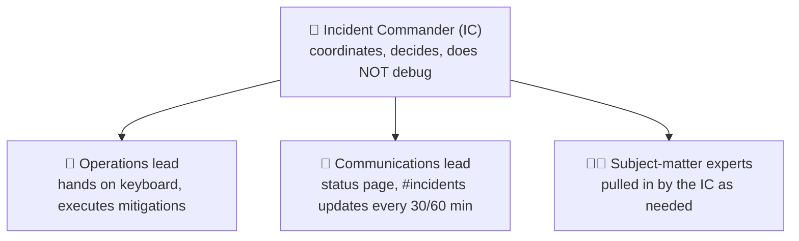
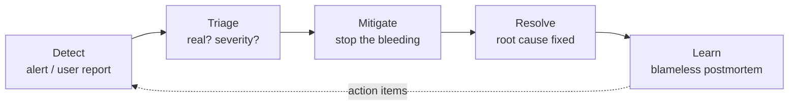

# Lesson 6.5: Incident response and on-call

> ⏱ ~45 min · 🎚 Level: Core · 🧰 Needs: lesson 6.4 (SLOs and alerts)

[Course home](../../README.md) › [Module 6](README.md) › Lesson 6.5

## 📨 The situation

> **From: Diego (SRE / platform lead)**
> Congratulations, you're joining the on-call rotation next month. Primary for fraud-service and docs-assistant.
> Before that: the docs-assistant has never had an incident, which mostly means we've never *noticed* one.
> I need (1) a runbook for every alert you own, (2) a way to switch the AI off without switching the product off, and (3) you to have read our last postmortem.
> Shadow me for a week first. Nobody should learn incident response *during* an incident.

## 🎯 By the end you can

- **Classify** incidents by severity and **run** one using clear roles (Incident Commander, Communications, Operations)
- **Prioritise** mitigation over diagnosis, and **name** the standard mitigations for AI systems
- **Recognise** AI-specific incidents: quality regressions, hallucination spikes, prompt injection, cost runaways
- **Write** an actionable alert and a runbook someone can follow at 03:00
- **Run** a blameless postmortem that produces action items, not blame
- **Keep** an on-call rotation humane and sustainable

## 🤔 Predict first

1. An alert fires at 03:00 for fraud-service latency. A deploy happened 3 hours ago. Do you first find the root cause, or first roll back?
2. The docs-assistant starts confidently quoting a refund policy that doesn't exist. No error rate moved, no latency moved. How would you find out?
3. What's wrong with a postmortem whose main action item is "Engineer X will be more careful"?

---

## 1. What counts as an incident, and how bad is it?

An **incident** is an unplanned event that degrades (or threatens to degrade) a service for its users, and needs a coordinated response. Kestrel's runbook (`datasets/handbook/incident-response-runbook.md`) defines severities:

| Severity | Definition | Response time | Kestrel example | AI-flavoured example |
|---|---|---|---|---|
| **SEV1** | Customer money or data at risk, or core payments down | 5 min, 24/7 | Card authorisations failing | Docs-assistant leaking other customers' data (permission-aware retrieval broken) |
| **SEV2** | Major feature degraded for many users | 15 min, 24/7 | Fraud scoring timing out; fallback rules active | Assistant giving wrong refund answers to many customers |
| **SEV3** | Minor degradation, workaround exists | Next business day | Docs-assistant slow | Embedding job failed; index one day stale |

> 💡 **Production tip:** when in doubt, declare the **higher** severity. Downgrading later is cheap. Under-reacting while customer money is at risk is not.

## 2. Roles: someone must *not* be debugging

The most common failure in incidents isn't technical. It's five engineers debugging in parallel while nobody coordinates, nobody updates customers, and two people roll back different things at the same time.



| Role | Does | Doesn't |
|---|---|---|
| **Incident Commander** | Sets priorities, assigns tasks, makes the call (rollback?), tracks the timeline | Type commands or debug |
| **Operations lead** | Executes mitigations, reports results to the IC | Make big decisions alone |
| **Communications lead** | Updates stakeholders on a fixed rhythm (Kestrel: every 30 min for SEV1, 60 min for SEV2) | Speculate about root cause in public |

At 03:00 with one on-call engineer, one person holds all roles. The moment a second person joins, **split IC from Ops**.

## 3. The incident lifecycle: mitigate first



**Predict question 1: roll back first.** Root-cause analysis can take hours; customers are hurting *now*. The runbook says: *"Stabilise first: roll back, fail over or switch to the fallback. Root cause comes later."* If the rollback doesn't help, you've learned something too (it's probably not the deploy).

Standard mitigations, roughly in order of how often they work:

| Mitigation | When | AI-system version |
|---|---|---|
| **Roll back** | Something changed recently | Roll back the model version, prompt version or index version, not just code |
| **Fail over / degrade gracefully** | A dependency is down or slow | Fraud: rule-based fallback scoring. Assistant: "search results only" mode or "contact support" |
| **Kill switch** | The AI behaviour itself is harmful | Feature flag that disables the LLM answer and keeps the rest of the product working |
| **Scale up** | Load exceeds capacity | Raise HPA max; shift traffic to an API fallback model (router, lesson 3.3) |
| **Block / shed** | Abusive or malicious traffic | Rate-limit the abusive user; block a prompt-injection pattern at the guardrail layer |
| **Purge** | Bad data is being served | Remove a poisoned document from the index; invalidate the semantic cache |

> ⚠️ **Common mistake:** forgetting the **semantic cache** (lesson 3.5) during an AI incident. You fix the prompt, and the cache keeps serving the old wrong answers for hours. Cache invalidation belongs in every docs-assistant runbook.

> 💡 **Production tip:** build the kill switch **before** you need it, and test it like a fire drill. "Switch the AI off without switching the product off" (Diego's ask #2) must be one command or one flag, and the product must still work afterwards.

## 4. AI-specific incidents: the ones dashboards don't show

Classic incidents are loud: errors and latency spike. AI incidents are often **silent**: the service returns fast, valid 200 responses that are *wrong*.

| Incident type | How it shows up | Detection signal |
|---|---|---|
| **Quality regression** | New model or prompt answers worse | Online eval sample scores drop; groundedness SLO burn (6.4); thumbs-down rate |
| **Hallucination spike** | Confident, unsupported answers | Groundedness judge on sampled traffic; "answer cites nothing" rate |
| **Retrieval failure** | Index stale, empty or corrupted | Retrieval hit rate, average similarity score, "no documents found" rate |
| **Prompt injection / data exfiltration** | Assistant follows instructions in a document | Guardrail block counts, canary tokens, unusual tool calls (Module 5) |
| **Cost runaway** | Agent loop or traffic spike multiplies tokens | Tokens/min and €/hour against budget; per-user token anomalies |
| **Data or label pipeline issue** | Model trained on broken data | Validation gate failures; feature drift (4.5) |
| **Feedback loop** | Model decisions shape its own future data | Slow drift in decline rates or score distributions |

Predict question 2: **you need a quality signal**. That means a sampled online eval (groundedness judge), user feedback, and the support team's escalation rate. Without at least one of these, the first person to detect it will be a customer or a journalist. This is why lesson 6.4 made groundedness an SLO.

The [AI Incident Database](https://incidentdatabase.ai/) collects public AI failures. Browsing it for 20 minutes is a fast way to calibrate your sense of what goes wrong in practice.

## 5. Alerts and runbooks that work at 03:00

Every page must pass four tests:

1. **Urgent**: it needs a human *now*, not tomorrow (otherwise make it a ticket).
2. **Actionable**: there is something the on-call engineer can do.
3. **Real**: it reflects user pain, ideally an SLO burn rate, not "CPU is 80%".
4. **Linked**: it links to a runbook. Kestrel's on-call handbook says: *an alert without a runbook is a bug*.

A good runbook (see `lab/runbooks/fraud-scoring-latency.md`) has this shape:

```markdown
# Runbook: <alert name>
Service, owner, SLO, severity if customer impact
1. Is it real? (2 minutes)        → checks with dashboard links
2. Stabilise first (5 minutes)     → symptom → action → exact command table
3. Declare and communicate         → when to declare, who to tell
4. Diagnose (after stabilising)    → where to look
5. Close out                       → checklist incl. postmortem + runbook update
```

> ⚠️ **Common mistake:** runbooks that say "investigate the issue" or "check the logs". At 03:00 nobody knows *which* logs. Write exact commands, exact dashboard names and exact thresholds, and update the runbook after every incident that used it.

## 6. Blameless postmortems

After every SEV1 and SEV2 (Kestrel: within 5 business days), write a postmortem. **Blameless** means you assume everyone acted reasonably given what they knew at the time, and ask *how the system allowed the failure*.

Predict question 3: "be more careful" isn't an action item. It changes nothing in the system, the next person makes the same mistake, and people learn to hide mistakes. Ask instead: why was the mistake *possible*, and why wasn't it *caught*?

Read `lab/runbooks/postmortem-example.md`, a simulated SEV2 where a slower fraud model passed a canary that only checked error rates. Its structure:

| Section | Purpose |
|---|---|
| Summary | 3–5 sentences anyone in the company can understand |
| Impact | Users affected, duration, money, **error budget consumed** |
| Timeline | Timestamped facts: what happened, what people saw, what they did |
| Root causes and contributing factors | Ask "why?" repeatedly until you reach things you can change in the system |
| What went well | Reinforce what worked (graceful degradation, fast rollback) |
| Action items | Owner, due date, type (**prevent / detect / mitigate / process**) |

From the example, notice how each "why" ends at a **system** change:

- *Why was the regression released?* The canary didn't check latency. → Add a latency metric to the AnalysisTemplate. (Lab 6's `canary.py` does this.)
- *Why wasn't it caught in testing?* No load test for model changes. → Require a 2× peak load test when model size or features change.
- *Why did it melt at peak?* Capacity was planned for the old model's cost per request. → A model change is a capacity change (lesson 6.3).

> 💡 **Production tip:** track action items to completion and review them monthly. A postmortem whose action items never ship is a ritual, not a learning process.

## 7. Humane on-call

Kestrel's on-call handbook: one-week rotations with a primary and a secondary, acknowledge within 5 minutes, escalation to the secondary after 5 and to the manager after 15, compensation per week and per out-of-hours page, and a late start after a night of pages.

What keeps a rotation sustainable:

- **Few, good pages.** Google's SRE book suggests aiming for at most about two incidents per 12-hour shift so there is time to handle each one properly. Track pages per shift; noisy alerts are bugs.
- **Enough people.** A rotation of 3 means on call every third week, which burns people out. Aim for 6–8.
- **Shadowing first** (Diego's plan): shadow, then reverse-shadow (you're primary, an expert watches), then solo.
- **Handoffs**: a short written note at each rotation change about open issues, risky releases and noisy alerts.
- **Error budgets back on-call.** When the budget is gone, releases freeze (lesson 6.4), which reduces pages.

## 🧪 Try it

1. Read `lab/runbooks/fraud-scoring-latency.md`. For each mitigation row, identify which lab artifact it relies on (Rollout, HPA, ConfigMap, fallback).
2. Read `lab/runbooks/postmortem-example.md` and map each action item to a *prevent / detect / mitigate / process* category. Then answer: which action item does Lab 6 already implement? (Answer: #1, the p95 latency ratio check, in both `canary.py` and `analysis-template.yaml`.)
3. **Write a runbook** for a new alert: `DocsAssistantGroundednessBurn` (slow-burn ticket on the groundedness SLO). Include at least: how to confirm it's real (look at sampled answers), three mitigations (roll back the prompt version, roll back the index version, invalidate the semantic cache), and the kill switch. Start from `templates/runbook.md` at the repo root.
4. **Tabletop exercise** (with a friend or alone): "At 18:20 customers report the assistant tells them refunds are unlimited and asks for their CVV." Using `datasets/handbook/partner-faq.md` as the clue, walk through roles, severity, mitigation and communications. What severity is it, and why? (Hint: it asks customers for card data.)

## 🏭 In the real world

Most mature organisations publish their incident process internally in the same shape as Kestrel's: severities, roles, a fixed communication rhythm, blameless reviews. PagerDuty's open-source incident response documentation (linked below) is a widely copied template. What changes for AI systems is mainly **detection**: you need quality signals (evals on live samples, user feedback, guardrail metrics) because the loudest failures of AI systems are often silent on technical dashboards.

## ✅ Check yourself

<details><summary>Q1. Why should the Incident Commander not debug?</summary>

Debugging absorbs all attention. Someone has to keep the big picture: priorities, who's doing what, when to roll back, when to escalate, and keeping communications flowing. Coordination failures make incidents longer than technical difficulty does.
</details>

<details><summary>Q2. Give three mitigations specific to LLM applications.</summary>

Any three of: roll back the prompt/model/index version; kill switch that disables LLM answers while keeping the product working; route to a fallback model; invalidate the semantic cache; remove a poisoned document from the index; tighten a guardrail rule; rate-limit an abusive user or tool.
</details>

<details><summary>Q3. Name two signals that detect a hallucination spike when error rate and latency look normal.</summary>

For example: groundedness scores from an LLM judge on sampled live traffic; rate of answers with no citations; thumbs-down or user feedback rate; escalations to human support; spot checks from the support team.
</details>

<details><summary>Q4. Rewrite "Engineer X should be more careful when changing the prompt" as a system action item.</summary>

For example: "Prompt changes must pass the regression eval suite in CI and be released through the prompt registry with a canary (owner: AI Platform, due in 2 weeks)." It changes the system so the mistake is caught regardless of who makes it.
</details>

<details><summary>Q5. Four tests every page should pass?</summary>

Urgent, actionable, reflects real user impact (ideally an SLO burn), and links to a runbook.
</details>

## 💬 Explain it back

Explain to a new teammate why "roll back first, investigate later" is not lazy engineering. Use the analogy of a doctor stopping the bleeding before running diagnostic tests.

## 🔑 Key takeaways

- Severity drives the response; when unsure, go higher.
- Separate roles: **IC coordinates, Ops executes, Comms communicates**.
- **Mitigate first**: rollback, fallback, kill switch, scale, block, purge. For AI, also roll back prompts, indexes and caches.
- AI incidents are often **silent**; detect them with quality signals (sampled evals, feedback, guardrail metrics).
- Pages must be urgent, actionable, real and linked to an exact-command runbook.
- **Blameless postmortems** produce system changes (prevent / detect / mitigate / process), not "be careful".

## 📚 Go deeper (free)

| | Resource | Why read it | Time |
|---|---|---|---|
| ⭐ | [PagerDuty Incident Response documentation](https://response.pagerduty.com/) | A complete, open incident process: roles, severities, calls, postmortems | 1 h |
| ⭐ | [SRE Book: Managing Incidents](https://sre.google/sre-book/managing-incidents/) | A real incident told twice, chaotic vs well-managed | 25 min |
| 🔍 | [SRE Book: Being On-Call](https://sre.google/sre-book/being-on-call/) | Sustainable on-call load and why it matters | 25 min |
| 🔍 | [SRE Book: Postmortem Culture](https://sre.google/sre-book/postmortem-culture/) | How to make blamelessness real | 20 min |
| 🔍 | [AI Incident Database](https://incidentdatabase.ai/) | Real, public AI failures to learn from | 20 min |
| 🔍 | [SRE Workbook: On-Call](https://sre.google/workbook/on-call/) | Practical on-call setups and handoffs | 30 min |

---
⬅️ [Previous: Lesson 6.4 Release engineering and SLOs](04-release-engineering-and-slos.md) · ➡️ [Next: Lesson 6.6 Agents in production](06-agents-in-production.md)
