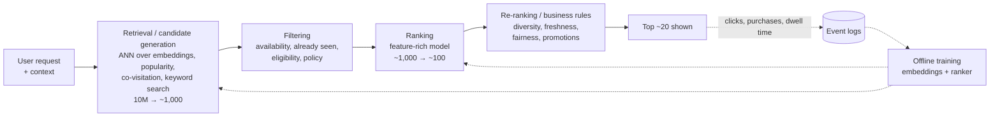
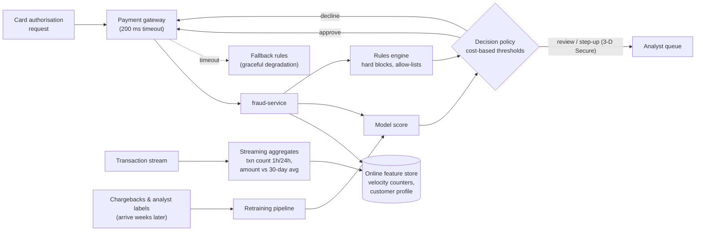
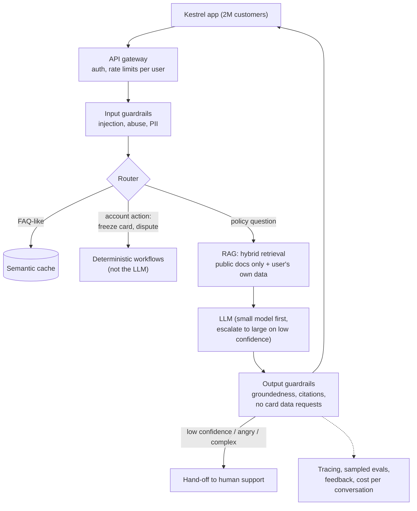

# Lesson 6.7: Case studies: recommendation and search, fintech risk, consumer assistants

> ⏱ ~75 min · 🎚 Level: Advanced · 🧰 Needs: the whole course so far

[Course home](../../README.md) › [Module 6](README.md) › Lesson 6.7

## 📨 The situation

> **From: Maya (Engineering Manager)**
> Final stretch. Next week you present the platform to leadership, and they'll throw curveballs:
> "Could this power product recommendations?", "How does a *real* bank do fraud?", "What if we open the assistant to all 2 million customers?"
> I don't need you to have built those. I need you to reason about them out loud, with the same building blocks you've used all quarter.
> These are also, not by coincidence, the three most common AI system design interview questions.

## 🎯 By the end you can

- **Apply** a repeatable 9-step framework to any production AI system design question
- **Sketch** the standard architectures for recommendation/search, real-time risk scoring and consumer LLM assistants
- **Identify** each system's hardest constraint (latency budget, label delay, feedback loops, cost per user, safety)
- **Map** every component back to the lesson where you built or studied it
- **Find and read** real, public case studies critically

## 🤔 Predict first

1. Why do recommendation systems almost always use *two or more* stages instead of one model scoring every item?
2. Fraud labels (chargebacks) arrive weeks after the transaction. What does that do to monitoring and retraining?
3. An assistant that costs €0.002 per question goes from 10,000 internal users to 2 million customers. Besides cost, what *changes in kind*, not just in size?

---

## 1. A framework for any AI system design

Use the same nine steps every time. They mirror the modules of this course:

| # | Step | Questions | Course link |
|---|---|---|---|
| 1 | **Requirements** | Users, scale (QPS, data size), latency budget, availability, regulatory constraints | 1.1 |
| 2 | **Success metrics** | Business metric, ML/quality metric, guardrail metrics | 4.1, 4.3 |
| 3 | **Data** | Sources, labels and their **delay**, freshness, PII, leakage | 2.1, 2.2, 5.4 |
| 4 | **Architecture** | Batch vs online vs streaming; stages; building blocks | 1.2 |
| 5 | **Model / prompting choice** | Simplest approach that meets the metric; prompt vs RAG vs fine-tune | 2.7 |
| 6 | **Serving** | Latency budget per stage, caching, batching, hardware, cost per request | Module 3, 6.3 |
| 7 | **Evaluation and release** | Offline evals, online tests, canary gates, SLOs | Module 4, 6.4 |
| 8 | **Monitoring and operations** | Drift, quality signals, alerts, runbooks, incident response | 4.4, 4.5, 6.5 |
| 9 | **Risks and governance** | Security, abuse, fairness, explainability, regulation, failure modes, fallbacks | Module 5 |

> 💡 **Production tip:** in interviews and design reviews alike, spend the first 10–15% of the time on steps 1–2. Most bad designs are good answers to the wrong question.

---

## 2. Case study A: recommendation and search

**The problem.** Show each user the most relevant items (products, articles, videos, or, for Kestrel, offers and merchant cashback) from a catalogue of millions, in about 100–200 ms.

**Predict question 1.** You can't run an expensive model on 10 million items per request. So systems use a **funnel**: cheap stages cut the candidates down, expensive stages rank the survivors.

| Component | What it is | Where you've seen the idea |
|---|---|---|
| **Candidate generation** | Often a *two-tower* model: one tower embeds users, one embeds items; approximate nearest-neighbour (ANN) search finds close items | Vector search (2.5): same machinery as RAG retrieval |
| **Ranking** | Gradient-boosted trees or a neural network over hundreds of features (user history, item stats, context) | The fraud model is also a ranker, of risk |
| **Re-ranking** | Rules and light models for diversity, freshness and business constraints | Like RAG reranking (2.5) |
| **Feature store** | Same features online (serving) and offline (training) | Training/serving skew (1.1) |
| **Offline / nearline / online** | Embeddings recomputed daily (offline), counters updated within minutes (nearline), request context in real time (online) | Batch vs online (1.2) |

**The hard parts**

- **Feedback loops and position bias.** Users click what you showed them, usually what's at the top. Train naively on clicks and the model learns "things we ranked high are good". Mitigations: log impression position and model it, reserve a small share of traffic for exploration, use counterfactual evaluation methods.
- **Offline ≠ online.** Offline ranking metrics (for example NDCG or recall@k) often disagree with online business results. The final judge is an **online A/B test** with guardrail metrics (lesson 4.6).
- **Cold start.** New users and new items have no history: fall back to content features, popularity, and onboarding questions.
- **Search** is the same funnel with the query as the main signal. Production search usually mixes keyword (BM25) and semantic retrieval, which is exactly the *hybrid retrieval* you built for RAG in lesson 2.5. RAG retrieval *is* a search system.

**Latency budget** (illustrative, for a 150 ms target):

| Stage | Budget |
|---|---|
| Feature fetch (user, context) | 15 ms |
| Candidate retrieval (ANN + others, in parallel) | 30 ms |
| Filtering | 10 ms |
| Ranking ~1,000 candidates | 60 ms |
| Re-ranking + response | 15 ms |
| Network and headroom | 20 ms |

**How Kestrel would start:** for "merchant cashback offers", with ~5,000 offers and 2M customers, a single ranker over all eligible offers (no ANN needed at this catalogue size), daily batch features plus real-time context, and an A/B test against "most popular offers". Don't build the 4-stage funnel until the catalogue needs it.

📖 Read [Eugene Yan: System Design for Recommendations and Search](https://eugeneyan.com/writing/system-design-for-discovery/), a clear walk through the offline/online split and the retrieval/ranking pattern based on public industry write-ups.

---

## 3. Case study B: fintech risk scoring (Kestrel's fraud-service at scale)

**The problem.** Score every card authorisation for fraud risk **inside the payment path**: the card network gives the issuer very little time, so Kestrel budgets ~200 ms end to end for scoring, and the answer changes whether a real person's payment goes through.

| Concern | Design choice | Course link |
|---|---|---|
| Latency in the payment path | Precomputed features in an online store; small, fast model; strict timeouts; **fallback rules** on timeout | 1.3, 3.4 |
| Velocity features | Streaming aggregates ("transactions in the last hour") with identical logic offline and online | 2.1, 2.2 |
| Thresholds | Chosen by **expected cost**: a missed fraud costs the amount; a false decline costs customer trust and revenue | 4.2 |
| Calibrated probabilities | Thresholds and expected-cost maths need calibrated scores | 4.2 |
| Rules + model | Rules for known patterns, regulatory blocks and instant reactions; models for subtle patterns | 1.2 |
| Explainability | Reason codes for analysts and customers ("unusual country + new device") | 5.6 |
| Release safety | Champion/challenger: shadow-score with the new model, then canary with a **decline-rate guardrail** | 6.4 |

**The hard parts**

- **Label delay** (Predict question 2). Chargebacks arrive weeks later. Consequences:
  - You **can't measure today's precision and recall today**. Monitor *proxies* in real time: score distribution, decline rate, review-queue volume, feature drift (4.5).
  - Training data is always somewhat **stale**, and the most recent weeks have incomplete labels. Using them naively teaches the model that recent fraud is rare.
  - Your synthetic dataset even has a **leaky** feature built in, `chargeback_filed`, that exists only *after* the label (2.2). In real life, leakage like that produces a brilliant offline score and a useless production model.
- **Adversarial drift.** Fraudsters adapt to your model. The `concept_drift` scenario in `datasets/fraud/generate.py` simulates card testing (bursts of tiny online charges) that a baseline model has never seen. Rules give you a fast reaction (hours) while the model retrains (days).
- **Feedback loop.** Transactions you decline never become chargebacks, so you never learn whether they were really fraud. A small randomised holdout, or analyst review of a sample of declines, keeps labels honest.
- **Extreme class imbalance.** Base rates of a fraction of a percent mean accuracy is meaningless; use PR-AUC and cost-based evaluation (4.1). Your lab pipeline's quality gate compares PR-AUC with the base rate for exactly this reason.
- **Regulation and fairness.** Credit and risk decisions are heavily regulated in many jurisdictions. Explanations, documentation (model cards, 5.6) and fairness audits are requirements, not extras.

**Graceful degradation is the design.** The payment must go through even when the ML service is down, so the gateway falls back to rules on timeout. That's why the postmortem in `lab/runbooks/` was a SEV2 (degraded accuracy) and not a SEV1 (payments down).

📖 The [Evidently AI ML system design database](https://www.evidentlyai.com/ml-system-design) lists hundreds of public write-ups from real companies. Filter by *fraud detection* to read how payment companies describe their own systems.

---

## 4. Case study C: consumer assistants (the docs-assistant for 2 million customers)

**The problem.** Lena wants the internal docs-assistant inside the customer app. Same RAG core, completely different risk profile.

**Predict question 3.** At consumer scale, what changes *in kind*:

- **Adversarial users.** Some of 2M people will actively try jailbreaks and prompt injection (Module 5); employees mostly didn't.
- **Permissions and privacy.** Customers must only ever see public docs and *their own* data: permission-aware retrieval (5.3) becomes a SEV1-class requirement.
- **Brand and legal risk.** A wrong answer about fees or disputes isn't an internal inconvenience; it can be a regulatory problem and a news story.
- **Cost per user** matters: €0.002/question × several questions per user per month × 2M users is a real line item, so routing, caching and answer length matter (3.3, 3.5).
- **Escalation to humans** becomes part of the product: the assistant must know when to hand off.

| Design decision | Why |
|---|---|
| **Deterministic flows for actions** (freeze card, open a dispute) | Actions with side effects stay out of the LLM's control (6.6); the LLM only recognises intent and explains |
| **Router + small model first** | Most questions are easy; send only hard ones to a large model. Cost and latency drop a lot (3.3) |
| **Semantic cache for FAQ-style questions** | Thousands of customers ask "how long does a refund take?" Invalidate the cache on every doc or prompt release (6.5) |
| **Strict output guardrails** | The assistant must never ask for a PIN/CVV, a rule that the hidden injection in `partner-faq.md` tries to break (5.2, 5.5) |
| **Streaming + TTFT SLO** | Perceived speed is time to first token, not total time (3.4) |
| **Groundedness SLO + sampled evals** | Quality incidents are silent; measure them continuously (6.4, 6.5) |
| **Human hand-off** | A good assistant knows its limits; escalation rate is a key metric |

**Cost sketch** (illustrative, using the lab's cost model): suppose 2M customers and 15% monthly active users asking 4 questions each = 1.2M questions/month, with 40% served from cache. That's ~720k LLM calls/month. With a small model at roughly €0.0003 per call, that's about €220/month. The LLM is cheap; the **platform** around it (guardrails, retrieval, observability, human support for escalations) dominates. Run `scripts/cost_report.py` with these assumptions to check. This is a common, counter-intuitive result: for many assistants, **the LLM is not the expensive part; the people and the platform are**.

**Rollout plan** (how you'd actually ship it): internal employees → 1% of customers on one language/market behind a flag → canary with groundedness, escalation-rate and complaint guardrails → gradual ramp, with a kill switch that falls back to the existing help centre.

📖 [What We Learned from a Year of Building with LLMs](https://applied-llms.org/) collects practitioner lessons on exactly these trade-offs (evals, RAG, guardrails, cost, team process).

---

## 5. Reading real case studies critically

Public engineering blog posts are invaluable, and also marketing. When you read one, ask:

| Question | Why |
|---|---|
| What was the **baseline**, and how much did they improve over it? | "A 20% lift" means little without knowing the starting point |
| What's their **scale**, and does it match yours? | Advice for 1B users can be harmful at 10k |
| What did they **not** say? | Costs, failed attempts, team size, ops burden are often missing |
| Which **metrics** moved: offline or online? | Offline wins often don't survive A/B tests |
| When was it written? | Tooling changes fast; principles change slowly |

> ⚠️ **Common mistake:** copying the architecture of a company 1,000× your size. Start with the simplest version that meets your requirements, measure, and add stages when the data says you need them.

## 🧪 Try it

1. **Design drill (45 min, no code).** Pick one case. Write a one-page design doc using the 9-step framework (template: `templates/design-doc.md` at the repo root). Include one diagram, the latency budget, three metrics (business, quality, guardrail), and three failure modes with their mitigations.
2. **Cost the consumer assistant.** Copy `lab/cost_assumptions.toml` to `consumer.toml`, set `avg_rps` and `peak_rps` from the cost sketch in section 4 (1.2M questions/month × 60% non-cached ≈ 0.27 req/s on average; assume peak = 5× average), regenerate with `uv run python scripts/cost_report.py --assumptions consumer.toml --out reports/consumer.md`, and compare the LLM line with the platform line.
3. **Concept drift, hands on.** Generate drifted data with `python datasets/fraud/generate.py --scenario concept_drift` (from the repo root), score it with the model the lab pipeline registered, and compare PR-AUC against the baseline. Which monitoring signal from case study B would have warned you first?

## 🏭 In the real world

The three architectures in this lesson are deliberately generic. Real systems vary in the details: number of stages, feature freshness, model families. But the **constraints** recur everywhere: tight latency budgets with fallbacks, delayed and biased labels, feedback loops, adversaries, and cost per user. If you can name a system's hardest constraint in the first five minutes, you're most of the way to a good design.

## ✅ Check yourself

Q1. Why do recommenders use a retrieval stage before ranking?

Scoring millions of items with a feature-rich model per request is far too slow and expensive. A cheap retrieval stage (ANN over embeddings, heuristics) narrows millions to hundreds or thousands, and the expensive ranker only scores those.

Q2. Name two consequences of delayed fraud labels and one mitigation for each.

(1) You can't measure current precision/recall → monitor proxies in real time (score distribution, decline rate, feature drift). (2) Recent training data has incomplete labels → wait for label maturity before training on a period, or correct for it. Also: feedback loops from declined transactions → randomised holdouts or analyst review of a sample of declines.

Q3. Why should "freeze my card" in a consumer assistant run as a deterministic workflow, not an LLM tool call decided by an agent?

It's a side-effecting action on a customer's money and account. The LLM should only recognise the intent; a deterministic, tested, authorised workflow (with confirmation) performs it. That keeps the action predictable, auditable and immune to prompt injection (lesson 6.6).

Q4. What is a position-bias feedback loop in recommendations, and how do you counter it?

Users click what's shown at the top, so a model trained on clicks learns to favour whatever it already ranked high, which reinforces itself. Counter it by logging position and modelling it, reserving exploration traffic, and using counterfactual or A/B evaluation.

Q5. In the consumer assistant cost sketch, why is the LLM not the dominant cost?

Questions per user are few, many are cached, and a small model handles most of them, so LLM spend is modest. Fixed platform costs (retrieval infrastructure, guardrails, observability) and especially human support for escalations are larger.

## 💬 Explain it back

Pick one of the three systems and explain its *single hardest constraint* to Maya in two sentences, then say which component of the Kestrel platform you'd reuse for it unchanged.

## 🔑 Key takeaways

- Use a **9-step framework**: requirements → metrics → data → architecture → model → serving → evaluation and release → operations → risks.
- **Recsys/search:** a multi-stage funnel (retrieve → filter → rank → re-rank); beware feedback loops; online A/B tests decide. RAG retrieval *is* search.
- **Risk scoring:** a strict latency budget with fallbacks, streaming features, cost-based thresholds, **delayed labels**, adversarial drift, regulation.
- **Consumer assistants:** adversarial users, permissions, brand risk, cost per user, human hand-off. Keep actions deterministic; route and cache aggressively.
- Read public case studies critically: baseline, scale, omissions, online vs offline metrics.

## 📚 Go deeper (free)

| | Resource | Why read it | Time |
|---|---|---|---|
| ⭐ | [Evidently AI: ML system design, 650+ case studies](https://www.evidentlyai.com/ml-system-design) | A searchable database of real public write-ups from many companies | browse |
| ⭐ | [Eugene Yan: System Design for Recommendations and Search](https://eugeneyan.com/writing/system-design-for-discovery/) | The canonical offline/online, retrieval/ranking explanation | 30 min |
| 🔍 | [What We Learned from a Year of Building with LLMs](https://applied-llms.org/) | Practitioner lessons on shipping LLM products | 1 h |
| 🔍 | [Stanford CS 329S: Machine Learning Systems Design](https://stanford-cs329s.github.io/) | Lecture notes on ML system design end to end | as needed |
| 🔍 | [Google: Rules of Machine Learning](https://developers.google.com/machine-learning/guides/rules-of-ml) | Practical heuristics that apply to all three case studies | 1 h |
| 🔍 | [CMU: Machine Learning in Production](https://mlip-cmu.github.io/book/) | Free book: requirements, architecture, quality, safety of ML-enabled systems | as needed |

---
⬅️ [Previous: Lesson 6.6 Agents in production](06-agents-in-production.md) · ➡️ [Next: 🛠 Lab 6](lab/README.md) · 🏆 [Capstone](../../capstone/README.md)
