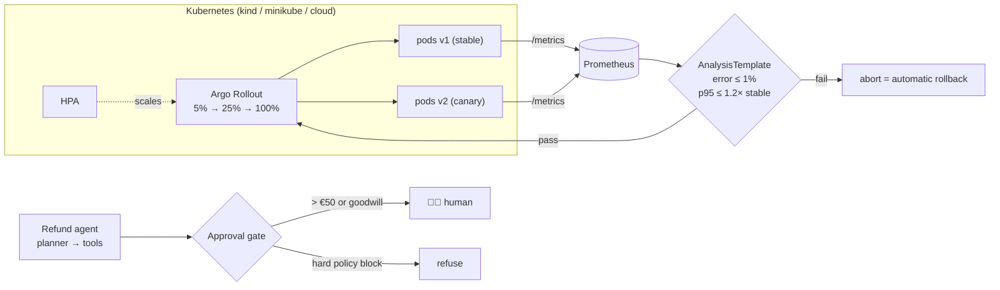

# 🛠 Lab 6: Deploy the platform with a canary, a cost report and a supervised agent

> ⏱ 3–5 hours · 🧰 Needs: Python 3.11+, [uv](https://docs.astral.sh/uv/), Docker. Optional: `kubectl` + [kind](https://kind.sigs.k8s.io/) or [minikube](https://minikube.sigs.k8s.io/) for steps 7–8.

[Course home](../../../README.md) › [Module 6](../README.md) › Lab

> **From: Maya**
> Leadership signs off the platform next week. They will ask four questions:
> *How do we release without breaking payments? How do we know we're healthy? What does it cost? And can the new refund agent hurt us?*
> Diego wants canaries with automatic rollback, Priya wants a human approving risky refunds, and Finance wants one page of numbers.
> Can you have all of it ready, running, and explainable?

## 🎯 What you'll build

| Piece | File(s) | Lesson |
|---|---|---|
| A small `kestrel-platform` service with probes, metrics and **fault injection** | `src/kestrel_platform/main.py`, `api/routes.py` | 6.1, 6.4 |
| Kubernetes manifests: base + `dev`/`prod` overlays, HPA, PDB, ConfigMap/Secret | `k8s/base`, `k8s/overlays` | 6.1, 6.3 |
| An **Argo Rollouts canary** (5% → 25% → 100%) with a Prometheus rollback gate | `k8s/rollout` | 6.4 |
| A canary analyzer you can run locally, with small-sample statistics | `src/kestrel_platform/canary.py`, `scripts/simulate_canary.py` | 6.4 |
| SLO, error budget and **multi-window burn-rate** alert logic | `src/kestrel_platform/slo.py` | 6.4 |
| A training pipeline as a DAG (+ the same as a Prefect flow) | `orchestration/` | 6.2 |
| Capacity plan and an **API-vs-self-host cost report** | `scripts/capacity_plan.py`, `scripts/cost_report.py`, `cost_assumptions.toml` | 6.3 |
| A planner/worker **refund agent** with tracing, limits and a **human approval gate** | `src/kestrel_platform/agent/`, `scripts/run_agent.py` | 6.6 |
| A runbook and a blameless postmortem | `runbooks/` | 6.5 |



## Step 0: Install and run the tests

```bash
cd modules/06-scaling-and-operations/lab
uv sync
uv run pytest
```

Expected (timings vary):

```
...................................................                      [100%]
52 passed in 3.1s
```

The Kubernetes tests run `kubectl kustomize` (no cluster needed). Without `kubectl` they are skipped, not failed.

## Step 1: Run the service and poke its probes

```bash
uv run uvicorn kestrel_platform.main:app --port 8080
```

In a second terminal:

```bash
curl -s localhost:8080/health
curl -s localhost:8080/ready
curl -s -X POST localhost:8080/v1/score -H 'content-type: application/json' \
  -d '{"amount": 900, "merchant_category": "crypto_exchange", "hour": 3, "is_online": true, "country_mismatch": true, "device_is_new": true}'
curl -s localhost:8080/metrics | grep kestrel_requests_total
```

Expected:

```
{"status":"ok"}
{"status":"ready"}
{"fraud_probability":0.9422,"decision":"decline","model_version":"v1"}
kestrel_requests_total{route="/v1/score",service="kestrel-platform",status="200",version="v1"} 1.0
```

Now restart it as a "not ready" pod: `KESTREL_READY=false uv run uvicorn kestrel_platform.main:app --port 8080`. `/health` still returns 200 but `/ready` returns **503**. In Kubernetes that pod stays alive but receives no traffic. That's the difference between liveness and readiness (lesson 6.1).

## Step 2: Build the container

```bash
docker build -t kestrel-platform:dev .
docker run --rm -p 8080:8080 kestrel-platform:dev
```

The image runs as a non-root user (UID 10001), matching `runAsNonRoot` in `k8s/base/deployment.yaml`.

## Step 3: Render the Kubernetes manifests (no cluster needed)

```bash
kubectl kustomize k8s/overlays/dev  | grep -E '^kind:|replicas:|namespace:' | sort | uniq -c
kubectl kustomize k8s/overlays/prod | grep -E 'replicas:|minReplicas:|maxReplicas:|image:'
diff <(kubectl kustomize k8s/overlays/dev) <(kubectl kustomize k8s/overlays/prod)
```

Read the diff. Everything that differs between environments should be **intentional**: namespace, replicas, HPA bounds, image, resources, secrets. If something differs that you did not expect, that's configuration drift.

✅ Checkpoint questions (answer before moving on):
- Why does the ConfigMap's name end in a hash such as `kestrel-platform-config-6694f4526g`?
- Why does `prod` have **no** Secret in its output?

<details><summary>Answers</summary>

- Kustomize appends a hash of the content. Change a value → new name → the Deployment's pod template changes → Kubernetes rolls the pods. Without the hash, pods would keep running with stale config until something else restarted them.
- Real secrets must not live in Git. In prod the Secret is created by a secret manager (External Secrets Operator, Sealed Secrets, or a cloud secret-store CSI driver). The Deployment references it with `optional: true`, so the same base works in both environments.
</details>

## Step 4: Simulate a canary and watch it roll back

```bash
uv run python scripts/simulate_canary.py --fault errors
```

Expected (abridged):

```
▶ setWeight 5%  (canary gets ~5% of traffic)
  analysis after   100 requests: ROLLBACK | canary 10 req, 1 err

⛔ AUTOMATIC ROLLBACK: all traffic back to stable v1
   - error_rate: rollback (canary 1/10 = 10.00%, 95% CI [1.79%, 40.42%], limit 1.00%)
   - p95_latency: hold (need >= 100 samples per version (baseline 90, canary 10))
```

Then run `--fault latency` (rolls back at 25%, once there are enough latency samples) and `--fault none` (holds while evidence builds up, then promotes at 100%).

🤔 **Notice:** one error in **10** requests triggers a rollback, but in `tests/test_canary.py` one error in **40** only *holds*. Why? Look at the confidence intervals. With 1/10 even the optimistic bound (1.79%) is above 1%. With 1/40 the interval is roughly [0.4%, 13%], which still includes "fine". **Fail fast, pass slow.**

To run against real processes instead of in-process apps:

```bash
KESTREL_APP_VERSION=v1 uv run uvicorn kestrel_platform.main:app --port 8080 &
KESTREL_APP_VERSION=v2 KESTREL_FAULT_ERROR_RATE=0.05 uv run uvicorn kestrel_platform.main:app --port 8081 &
uv run python scripts/simulate_canary.py --stable-url http://localhost:8080 --canary-url http://localhost:8081
kill %1 %2
```

## Step 5: SLOs and burn-rate alerts

```bash
uv run python -m kestrel_platform.slo --objective 0.999 --total 10000000 --bad 4200 --ratio 1h=0.02 --ratio 5m=0.03
```

Expected:

```
SLO: fraud-service availability  objective 99.900% over 30 days
Error budget: 0.100% of events (= 43.2 fully-down minutes)
Allowed bad events: 10,000   actual: 4,200
Budget consumed: 42.0%   remaining: 58.0%
  burn rate over   1h:   20.0x
  burn rate over   5m:   30.0x
🔔 PAGE: fast-burn (1h 20.0x and 5m 30.0x >= 14.4x)
```

Now try `--ratio 1h=0.02 --ratio 5m=0.0005`. The incident has *already stopped* (the 5-minute window is clean), so nobody gets woken up. That's what the short window is for.

## Step 6: Run the pipeline DAG

```bash
uv run python -m orchestration.pipeline --rows 20000
```

Expected:

```
DAG 'fraud-training' order: ingest -> validate -> train -> evaluate -> register
  ✅ ingest: success in 0.23s, attempts=1
  ✅ validate: success in 0.03s, attempts=1
  ✅ train: success in 1.53s, attempts=1
  ✅ evaluate: success in 0.02s, attempts=1
  ✅ register: success in 0.00s, attempts=1
registered: artifacts/pipeline/registry/fraud-model/2026...  metrics: {'pr_auc': 0.087, 'roc_auc': 0.819, 'base_rate': 0.0134}
```

> ℹ️ PR-AUC ≈ 0.09 looks bad until you compare it with the base rate (1.3%): that's about a 6.5× lift. The synthetic data is deliberately noisy; even the true generating function only reaches PR-AUC ≈ 0.10. The quality gate therefore requires **3× the base rate**, not an absolute number.

Optional: the same pipeline in Prefect, with a UI:

```bash
uv sync --extra prefect
uv run python -m orchestration.prefect_flow
```

## Step 7: Deploy to a local cluster (optional, needs kind or minikube)

```bash
kind create cluster --name kestrel
docker build -t kestrel-platform:dev .
kind load docker-image kestrel-platform:dev --name kestrel   # minikube: minikube image load kestrel-platform:dev
kubectl create namespace kestrel-dev
kubectl apply -k k8s/overlays/dev
kubectl -n kestrel-dev rollout status deploy/kestrel-platform
kubectl -n kestrel-dev port-forward svc/kestrel-platform 8080:80
```

Then `curl localhost:8080/ready`. Try these:

- `kubectl -n kestrel-dev delete pod -l app=kestrel-platform`: a new pod appears (self-healing).
- `kubectl -n kestrel-dev get hpa`: shows `<unknown>` targets until you install metrics-server. Why does the HPA need it?

## Step 8: Run a real canary with Argo Rollouts (optional, advanced)

Install the controller and the kubectl plugin by following the [Argo Rollouts installation guide](https://argo-rollouts.readthedocs.io/en/stable/installation/). You also need Prometheus (for example, the community `kube-prometheus-stack` Helm chart). Then:

```bash
kubectl create namespace kestrel-prod
kubectl apply -k k8s/rollout
kubectl argo rollouts get rollout kestrel-platform -n kestrel-prod --watch
# release a "bad" v2: inject 5% errors
kubectl argo rollouts set image kestrel-platform -n kestrel-prod app=kestrel-platform:dev
kubectl -n kestrel-prod set env deployment/kestrel-platform KESTREL_APP_VERSION=v2 KESTREL_FAULT_ERROR_RATE=0.05
```

Watch the AnalysisRun fail and the rollout abort. The prod overlay points at `registry.example.com/...`, so for a local cluster either load your image under that name or edit the overlay.

## Step 9: Capacity plan and cost report

```bash
uv run python scripts/capacity_plan.py
uv run python scripts/cost_report.py
```

Expected (capacity plan):

```
  GPU-seconds per request : 800/20,000 + 250/2,500 = 0.140 s
  busy replicas at peak   : 20 rps x 0.140 s = 2.80
  replicas at peak        : ceil(2.80 / 0.6) = 5  (min 2 for N+1)
  monthly cost, fixed     : €4,380  (peak capacity 24/7)
  monthly cost, autoscaled: €1,752  (rough lower bound)
```

The cost report is written to `reports/cost-report.md`. Edit `cost_assumptions.toml` (traffic, token counts, prices) and regenerate. Every price in that file is an **illustrative placeholder**; before you defend these numbers, replace them with your provider's current pricing and your own load-test throughput.

## Step 10: The supervised refund agent

```bash
uv run python scripts/run_agent.py
```

Expected (abridged):

```
[small] €7 fee, 13 days old -> agent acts alone
  status : completed
[large] €79 fee -> above the €50 autonomy limit
  status : denied_by_human
[old] fee 101 days old -> goodwill only
  status : denied_by_human
[blocked] old fee, goodwill limit used -> refused
  status : refused
[atm] third-party ATM fee -> never refundable
  status : refused
```

The default approver is **AutoDeny**: when no human answers, nothing risky happens. Now be the human:

```bash
uv run python scripts/run_agent.py --approver cli                 # answer y/N in the terminal
uv run python scripts/run_agent.py --scenario large --approver approve --show-trace
```

And the asynchronous flow real systems use (the agent pauses and someone approves later):

```bash
uv run python scripts/run_agent.py --scenario large --approver file
cat approvals.pending.json                                        # find the apr_... id
echo '{"apr_e000b64b10": "approve"}' > approvals.json
uv run python scripts/run_agent.py --scenario large --approver file
```

Traces are written to `traces/agent-<id>.jsonl`, one span per line.

## 💥 Break it

1. **Remove the latency check.** In `canary.py`, make `analyze` ignore `check_latency`. Run `--fault latency`. The bad release is promoted. This is exactly the failure in `runbooks/postmortem-example.md`. Revert it.
2. **Let the LLM plan.** Run `KESTREL_LLM_PROVIDER=ollama uv run python scripts/run_agent.py --planner llm --show-trace` (needs `ollama pull qwen2.5:1.5b-instruct`). Count the `planner_fallback` events. Small models often produce invalid JSON, and the agent must survive that.
3. **Make the planner loop.** Run the tests in `tests/test_agent.py::test_agent_stops_at_max_steps`, then set `max_steps=1000` and use `LoopingPlanner`. Without code-enforced limits, a confused agent burns money forever.
4. **Remove `maxUnavailable: 0`** from the base Deployment and think about what a rollout of a 2-replica service could do to capacity.

## 🚀 Extend it

<details><summary>1. Add a groundedness SLO to the SLO CLI</summary>

**Hint:** groundedness is a *ratio of good events* just like availability: "98% of sampled answers are judged grounded by the eval from Module 4". Reuse `SLO`, `error_budget` and `evaluate_burn_alerts`; only the event source changes.

**Solution sketch:**

```python
groundedness = SLO("docs-assistant groundedness", objective=0.98, window_days=30)
status = error_budget(groundedness, total_events=sampled_answers, bad_events=ungrounded_answers)
fired = evaluate_burn_alerts(groundedness, {"6h": 0.15, "30m": 0.20})  # 7.5x and 10x burn -> medium-burn page
```

Because judged samples are few (say 500 a day), prefer ticket-severity slow-burn alerts for this SLO: fast-burn pages on tiny samples are noisy.
</details>

<details><summary>2. Add a third canary check: business metric guardrail</summary>

**Hint:** for the fraud model the scariest regression is not errors or latency. It's the **decline rate** jumping (false positives blocking good customers). Add `declines` to `WindowMetrics` and roll back if the canary decline rate is more than 1.5× the baseline's, using a Wilson interval on both.

**Solution sketch:** compute `wilson_interval(canary.declines, canary.requests)` and `wilson_interval(baseline.declines, baseline.requests)`. Roll back if `canary_low > 1.5 * baseline_high`, and hold if the intervals overlap with too few samples.
</details>

<details><summary>3. Make the approval gate configurable per team</summary>

**Hint:** move `AUTONOMY_LIMIT_EUR` into `Settings` (`KESTREL_AGENT_AUTONOMY_LIMIT_EUR`) and pass it into `gate_refund`. Add a test proving that a limit of €100 auto-approves the €79 case. Then ask yourself: who should be allowed to change this number, and how would you audit it? (Hint: lesson 5.7, policy registry.)
</details>

<details><summary>4. Export agent spans to OpenTelemetry</summary>

**Hint:** the `Span` fields map one-to-one to OTel: `trace_id`, `span_id`, `parent_id`, `name`, `attributes`, `events`, `status`. Wrap `Tracer.span` so it also opens an `opentelemetry.trace.get_tracer(...).start_as_current_span(name)` and copies attributes. Point the exporter at the collector from Lab 4.
</details>

## ✅ Definition of Done

- [ ] `uv run pytest` passes
- [ ] You ran the canary simulation in all three modes and can explain each decision from the printed confidence intervals
- [ ] You can explain every difference between the `dev` and `prod` overlays
- [ ] The SLO CLI output makes sense to you, including why a 5m window exists
- [ ] `reports/cost-report.md` exists, generated from assumptions **you** edited and can defend
- [ ] You approved one refund via the CLI and one via the approvals file, and read a trace
- [ ] You read `runbooks/postmortem-example.md` and can name the action item that the canary in this lab already implements
- [ ] (Optional) The dev overlay runs on kind or minikube

---
⬅️ [Module 6 overview](../README.md) · ➡️ [Module quiz](../quiz.md)
